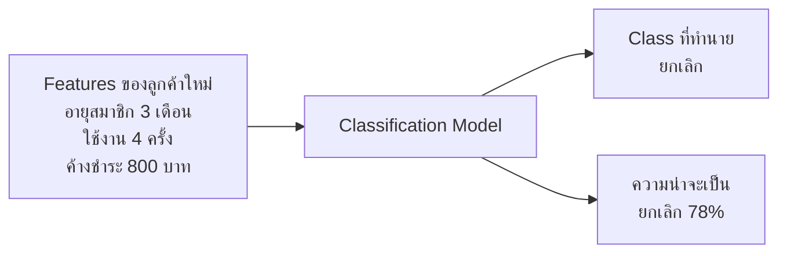
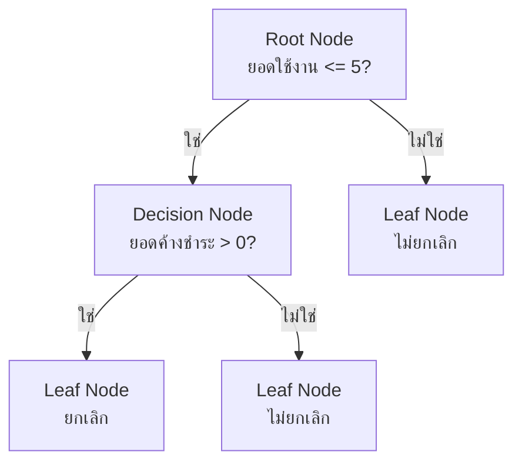

# Decision Tree

Decision Tree คือโมเดล Machine Learning ที่เรียนรู้กฎแบบ **ถ้า...แล้ว...** (`if/else`) จากข้อมูล เหมาะกับทั้งงาน Classification และ Regression

ตัวอย่างกฎสำหรับทำนายว่าลูกค้าจะยกเลิกบริการหรือไม่:

```text
ยอดใช้งานต่อเดือน <= 5 ครั้งหรือไม่?
├── ใช่
│   └── มียอดค้างชำระหรือไม่?
│       ├── ใช่     → ยกเลิก
│       └── ไม่ใช่  → ไม่ยกเลิก
└── ไม่ใช่          → ไม่ยกเลิก
```

โมเดลไม่ได้รับกฎเหล่านี้จากผู้เขียนโปรแกรม แต่ค้นหา Feature และจุดแบ่งที่แยกข้อมูลได้ดีที่สุดจากชุด Train

Decision Tree ใช้ได้กับสองประเภทงาน:

- `DecisionTreeClassifier` ทำนายคลาส เช่น ยกเลิกหรือไม่ยกเลิก
- `DecisionTreeRegressor` ทำนายตัวเลข เช่น ราคาบ้าน

## ก่อนเริ่ม: Classification คืออะไร?

**Classification** คือโจทย์ที่ต้องการให้โมเดลทำนายว่าแต่ละข้อมูล **อยู่ในกลุ่มหรือคลาสใด**

ตัวอย่าง:

| ข้อมูลที่ป้อนให้โมเดล | Target ที่ต้องการทำนาย |
|---|---|
| เนื้อหาของอีเมล | `spam` หรือ `not_spam` |
| ประวัติการใช้งานของลูกค้า | `ยกเลิก` หรือ `ไม่ยกเลิก` |
| ภาพสัตว์ | `แมว`, `สุนัข` หรือ `นก` |
| ข้อมูลธุรกรรม | `ทุจริต` หรือ `ปกติ` |

ข้อมูลที่ใช้ช่วยทำนายเรียกว่า **Features** ส่วนกลุ่มที่ต้องการให้โมเดลตอบเรียกว่า **Target** หรือ **Class label**

ตัวอย่างข้อมูลลูกค้า:

| อายุสมาชิก | จำนวนครั้งที่ใช้งาน | ยอดค้างชำระ | Target |
|---:|---:|---:|---|
| 2 เดือน | 3 | 1,200 | ยกเลิก |
| 18 เดือน | 25 | 0 | ไม่ยกเลิก |
| 5 เดือน | 4 | 500 | ยกเลิก |

โมเดลเรียนรู้ความสัมพันธ์จากแถวที่มีคำตอบ แล้วนำไปทำนายลูกค้ารายใหม่:



ถ้ามีคลาสทั้งหมด $K$ คลาส โมเดลจะเลือกคลาสที่มีความน่าจะเป็นสูงที่สุด:

$$
\hat{y}
=\underset{k\in\{1,2,\ldots,K\}}
{\operatorname{argmax}}
P(y=c_k\mid X=x)
$$

อ่านสูตรจากขวาไปซ้ายได้ว่า:

1. รับข้อมูลใหม่ $x$
2. คำนวณความน่าจะเป็นของแต่ละคลาส $c_k$
3. `argmax` เลือกคลาสที่มีความน่าจะเป็นสูงที่สุด
4. คลาสที่เลือกคือคำทำนาย $\hat{y}$

ตัวอย่าง:

```text
P(ยกเลิก | ข้อมูลลูกค้า)     = 0.78
P(ไม่ยกเลิก | ข้อมูลลูกค้า) = 0.22

คำทำนายสุดท้าย = ยกเลิก
```

### ประเภทของ Classification

| ประเภท | ความหมาย | ตัวอย่าง |
|---|---|---|
| Binary Classification | มี 2 คลาส | ทุจริต/ปกติ |
| Multiclass Classification | มีมากกว่า 2 คลาส และเลือกหนึ่งคลาส | แมว/สุนัข/นก |
| Multilabel Classification | ข้อมูลหนึ่งรายการมีหลายป้ายกำกับพร้อมกัน | รูปหนึ่งมีทั้ง `ทะเล`, `คน` และ `พระอาทิตย์ตก` |

### Classification ต่างจาก Regression อย่างไร?

| หัวข้อ | Classification | Regression |
|---|---|---|
| คำตอบ | ชื่อกลุ่มหรือคลาส | ตัวเลขต่อเนื่อง |
| ตัวอย่าง | ยกเลิก/ไม่ยกเลิก | ราคาบ้าน 2.7 ล้านบาท |
| โมเดล | `DecisionTreeClassifier` | `DecisionTreeRegressor` |
| Metrics ที่พบบ่อย | Accuracy, Precision, Recall, F1 | MAE, MSE, RMSE, $R^2$ |

> [!NOTE]
> Target ที่เข้ารหัสเป็น `0` และ `1` ยังเป็น Classification ถ้าตัวเลขหมายถึงชื่อกลุ่ม เช่น `0 = ไม่ยกเลิก` และ `1 = ยกเลิก` ตัวเลขเหล่านี้ไม่ใช่ปริมาณที่นำไปบวกลบตามความหมายทางธุรกิจ

> [!IMPORTANT]
> ต้นไม้ที่โตลึกมากสามารถจำข้อมูล Train ได้ละเอียดจนเกิด Overfitting จึงควรตรวจคะแนน Validation และควบคุมความซับซ้อนของต้นไม้

## 1. ส่วนประกอบของต้นไม้



| คำศัพท์ | ความหมาย |
|---|---|
| Root Node | จุดเริ่มต้นที่มีข้อมูล Train ทั้งหมด |
| Decision Node | จุดที่ตั้งคำถามเพื่อแบ่งข้อมูล |
| Branch | เส้นทางของคำตอบ เช่น ใช่หรือไม่ใช่ |
| Leaf Node | จุดปลายที่ให้คำทำนาย |
| Split | การแบ่งข้อมูลด้วย Feature และ Threshold |
| Depth | จำนวนระดับจาก Root ลงไปในต้นไม้ |
| Parent | Node ก่อนถูกแบ่ง |
| Child | Node ที่ได้หลังแบ่ง Parent |

ตัวอย่างเงื่อนไข:

```text
monthly_usage <= 5.5
```

- `monthly_usage` คือ Feature ที่ใช้แบ่ง
- `5.5` คือ Threshold หรือจุดแบ่ง
- ค่าน้อยกว่าหรือเท่ากับ `5.5` ไปทางซ้าย
- ค่ามากกว่า `5.5` ไปทางขวา
___
## 2. โมเดลสร้างต้นไม้อย่างไร?

ที่แต่ละ Node โมเดลทำงานโดยย่อดังนี้:

1. ทดลองใช้ Features ต่าง ๆ
2. ทดลอง Threshold หลายค่า
3. คำนวณคุณภาพของแต่ละการแบ่ง
4. เลือกการแบ่งที่ทำให้ข้อมูลใน Child Nodes บริสุทธิ์ขึ้นมากที่สุด
5. ทำขั้นตอนเดิมซ้ำกับ Child Nodes จนถึงเงื่อนไขหยุด

คำว่า **บริสุทธิ์** สำหรับ Classification หมายถึงข้อมูลใน Node มีคลาสเดียวกันมากขึ้น ตัวอย่างเช่น:

```text
Node A: ยกเลิก 5 คน, ไม่ยกเลิก 5 คน  → ปะปนกันมาก
Node B: ยกเลิก 9 คน, ไม่ยกเลิก 1 คน  → บริสุทธิ์กว่า
Node C: ยกเลิก 10 คน                  → บริสุทธิ์ทั้งหมด
```

สำหรับ Regression โมเดลจะพยายามทำให้ค่าตัวเลขภายในแต่ละ Node ใกล้กันมากขึ้น
___
## 3. Classification: Gini Impurity

`DecisionTreeClassifier` ของ scikit-learn ใช้ Gini Impurity เป็นค่าเริ่มต้น

$$
\operatorname{Gini}(Q)
=1-\sum_{k=1}^{K}p_k^2
$$

| สัญลักษณ์ | ความหมาย |
|---|---|
| $Q$ | ชุดข้อมูลที่อยู่ใน Node |
| $K$ | จำนวนคลาสทั้งหมด |
| $p_k$ | สัดส่วนของคลาสที่ $k$ ใน Node |
| $\sum$ | นำค่าของทุกคลาสมาบวกกัน |

ค่าที่ควรจำ:

- Gini เท่ากับ 0 หมายถึงทุกแถวเป็นคลาสเดียวกัน
- Gini สูงขึ้นหมายถึงคลาสปะปนกันมากขึ้น
- กรณี 2 คลาสที่มีสัดส่วนครึ่งต่อครึ่ง Gini จะเท่ากับ 0.5

### 3.1 ตัวอย่างคำนวณ Gini ของ Parent

สมมติ Node หนึ่งมีลูกค้า 10 คน:

| คลาส | จำนวน | สัดส่วน |
|---|---:|---:|
| ไม่ยกเลิก | 6 | $6/10=0.6$ |
| ยกเลิก | 4 | $4/10=0.4$ |

แทนค่าลงในสูตร:

$$
\begin{aligned}
\operatorname{Gini}(\text{Parent})
&=1-(0.6)^2-(0.4)^2\\
&=1-0.36-0.16\\
&=0.48
\end{aligned}
$$

ค่า `0.48` แสดงว่าใน Parent ยังมีสองคลาสปะปนกันค่อนข้างมาก

### 3.2 คำนวณคุณภาพหลังแบ่งข้อมูล

สมมติโมเดลทดลองแบ่งแล้วได้:

```text
Parent: ลูกค้า 10 คน
├── Left:  ไม่ยกเลิก 4, ยกเลิก 0
└── Right: ไม่ยกเลิก 2, ยกเลิก 4
```

Gini ของฝั่งซ้าย:

$$
\begin{aligned}
\operatorname{Gini}(\text{Left})
&=1-(4/4)^2-(0/4)^2\\
&=0
\end{aligned}
$$

Gini ของฝั่งขวา:

$$
\begin{aligned}
\operatorname{Gini}(\text{Right})
&=1-(2/6)^2-(4/6)^2\\
&\approx1-0.111-0.444\\
&\approx0.444
\end{aligned}
$$

ต้องถ่วงน้ำหนักตามจำนวนข้อมูลในแต่ละฝั่ง:

$$
\operatorname{Gini}_{\text{after split}}
=\frac{N_L}{N}\operatorname{Gini}(L)
+\frac{N_R}{N}\operatorname{Gini}(R)
$$

แทนค่า:

$$
\begin{aligned}
\operatorname{Gini}_{\text{after split}}
&=\frac{4}{10}(0)+\frac{6}{10}(0.444)\\
&\approx0.267
\end{aligned}
$$

Gini ที่ลดลงจากการแบ่งนี้คือ:

$$
\begin{aligned}
\Delta\operatorname{Gini}
&=\operatorname{Gini}(\text{Parent})
-\operatorname{Gini}_{\text{after split}}\\
&=0.48-0.267\\
&\approx0.213
\end{aligned}
$$

โมเดลจะเปรียบเทียบค่าที่ลดลงของหลาย ๆ จุดแบ่ง แล้วเลือกจุดที่ลด Impurity ได้มากที่สุด
___
## 4. Classification: Entropy และ Information Gain

อีกวิธีวัดความปะปนของคลาสคือ Entropy:

$$
H(Q)=-\sum_{k=1}^{K}p_k\log_2(p_k)
$$

เมื่อต้องการใช้ Entropy ใน scikit-learn:

```python
from sklearn.tree import DecisionTreeClassifier

model = DecisionTreeClassifier(
    criterion="entropy",
    random_state=42,
)
```

> [!NOTE]
> ถ้า $p_k=0$ จะถือว่าพจน์ $p_k\log_2(p_k)$ มีค่าเป็น 0 เพราะคลาสนั้นไม่มีข้อมูลอยู่ใน Node

สำหรับ Parent ตัวอย่างเดิมที่มีสัดส่วน `0.6` และ `0.4`:

$$
\begin{aligned}
H(\text{Parent})
&=-0.6\log_2(0.6)-0.4\log_2(0.4)\\
&\approx0.971
\end{aligned}
$$

หลังแบ่งข้อมูล Entropy แบบถ่วงน้ำหนักมีค่าประมาณ `0.551` ดังนั้น Information Gain คือ:

$$
\begin{aligned}
\operatorname{Information\ Gain}
&=H(\text{Parent})-H_{\text{after split}}\\
&=0.971-0.551\\
&=0.420
\end{aligned}
$$

Information Gain ยิ่งมาก แปลว่าจุดแบ่งนั้นช่วยแยกคลาสได้ดีขึ้นมาก

Gini และ Entropy มักให้ต้นไม้คล้ายกัน เริ่มต้นด้วย `criterion="gini"` ได้ แล้วใช้ Validation หรือ Cross-validation เปรียบเทียบเมื่อจำเป็น
___
## 5. Classification: Leaf ทำนายอย่างไร?

เมื่อข้อมูลใหม่เดินทางมาถึง Leaf โมเดลจะดูสัดส่วนของคลาสใน Leaf นั้น

สมมติ Leaf มีข้อมูล Train:

```text
ยกเลิก 4 คน
ไม่ยกเลิก 2 คน
รวม 6 คน
```

ความน่าจะเป็นที่ประมาณจาก Leaf คือ:

$$
P(\text{ยกเลิก}\mid\text{Leaf})=\frac{4}{6}\approx0.667
$$

$$
P(\text{ไม่ยกเลิก}\mid\text{Leaf})=\frac{2}{6}\approx0.333
$$

โมเดลเลือกคลาสที่มีสัดส่วนสูงที่สุด จึงทำนายว่า **ยกเลิก**

ใน `Python` สามารถดูทั้งคลาสและความน่าจะเป็นได้ด้วย:

```python
predicted_class = model.predict(X_new)
class_probabilities = model.predict_proba(X_new)
```

## 6. ตัวอย่าง Classification แบบครบขั้นตอน

```python
from sklearn.datasets import make_classification
from sklearn.metrics import classification_report, confusion_matrix
from sklearn.model_selection import train_test_split
from sklearn.tree import DecisionTreeClassifier

SEED = 42

X, y = make_classification(
    n_samples=1000,
    n_features=8,
    n_informative=5,
    n_redundant=1,
    weights=[0.75, 0.25],
    random_state=SEED,
)

X_train, X_test, y_train, y_test = train_test_split(
    X,
    y,
    test_size=0.2,
    random_state=SEED,
    stratify=y,
)

model = DecisionTreeClassifier(
    criterion="gini",
    max_depth=4,
    min_samples_leaf=10,
    random_state=SEED,
)

model.fit(X_train, y_train)
predictions = model.predict(X_test)

print(confusion_matrix(y_test, predictions))
print(classification_report(y_test, predictions))
```

ลำดับสำคัญคือ:

1. แบ่ง Train และ Test
2. ใช้เฉพาะ Train ใน `fit()`
3. ทำนาย Test ด้วย `predict()`
4. เปรียบเทียบคำทำนายกับ `y_test`
___
## 7. ดูต้นไม้และกฎที่โมเดลเรียนรู้

### 7.1 วาดต้นไม้

```python
import matplotlib.pyplot as plt
from sklearn.tree import plot_tree

# ใช้ model จากตัวอย่าง Classification
plt.figure(figsize=(18, 8))
plot_tree(
    model,
    filled=True,
    rounded=True,
    feature_names=[f"feature_{i}" for i in range(X.shape[1])],
    class_names=["ไม่ยกเลิก", "ยกเลิก"],
    max_depth=3,
    fontsize=8,
)
plt.tight_layout()
plt.show()
```

ข้อมูลที่มักเห็นในแต่ละกล่อง:

| ค่า | ความหมาย |
|---|---|
| `feature_2 <= 0.75` | กฎที่ใช้แบ่งข้อมูล |
| `gini` | ความปะปนของคลาสใน Node |
| `samples` | จำนวนตัวอย่าง Train ใน Node |
| `value` | จำนวนข้อมูลของแต่ละคลาส |
| `class` | คลาสที่ Node จะทำนาย |

### 7.2 แสดงกฎเป็นข้อความ

```python
from sklearn.tree import export_text

feature_names = [f"feature_{i}" for i in range(X.shape[1])]
rules = export_text(
    model,
    feature_names=feature_names,
)

print(rules)
```

การวาดต้นไม้หรืออ่านกฎช่วยตรวจว่าโมเดลใช้เงื่อนไขสมเหตุสมผลหรือกำลังใช้ Feature ที่อาจเกิด Data Leakage
___
## 8. Regression: โมเดลแบ่งข้อมูลอย่างไร?

สำหรับ Regression ค่า Target เป็นตัวเลขต่อเนื่อง โมเดลจึงพยายามแบ่งให้ค่าภายในแต่ละ Child Node ใกล้กัน

เมื่อใช้ `criterion="squared_error"` โมเดลวัดความผิดพลาดภายใน Node ด้วย:

$$
\operatorname{MSE}(Q)
=\frac{1}{N}\sum_{i=1}^{N}(y_i-\bar{y})^2
$$

| สัญลักษณ์ | ความหมาย |
|---|---|
| $N$ | จำนวนตัวอย่างใน Node |
| $y_i$ | Target จริงของตัวอย่างที่ $i$ |
| $\bar{y}$ | ค่าเฉลี่ย Target ภายใน Node |

สมมติ Parent มีราคาบ้าน:

$$
[2,3,8,9]
$$

ค่าเฉลี่ยของ Parent คือ:

$$
\bar{y}=\frac{2+3+8+9}{4}=5.5
$$

MSE ก่อนแบ่ง:

$$
\begin{aligned}
\operatorname{MSE}(\text{Parent})
&=\frac{(2-5.5)^2+(3-5.5)^2+(8-5.5)^2+(9-5.5)^2}{4}\\
&=\frac{12.25+6.25+6.25+12.25}{4}\\
&=9.25
\end{aligned}
$$

สมมติจุดแบ่งหนึ่งแยกข้อมูลได้เป็น:

```text
Left:  [2, 3]  → ค่าเฉลี่ย 2.5, MSE = 0.25
Right: [8, 9]  → ค่าเฉลี่ย 8.5, MSE = 0.25
```

MSE หลังแบ่งแบบถ่วงน้ำหนักคือ:

$$
\begin{aligned}
\operatorname{MSE}_{\text{after split}}
&=\frac{2}{4}(0.25)+\frac{2}{4}(0.25)\\
&=0.25
\end{aligned}
$$

ความผิดพลาดลดลง:

$$
\Delta\operatorname{MSE}=9.25-0.25=9.00
$$

จุดแบ่งนี้แยกกลุ่มราคาต่ำออกจากกลุ่มราคาสูงได้ดี โมเดลจึงมีเหตุผลที่จะเลือกจุดแบ่งนี้

### 8.1 Leaf ของ Regression ทำนายอย่างไร?

เมื่อใช้ `squared_error` ค่าทำนายของ Leaf คือค่าเฉลี่ย Target ของข้อมูล Train ใน Leaf

ถ้าข้อมูลใหม่ไปถึง Leaf ที่มีราคา `[8, 9]`:

$$
\hat{y}=\frac{8+9}{2}=8.5
$$
___
## 9. ตัวอย่าง Regression แบบครบขั้นตอน

```python
import numpy as np
from sklearn.datasets import make_regression
from sklearn.metrics import mean_squared_error
from sklearn.model_selection import train_test_split
from sklearn.tree import DecisionTreeRegressor

SEED = 42

X, y = make_regression(
    n_samples=1000,
    n_features=6,
    n_informative=4,
    noise=15,
    random_state=SEED,
)

X_train, X_test, y_train, y_test = train_test_split(
    X,
    y,
    test_size=0.2,
    random_state=SEED,
)

model = DecisionTreeRegressor(
    criterion="squared_error",
    max_depth=5,
    min_samples_leaf=10,
    random_state=SEED,
)

model.fit(X_train, y_train)
predictions = model.predict(X_test)

rmse = np.sqrt(mean_squared_error(y_test, predictions))
print("Test RMSE:", rmse)
```

### 9.1 ค่าของ `make_regression()` กำหนดจากอะไร?

`make_regression()` ใช้ **สร้างข้อมูลจำลองเพื่อการเรียนรู้และทดลอง** ค่าที่ใส่ในฟังก์ชันจึงกำหนดลักษณะของข้อมูลที่อยากจำลอง ไม่ใช่ Hyperparameters ของ `DecisionTreeRegressor`

แนวคิดการสร้าง Target แบบย่อคือ:

$$
y=X\boldsymbol{\beta}+b+\varepsilon
$$

โดย:

- $X$ คือตาราง Features ที่สุ่มสร้าง
- $\boldsymbol{\beta}$ คือค่าสัมประสิทธิ์ที่ใช้สร้าง Target
- $b$ คือ Bias ซึ่งมีค่าเริ่มต้นเป็น 0
- $\varepsilon$ คือ Noise แบบ Gaussian ที่เพิ่มเข้าไปใน Target

ค่าจากตัวอย่างมีความหมายดังนี้:

| Parameter | ตัวอย่าง | ความหมาย | วิธีเลือกสำหรับข้อมูลจำลอง |
|---|---:|---|---|
| `n_samples` | `1000` | จำนวนแถวข้อมูล | เลือกตามขนาดชุดข้อมูลที่ต้องการจำลองและกำลังเครื่อง |
| `n_features` | `6` | จำนวน Features หรือจำนวนคอลัมน์ของ `X` | เลือกให้ใกล้จำนวน Features ของโจทย์ที่ต้องการทดลอง |
| `n_informative` | `4` | จำนวน Features ที่มีผลจริงต่อ `y` | ต้องไม่เกิน `n_features`; ที่เหลือไม่มีค่าสัมประสิทธิ์ในสมการสร้าง `y` |
| `noise` | `15` | ส่วนเบี่ยงเบนมาตรฐานของ Noise ที่เติมใน `y` | `0` หมายถึงไม่มี Noise; ค่าสูงขึ้นทำให้โจทย์ยากขึ้น |
| `random_state` | `42` | Seed ที่ควบคุมการสุ่ม | ใช้จำนวนเต็มใดก็ได้ และใช้ค่าเดิมเมื่อต้องการสร้างชุดเดิมซ้ำ |

จากตัวอย่างนี้:

```text
X มีขนาด (1000, 6) = 1,000 แถว × 6 Features
y มีขนาด (1000,)   = Target จำนวน 1,000 ค่า

Features ที่มีผลต่อ y       = 4 ตัว
Features ที่ไม่มีผลต่อ y โดยตรง = 2 ตัว
```

หลังจากใช้ `test_size=0.2` จะได้โดยประมาณ:

$$
\begin{aligned}
\text{Train} &=1{,}000\times(1-0.2)=800\text{ แถว}\\
\text{Test} &=1{,}000\times0.2=200\text{ แถว}
\end{aligned}
$$

#### `noise=15` หมายถึงอะไร?

Noise ถูกสุ่มจากการแจกแจงปกติที่มีค่าเฉลี่ย 0 และส่วนเบี่ยงเบนมาตรฐาน 15:

$$
\varepsilon\sim\mathcal{N}(0,15^2)
$$

จากนั้นนำ Noise ไปบวกกับ Target:

$$
y_{\text{observed}}=y_{\text{จากสมการ}}+\varepsilon
$$

> [!IMPORTANT]
> `noise=15` ไม่ได้หมายถึง Noise 15% แต่เป็นส่วนเบี่ยงเบนมาตรฐาน 15 หน่วยในหน่วยเดียวกับ Target

ตัวอย่าง ถ้า Target เป็นราคาหน่วยพันบาท ค่า `noise=15` หมายถึง Noise มีส่วนเบี่ยงเบนมาตรฐาน 15 พันบาท
#### ควรเลือกค่าเท่าไร?

ไม่มีค่าตายตัว ให้เลือกตามจุดประสงค์ของการทดลอง:

```python
# ตัวอย่างง่าย: ข้อมูลน้อย Features น้อย และไม่มี Noise
X, y = make_regression(
    n_samples=200,
    n_features=2,
    n_informative=2,
    noise=0,
    random_state=42,
)
```

```python
# ตัวอย่างยากขึ้น: มี Features ที่ไม่ช่วยทำนายและมี Noise มากขึ้น
X, y = make_regression(
    n_samples=2000,
    n_features=20,
    n_informative=5,
    noise=30,
    random_state=42,
)
```

| เป้าหมายการทดลอง | แนวทางกำหนดค่า |
|---|---|
| ต้องการตัวอย่างที่เข้าใจง่าย | ใช้ `n_features` น้อย, `n_informative` เท่ากับ `n_features` และ `noise=0` |
| ทดสอบว่าโมเดลรับมือ Feature ที่ไม่เกี่ยวข้องได้ไหม | ให้ `n_informative` น้อยกว่า `n_features` |
| ทดสอบความทนต่อข้อมูลคลาดเคลื่อน | ทดลองเพิ่ม `noise` ทีละระดับ |
| ต้องการผลที่เปรียบเทียบซ้ำได้ | ใช้ `random_state` ค่าเดิมทุกครั้ง |

ในงานจริงเราไม่ได้กำหนดจำนวนลูกค้าหรือจำนวน Features ด้วย `make_regression()` แต่ใช้ข้อมูลที่เก็บมาแล้ว:

```python
# ตัวอย่างแนวคิดสำหรับข้อมูลจริง
X = df[["area", "house_age", "distance_to_station"]]
y = df["price"]
```

ดังนั้นข้อมูลจริงจะเป็นตัวกำหนด `n_samples` และ `n_features` ส่วน `n_informative` กับ `noise` เป็นค่าที่เรารู้ได้ในข้อมูลจำลอง เพราะเราเป็นผู้สร้างข้อมูลขึ้นมาเอง
___
## 10. Hyperparameters สำคัญ

### `max_depth`

กำหนดความลึกสูงสุด:

```python
max_depth=4
```

- ค่าน้อยเกินไปอาจทำให้ Underfitting
- ค่ามากเกินไปอาจทำให้ Overfitting
- `None` อนุญาตให้ต้นไม้โตจนถึงเงื่อนไขหยุดอื่น

### `min_samples_split`

จำนวนตัวอย่างขั้นต่ำที่ Node ต้องมีก่อนอนุญาตให้แบ่ง:

```python
min_samples_split=10
```

ถ้า Node มีข้อมูลน้อยกว่าค่านี้ Node จะไม่ถูกแบ่งต่อ

### `min_samples_leaf`

จำนวนตัวอย่างขั้นต่ำที่ต้องเหลือในแต่ละ Leaf:

```python
min_samples_leaf=5
```

ค่านี้ช่วยป้องกันกฎที่เกิดจากข้อมูลเพียงหนึ่งหรือสองแถว และมักเป็นค่าที่ควรลองปรับเมื่อโมเดล Overfitting

### `max_leaf_nodes`

กำหนดจำนวน Leaf สูงสุด:

```python
max_leaf_nodes=20
```

### `criterion`

กำหนดวิธีวัดคุณภาพของการแบ่ง:

```python
# Classification
criterion="gini"

# Regression
criterion="squared_error"
```

### `splitter`

กำหนดวิธีเลือกจุดแบ่ง:

```python
splitter="best"
```

- `"best"` เลือกจุดแบ่งที่ดีที่สุดจากตัวเลือกที่พิจารณา
- `"random"` เพิ่มการสุ่มในการเลือกจุดแบ่ง

### `random_state`

ควบคุมการสุ่มภายในโมเดลเพื่อให้ทดลองซ้ำได้ผลเดิม:

```python
random_state=42
```

แม้ใช้ `splitter="best"` การกำหนด Seed ยังช่วยให้ผลทำซ้ำได้ โดยเฉพาะเมื่อหลายจุดแบ่งให้คะแนนดีเท่ากัน
___
## 11. Overfitting และการตัดแต่งต้นไม้

สัญญาณของ Overfitting:

```text
Train Accuracy      = 100%
Validation Accuracy = 78%
```

ช่องว่างขนาดใหญ่บอกว่าต้นไม้จำข้อมูล Train ได้ดี แต่ทำนายข้อมูลใหม่ได้ไม่ดีเท่าที่ควร

### 11.1 จำกัดต้นไม้ก่อนฝึกเสร็จ

เรียกว่า Pre-pruning เช่น:

```python
model = DecisionTreeClassifier(
    max_depth=4,
    min_samples_split=10,
    min_samples_leaf=5,
    random_state=42,
)
```

### 11.2 ตัดกิ่งภายหลังด้วย `ccp_alpha`

แนวคิด Cost-Complexity Pruning พิจารณาทั้งความผิดพลาดและขนาดต้นไม้:

$$
R_\alpha(T)=R(T)+\alpha|\widetilde{T}|
$$

| สัญลักษณ์ | ความหมาย |
|---|---|
| $R(T)$ | ความผิดพลาดของต้นไม้ $T$ |
| $|\widetilde{T}|$ | จำนวน Leaf Nodes |
| $\alpha$ | ค่าลงโทษความซับซ้อน |

- `ccp_alpha=0` ไม่เพิ่มค่าลงโทษจากจำนวน Leaf
- เพิ่ม `ccp_alpha` ทำให้โมเดลมีแนวโน้มเลือกต้นไม้ขนาดเล็กลง
- ควรเลือกค่าด้วย Validation หรือ Cross-validation

```python
model = DecisionTreeClassifier(
    ccp_alpha=0.01,
    random_state=42,
)
```

> [!CAUTION]
> ไม่มีค่า `max_depth`, `min_samples_leaf` หรือ `ccp_alpha` ที่ดีที่สุดสำหรับทุกชุดข้อมูล ต้องเลือกจากผล Validation หรือ Cross-validation โดยไม่ใช้ Test มาช่วยเลือก

___
## 12. ต้องใช้ StandardScaler หรือไม่?

โดยทั่วไป Decision Tree ไม่จำเป็นต้องใช้ StandardScaler เพราะตัดสินใจจากลำดับและ Threshold เช่น:

```text
รายได้ <= 35,000 หรือไม่?
```

เมื่อแปลงหน่วยจากบาทเป็นพันบาท ลำดับของข้อมูลยังเหมือนเดิม และ Threshold เปลี่ยนหน่วยตามไปด้วย

สิ่งที่ยังต้องจัดการ:

- ข้อมูลข้อความหรือ Category ต้องแปลงเป็นตัวเลขก่อน
- ต้องป้องกัน Data Leakage
- ต้องแบ่ง Train, Validation และ Test ให้ถูกต้อง
- ต้องเลือก Metric ให้ตรงกับเป้าหมาย
- วิธีรองรับ Missing values ขึ้นอยู่กับเวอร์ชัน ชนิดงาน และพารามิเตอร์ที่ใช้ ควรตรวจเอกสารของเวอร์ชันที่ติดตั้ง
___
## 13. Feature Importance

```python
import pandas as pd

feature_names = [f"feature_{i}" for i in range(X.shape[1])]
importance = pd.Series(
    model.feature_importances_,
    index=feature_names,
).sort_values(ascending=False)

print(importance)
```

ค่า Importance แบบค่าเริ่มต้นรวมปริมาณ Impurity ที่ Feature ช่วยลดตลอดทั้งต้นไม้

> [!CAUTION]
> Feature Importance สูงไม่ได้แปลว่า Feature นั้นเป็นสาเหตุของ Target และ Importance อาจให้ความสำคัญกับ Feature ที่มีจุดแบ่งจำนวนมาก ควรตรวจร่วมกับความรู้ของงานและวิธีอื่น เช่น Permutation Importance

___
## 14. Decision Tree ต่างจาก Random Forest อย่างไร?

| หัวข้อ | Decision Tree | Random Forest |
|---|---|---|
| จำนวนต้นไม้ | 1 ต้น | หลายต้น |
| การอธิบาย | วาดและอ่านกฎได้ง่าย | อธิบายยากกว่า |
| ความเสถียร | เปลี่ยนข้อมูลเล็กน้อย ต้นไม้อาจเปลี่ยนมาก | เสถียรกว่าเพราะรวมหลายต้น |
| Overfitting | เกิดได้ง่ายเมื่อต้นไม้ลึก | มักน้อยกว่าต้นไม้เดียว |
| ความเร็วและหน่วยความจำ | ใช้น้อยกว่า | ใช้มากกว่า |
| การทำนาย | ใช้คำตอบจาก Leaf เดียว | รวมคำตอบจากต้นไม้ทั้งหมด |

เริ่มจาก Decision Tree เมื่ออยากเข้าใจกฎของข้อมูลอย่างชัดเจน จากนั้นลอง Random Forest เมื่อให้ความสำคัญกับความแม่นยำและความเสถียรมากขึ้น
___
## 15. Checklist ก่อนใช้ Decision Tree

- แยก Train, Validation และ Test แล้ว
- กำหนด `random_state` เมื่อต้องการผลที่ทำซ้ำได้
- เริ่มจากต้นไม้ขนาดเล็กที่อ่านได้
- เปรียบเทียบคะแนน Train กับ Validation
- ปรับ `max_depth` และ `min_samples_leaf` เมื่อ Overfitting
- ใช้ `stratify` เมื่อแบ่งข้อมูล Classification ที่คลาสไม่สมดุล
- เลือก Metric ให้ตรงกับเป้าหมาย
- ตรวจ Data Leakage และกฎที่โมเดลเรียนรู้
- ประเมิน Test หลังเลือกโมเดลเสร็จแล้ว

หลักจำง่ายคือ:

> [!IMPORTANT]
> Decision Tree เรียนรู้คำถามทีละข้อ จุดแบ่งที่ดีทำให้คำตอบในแต่ละกิ่งเหมือนกันมากขึ้นสำหรับ Classification หรือมีค่าใกล้กันมากขึ้นสำหรับ Regression

___
## 16. แหล่งอ้างอิง

- [scikit-learn: Decision Trees User Guide](https://scikit-learn.org/stable/modules/tree.html) อธิบาย Classification, Regression, สูตรคำนวณ และการตัดแต่งต้นไม้
- [scikit-learn: DecisionTreeClassifier](https://scikit-learn.org/stable/modules/generated/sklearn.tree.DecisionTreeClassifier.html) รายละเอียดพารามิเตอร์สำหรับ Classification
- [scikit-learn: DecisionTreeRegressor](https://scikit-learn.org/stable/modules/generated/sklearn.tree.DecisionTreeRegressor.html) รายละเอียดพารามิเตอร์สำหรับ Regression
- [scikit-learn: make_regression](https://scikit-learn.org/stable/modules/generated/sklearn.datasets.make_regression.html) รายละเอียดการสร้างข้อมูล Regression จำลองและความหมายของแต่ละ Parameter

---

[สารบัญ Machine Learning](../ML/index.md) · [Linear Regression](LinearRegression.md) · [Random Forest](RandomForest.md)
