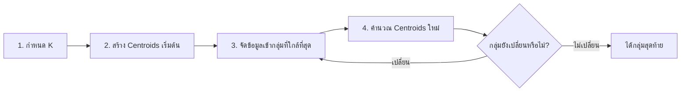

# K-Means Clustering

**K-Means** คืออัลกอริทึมที่แบ่งข้อมูลออกเป็นกลุ่ม โดยพยายามให้ข้อมูลในกลุ่มเดียวกันอยู่ใกล้กัน และข้อมูลต่างกลุ่มอยู่ห่างกัน

K-Means เป็น **Unsupervised Learning** เพราะไม่มี Target หรือเฉลยกำกับว่าแต่ละแถวควรอยู่กลุ่มใด

- **K** คือจำนวนกลุ่มที่ต้องการ
- **Means** คือค่าเฉลี่ยหรือตำแหน่งกึ่งกลางของแต่ละกลุ่ม เรียกว่า **Centroid**

## 1. ตัวอย่างเบื้องต้น

สมมติมียอดซื้อของลูกค้า:

```text
1,000  1,200  1,500  8,000  8,500  9,000
```

ถ้ากำหนด `K=2` โมเดลอาจแบ่งเป็น:

```text
กลุ่ม 1: 1,000  1,200  1,500
กลุ่ม 2: 8,000  8,500  9,000
```

Centroid ของกลุ่มแรก:

$$
\mu_1=\frac{1{,}000+1{,}200+1{,}500}{3}
\approx1{,}233.33
$$

Centroid ของกลุ่มที่สอง:

$$
\mu_2=\frac{8{,}000+8{,}500+9{,}000}{3}=8{,}500
$$

## 2. ขั้นตอนการทำงาน



1. เลือกจำนวนกลุ่ม `K`
2. สร้าง Centroids เริ่มต้นจำนวน `K` จุด
3. วัดระยะจากข้อมูลแต่ละแถวไปยังทุก Centroid
4. นำข้อมูลเข้ากลุ่มของ Centroid ที่ใกล้ที่สุด
5. คำนวณ Centroid ของแต่ละกลุ่มใหม่
6. ทำซ้ำจนกลุ่มหยุดเปลี่ยนหรือถึงจำนวนรอบสูงสุด

## 3. การวัดระยะทาง

K-Means ใช้ระยะทางแบบ Euclidean ในการจัดข้อมูลเข้ากลุ่ม สำหรับข้อมูล $p$ Features:

$$
d(x,\mu_k)
=\sqrt{\sum_{j=1}^{p}(x_j-\mu_{k,j})^2}
$$

สำหรับข้อมูลสอง Features:

$$
d(x,\mu_k)
=\sqrt{(x_1-\mu_{k,1})^2+(x_2-\mu_{k,2})^2}
$$

โมเดลจัด $x$ เข้ากลุ่มที่มี Centroid ใกล้ที่สุด:

$$
c_i=\underset{k}{\operatorname{argmin}}\;\|x_i-\mu_k\|^2
$$

## 4. คำนวณ Centroid ใหม่

Centroid ของกลุ่ม $k$ คือค่าเฉลี่ยของข้อมูลทุกแถวในกลุ่มนั้น:

$$
\mu_k=\frac{1}{|C_k|}\sum_{x_i\in C_k}x_i
$$

$C_k$ คือชุดข้อมูลในกลุ่ม $k$ และ $|C_k|$ คือจำนวนข้อมูลในกลุ่มนั้น

## 5. K-Means พยายามลดค่าอะไร?

K-Means พยายามลดผลรวมระยะทางกำลังสองจากข้อมูลไปยัง Centroid ของกลุ่ม เรียกว่า **Inertia** หรือ **Within-Cluster Sum of Squares**:

$$
\mathrm{Inertia}
=\sum_{k=1}^{K}
\sum_{x_i\in C_k}
\|x_i-\mu_k\|^2
$$

Inertia ต่ำหมายถึงข้อมูลอยู่ใกล้ Centroids มากขึ้น แต่เมื่อเพิ่ม `K` ค่า Inertia จะลดลงเสมอ ถ้ากำหนด `K` เท่ากับจำนวนข้อมูล แต่ละแถวจะเป็นกลุ่มของตัวเองและ Inertia อาจเป็น 0 ซึ่งไม่มีประโยชน์ต่อการสรุปกลุ่ม

## 6. ตัวอย่าง Python

```python
import pandas as pd
from sklearn.cluster import KMeans
from sklearn.preprocessing import StandardScaler

customers = pd.DataFrame(
    {
        "age": [20, 22, 25, 45, 48, 52],
        "annual_spending": [12000, 15000, 18000, 70000, 76000, 82000],
    }
)

scaler = StandardScaler()
X_scaled = scaler.fit_transform(customers)

model = KMeans(
    n_clusters=2,
    random_state=42,
    n_init=10,
)

customers["cluster"] = model.fit_predict(X_scaled)

print(customers)
print("Inertia:", model.inertia_)
```

`fit_predict()` ทำสองขั้นตอนต่อกัน:

1. หา Centroids และสร้างกลุ่มด้วย `fit()`
2. คืนหมายเลขกลุ่มของแต่ละแถวด้วย `predict()`

หมายเลขกลุ่ม เช่น `0` และ `1` เป็นเพียงป้ายชื่อ ไม่มีความหมายเรื่องลำดับหรือคุณภาพ

## 7. ทำไมต้อง Scale Features?

สมมติมีสอง Features:

- อายุประมาณ `20–60`
- ยอดซื้อประมาณ `10,000–100,000`

ยอดซื้อมีขนาดตัวเลขใหญ่กว่าอายุมาก จึงครองการคำนวณระยะทาง แม้ทั้งสอง Features อาจสำคัญเท่ากัน

ใช้ `StandardScaler` เพื่อปรับให้อยู่ในสเกลใกล้กัน:

$$
z=\frac{x-\mu}{\sigma}
$$

> [!IMPORTANT]
> K-Means ใช้ระยะทางโดยตรง จึงไวต่อสเกลของ Features ควรตรวจหน่วยและ Scale Features ตัวเลขก่อนฝึกในกรณีส่วนใหญ่

ถ้ามีชุดข้อมูลใหม่ ต้องใช้ Scaler ตัวเดิมที่ `fit` จากข้อมูลฝึก:

```python
new_customers = pd.DataFrame(
    {
        "age": [30, 55],
        "annual_spending": [25000, 90000],
    }
)

new_scaled = scaler.transform(new_customers)
new_clusters = model.predict(new_scaled)

print(new_clusters)
```

## 8. เลือก K ด้วย Elbow Method

ทดลองหลายค่า `K` แล้ววาดกราฟ Inertia:

```python
import matplotlib.pyplot as plt
from sklearn.cluster import KMeans

inertias = []
k_values = range(1, 6)

for k in k_values:
    model = KMeans(
        n_clusters=k,
        random_state=42,
        n_init=10,
    )
    model.fit(X_scaled)
    inertias.append(model.inertia_)

plt.plot(k_values, inertias, marker="o")
plt.xlabel("Number of clusters: K")
plt.ylabel("Inertia")
plt.title("Elbow Method")
plt.show()
```

มองหาจุดที่กราฟเริ่มลดช้าลงคล้ายข้อศอก จุดนั้นเป็นหนึ่งในค่า `K` ที่ควรทดลองต่อ แต่ข้อมูลบางชุดไม่มีข้อศอกชัดเจน

## 9. เลือก K ด้วย Silhouette Score

Silhouette Score พิจารณาทั้งความแน่นภายในกลุ่มและระยะห่างจากกลุ่มอื่น:

$$
s(i)=\frac{b(i)-a(i)}{\max(a(i),b(i))}
$$

- $a(i)$ คือระยะเฉลี่ยจากจุด $i$ ไปยังข้อมูลในกลุ่มเดียวกัน
- $b(i)$ คือระยะเฉลี่ยต่ำที่สุดจากจุด $i$ ไปยังกลุ่มอื่น
- คะแนนอยู่ระหว่าง $-1$ ถึง $1$

| คะแนน | ความหมายโดยคร่าว |
|---:|---|
| ใกล้ 1 | อยู่ในกลุ่มเหมาะสมและแยกจากกลุ่มอื่นชัด |
| ใกล้ 0 | อยู่ใกล้ขอบระหว่างกลุ่ม |
| ต่ำกว่า 0 | อาจถูกจัดอยู่ผิดกลุ่ม |

```python
from sklearn.cluster import KMeans
from sklearn.metrics import silhouette_score

for k in range(2, 6):
    model = KMeans(
        n_clusters=k,
        random_state=42,
        n_init=10,
    )
    labels = model.fit_predict(X_scaled)
    score = silhouette_score(X_scaled, labels)
    print(f"K={k}, silhouette={score:.3f}")
```

Silhouette Score ต้องมีอย่างน้อย 2 กลุ่ม และจำนวนกลุ่มต้องน้อยกว่าจำนวนข้อมูล

## 10. เลือก K จากความหมายของงาน

ค่า `K` ที่มีคะแนนดีที่สุดอาจใช้งานจริงไม่ได้ ตัวอย่างเช่น Silhouette แนะนำ 7 กลุ่ม แต่ทีมการตลาดดูแลแคมเปญได้เพียง 3 แบบ

ควรพิจารณาร่วมกัน:

- Elbow Method
- Silhouette Score
- ความสม่ำเสมอเมื่อเปลี่ยน Seed หรือข้อมูลตัวอย่าง
- จำนวนข้อมูลในแต่ละกลุ่ม
- ความแตกต่างที่อธิบายได้ของแต่ละกลุ่ม
- จำนวนกลุ่มที่นำไปดำเนินงานได้จริง

## 11. Parameters สำคัญ

| Parameter | ความหมาย |
|---|---|
| `n_clusters` | จำนวนกลุ่ม `K` |
| `init` | วิธีสร้าง Centroids เริ่มต้น |
| `n_init` | จำนวนครั้งที่ทดลองจุดเริ่มต้นใหม่ |
| `max_iter` | จำนวนรอบสูงสุดในการปรับ Centroids ต่อหนึ่งการทดลอง |
| `tol` | เกณฑ์หยุดเมื่อ Centroids เปลี่ยนน้อยมาก |
| `random_state` | Seed สำหรับการสุ่มจุดเริ่มต้น |

K-Means อาจได้คำตอบต่างกันเมื่อ Centroids เริ่มต้นต่างกัน `n_init` จึงช่วยทดลองหลายจุดเริ่มต้นและเลือกผลที่มี Inertia ต่ำกว่า ส่วน `random_state` ช่วยให้ทำซ้ำแล้วได้ผลเดิมภายใต้ข้อมูลและการตั้งค่าเดิม

## 12. ดูลักษณะของแต่ละกลุ่ม

หลังสร้างกลุ่มแล้ว ควรสรุป Features ในสเกลเดิมเพื่อทำความเข้าใจกลุ่ม:

```python
cluster_summary = customers.groupby("cluster").agg(
    customer_count=("cluster", "size"),
    average_age=("age", "mean"),
    average_spending=("annual_spending", "mean"),
)

print(cluster_summary)
```

ผู้วิเคราะห์อาจตั้งชื่อกลุ่มภายหลัง เช่น “วัยเริ่มทำงาน ยอดซื้อต่ำ” แต่ชื่อนั้นเป็นการตีความ ไม่ใช่สิ่งที่ K-Means รู้เอง

## 13. Outliers ส่งผลอย่างไร?

Centroid ใช้ค่าเฉลี่ย จึงถูก Outliers ดึงได้มาก ค่าสุดโต่งอาจ:

- ดึง Centroid ออกจากข้อมูลส่วนใหญ่
- กลายเป็นกลุ่มแยกเพียงเพราะอยู่ไกล
- ทำให้การแบ่งกลุ่มที่เหลือเปลี่ยนไป

ควรตรวจ Outliers ก่อนฝึก แต่ไม่ควรลบโดยอัตโนมัติ หากเป็นเหตุการณ์จริงอาจต้องใช้วิธีอื่น เช่น `DBSCAN`, `KMedoids` หรือวิเคราะห์กลุ่มพิเศษแยกต่างหาก

## 14. ข้อจำกัด

K-Means อาจทำงานไม่ดีเมื่อ:

- กลุ่มมีรูปร่างโค้งหรือซับซ้อน
- แต่ละกลุ่มมีขนาดหรือความหนาแน่นต่างกันมาก
- มี Outliers มาก
- Features ไม่ได้ Scale
- ใช้ข้อมูล Category โดยตรง
- กำหนด `K` ไม่เหมาะสม
- ใช้ Features จำนวนมากจนระยะทางแยกความต่างได้ยาก

K-Means แบ่งข้อมูลทุกแถวเข้ากลุ่มเสมอ จึงไม่มีแนวคิดว่าแถวหนึ่งเป็น Noise โดยตรงเหมือน `DBSCAN`

## 15. Checklist

- เลือกเฉพาะ Features ที่เกี่ยวข้องกับเป้าหมายการแบ่งกลุ่ม
- ตรวจ Missing values และชนิดข้อมูล
- Scale Features ที่มีหน่วยหรือช่วงต่างกัน
- ตรวจ Outliers
- ทดลองหลายค่า `K`
- ดูทั้ง Inertia, Silhouette Score และความหมายของงาน
- กำหนด `random_state` เพื่อทำซ้ำผลได้
- ตรวจจำนวนและลักษณะข้อมูลในทุกกลุ่ม
- อย่าตีความหมายเลขกลุ่มเป็นอันดับ
- บันทึก Scaler และโมเดลไว้ใช้กับข้อมูลใหม่ร่วมกัน

## แหล่งอ้างอิง

- [scikit-learn: K-means](https://scikit-learn.org/stable/modules/clustering.html#k-means)
- [scikit-learn: KMeans](https://scikit-learn.org/stable/modules/generated/sklearn.cluster.KMeans.html)
- [scikit-learn: Silhouette analysis](https://scikit-learn.org/stable/auto_examples/cluster/plot_kmeans_silhouette_analysis.html)

---

[สารบัญ](../ML/index.md) · [รวมสูตร](../ML/formulas.md) · [Outliers](../ML/15-outliers.md)
