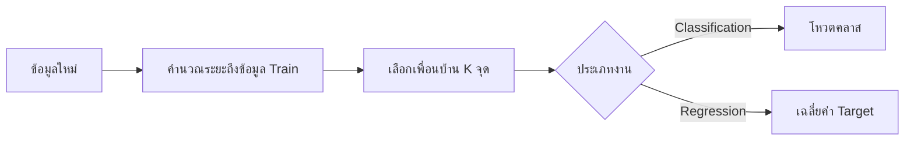

# K-Nearest Neighbors (KNN)

**KNN** ทำนายข้อมูลใหม่โดยดูข้อมูล Train ที่อยู่ใกล้ที่สุดจำนวน `K` จุด ไม่มีการสร้างสมการระหว่าง `fit()` แต่จะเก็บข้อมูลไว้และคำนวณระยะตอน `predict()`

## 1. หลักการ



Euclidean distance สำหรับ $p$ Features:

$$
d(x,z)=\sqrt{\sum_{j=1}^{p}(x_j-z_j)^2}
$$

Classification เลือกคลาสที่เพื่อนบ้านโหวตมากที่สุด:

$$
\hat{y}=\underset{c}{\operatorname{argmax}}
\sum_{i\in N_K(x)}\mathbf{1}(y_i=c)
$$

Regression ใช้ค่าเฉลี่ย Target ของเพื่อนบ้าน:

$$
\hat{y}=\frac{1}{K}\sum_{i\in N_K(x)}y_i
$$

## 2. เลือก K

- `K` เล็ก: ขอบเขตไวต่อ Noise และเสี่ยง Overfitting
- `K` ใหญ่: ขอบเขตเรียบขึ้น แต่อาจ Underfitting
- Classification แบบสองคลาสมักทดลองเลขคี่เพื่อลดโอกาสคะแนนเสมอ แต่ยังเสมอได้ในงานหลายคลาสหรือแบบถ่วงน้ำหนัก

ควรเลือก `K` ด้วย Cross-validation ไม่ควรกำหนดจากจำนวนคลาส

## 3. ตัวอย่าง Classification

```python
from sklearn.datasets import load_iris
from sklearn.model_selection import train_test_split
from sklearn.neighbors import KNeighborsClassifier
from sklearn.pipeline import make_pipeline
from sklearn.preprocessing import StandardScaler

X, y = load_iris(return_X_y=True)
X_train, X_valid, y_train, y_valid = train_test_split(
    X,
    y,
    test_size=0.25,
    random_state=42,
    stratify=y,
)

model = make_pipeline(
    StandardScaler(),
    KNeighborsClassifier(n_neighbors=5),
)
model.fit(X_train, y_train)

print("Validation accuracy:", model.score(X_valid, y_valid))
```

## 4. Scale สำคัญอย่างไร?

ถ้าอายุอยู่ช่วง `20–60` แต่รายได้อยู่ช่วง `10,000–100,000` รายได้จะครองระยะทาง KNN จึงควร Scale Features ในกรณีส่วนใหญ่

## 5. การถ่วงน้ำหนัก

`weights="uniform"` ให้เพื่อนบ้านทุกจุดมีน้ำหนักเท่ากัน ส่วน `weights="distance"` ให้จุดที่ใกล้กว่ามีอิทธิพลมากกว่า โดยแนวคิดทั่วไปคือ:

$$
w_i=\frac{1}{d(x,x_i)}
$$

scikit-learn จัดการกรณีระยะเป็นศูนย์ให้ การถ่วงตามระยะอาจช่วยเมื่อเพื่อนบ้านที่ใกล้มากควรสำคัญกว่า

## 6. Parameters สำคัญ

| Parameter | ความหมาย |
|---|---|
| `n_neighbors` | จำนวนเพื่อนบ้าน `K` |
| `weights` | `uniform` หรือ `distance` |
| `metric` | วิธีวัดระยะ เช่น Euclidean หรือ Manhattan |
| `p` | กำลังของ Minkowski; `p=1` คือ Manhattan, `p=2` คือ Euclidean |

## 7. จุดเด่นและข้อจำกัด

จุดเด่น:

- แนวคิดตรงไปตรงมา
- ใช้ได้ทั้ง Classification และ Regression
- จับขอบเขตไม่เป็นเส้นตรงได้

ข้อจำกัด:

- ทำนายช้าเมื่อ Train ใหญ่ เพราะต้องค้นหาเพื่อนบ้าน
- ใช้หน่วยความจำเก็บข้อมูล Train
- ไวต่อสเกล Outliers และ Features ที่ไม่เกี่ยวข้อง
- เมื่อมิติสูง ระยะห่างระหว่างจุดแยกกันยากขึ้น เรียกว่า Curse of dimensionality

## 8. Checklist

- Scale Features
- เลือก `K` ด้วย Cross-validation
- เปรียบเทียบ `uniform` กับ `distance`
- ลบหรือหลีกเลี่ยง Features ที่ไม่มีประโยชน์
- ตรวจ Outliers และ Missing values
- ระวังเวลา Predict เมื่อข้อมูล Train ใหญ่

## แหล่งอ้างอิง

- [scikit-learn: Nearest Neighbors](https://scikit-learn.org/stable/modules/neighbors.html)
- [scikit-learn: KNeighborsClassifier](https://scikit-learn.org/stable/modules/generated/sklearn.neighbors.KNeighborsClassifier.html)

---

[สารบัญ](../ML/index.md) · [รวมสูตร](../ML/formulas.md)
