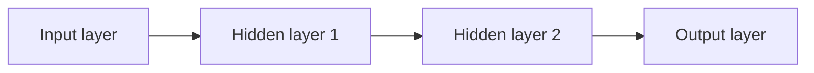

# Neural Network

**Neural Network** คือโมเดลที่ต่อหน่วยคำนวณหลายชั้น แต่ละชั้นแปลงข้อมูลด้วย Weights, Bias และ Activation function เพื่อเรียนรู้ความสัมพันธ์ที่ซับซ้อน

## 1. โครงสร้าง



- Input layer รับ Features
- Hidden layers เรียนรู้รูปแบบระดับต่าง ๆ
- Output layer สร้างค่าทำนาย

## 2. Neuron คำนวณอย่างไร?

คะแนนก่อน Activation:

$$
z=w^Tx+b=\sum_{j=1}^{p}w_jx_j+b
$$

ผลลัพธ์ของ Neuron:

$$
a=g(z)
$$

$g$ คือ Activation function หากไม่มี Activation หลายชั้นที่เป็นเส้นตรงจะยุบรวมเป็นการแปลงเชิงเส้นเพียงชั้นเดียว

## 3. Activation functions

ReLU:

$$
\operatorname{ReLU}(z)=\max(0,z)
$$

Sigmoid สำหรับ Binary classification:

$$
\sigma(z)=\frac{1}{1+e^{-z}}
$$

Softmax สำหรับหลายคลาส:

$$
P(y=k\mid x)=\frac{e^{z_k}}{\sum_{j=1}^{K}e^{z_j}}
$$

## 4. การเรียนรู้


Gradient descent ปรับพารามิเตอร์:

$$
w\leftarrow w-\eta\frac{\partial L}{\partial w}
$$

- $L$ คือ Loss
- $\eta$ คือ Learning rate
- Gradient บอกทิศทางที่ Loss เพิ่ม จึงลบเพื่อให้ Loss ลด

หนึ่ง **Epoch** คือการให้โมเดลเห็นข้อมูล Train ครบหนึ่งรอบ ส่วน **Batch size** คือจำนวนแถวที่ใช้คำนวณก่อนปรับ Weights หนึ่งครั้ง

## 5. ตัวอย่างด้วย scikit-learn

```python
from sklearn.datasets import load_breast_cancer
from sklearn.model_selection import train_test_split
from sklearn.neural_network import MLPClassifier
from sklearn.pipeline import make_pipeline
from sklearn.preprocessing import StandardScaler

X, y = load_breast_cancer(return_X_y=True)
X_train, X_valid, y_train, y_valid = train_test_split(
    X,
    y,
    test_size=0.25,
    random_state=42,
    stratify=y,
)

model = make_pipeline(
    StandardScaler(),
    MLPClassifier(
        hidden_layer_sizes=(64, 32),
        activation="relu",
        alpha=0.0001,
        early_stopping=True,
        max_iter=1000,
        random_state=42,
    ),
)
model.fit(X_train, y_train)

print("Validation accuracy:", model.score(X_valid, y_valid))
```

`MLPClassifier` เหมาะสำหรับเรียนรู้แนวคิดและข้อมูลตารางขนาดเล็กถึงกลาง โดย scikit-learn ไม่มี GPU support สำหรับโมเดลนี้

## 6. Parameters สำคัญ

| Parameter | ความหมาย |
|---|---|
| `hidden_layer_sizes` | จำนวน Neurons ในแต่ละ Hidden layer |
| `activation` | Activation เช่น `relu` หรือ `tanh` |
| `alpha` | ความแรงของ L2 regularization |
| `learning_rate_init` | Learning rate เริ่มต้น |
| `batch_size` | จำนวนตัวอย่างต่อการอัปเดต |
| `max_iter` | จำนวนรอบสูงสุด |
| `early_stopping` | หยุดเมื่อ Validation ไม่ดีขึ้น |

## 7. Underfitting และ Overfitting

Underfitting อาจเกิดจาก Network เล็ก ฝึกน้อย หรือ Regularization มากเกินไป ส่วน Overfitting อาจเกิดจาก Network ใหญ่ ข้อมูลน้อย หรือฝึกนานเกินไป

วิธีลด Overfitting:

- เพิ่มข้อมูล
- ใช้ L2 regularization หรือ Dropout ใน Framework ที่รองรับ
- ใช้ Early stopping
- ลดจำนวนชั้นหรือ Neurons
- ติดตาม Train และ Validation loss

## 8. จุดเด่นและข้อจำกัด

จุดเด่น:

- เรียนรู้ความสัมพันธ์ซับซ้อนได้
- ใช้ได้กับภาพ เสียง ข้อความ และข้อมูลตาราง
- สถาปัตยกรรมปรับให้เหมาะกับงานได้มาก

ข้อจำกัด:

- ต้องปรับ Hyperparameters หลายค่า
- มักต้องใช้ข้อมูลและทรัพยากรมาก
- ไวต่อสเกลและการเตรียมข้อมูล
- อธิบายผลยากกว่าโมเดลง่าย
- ผลการฝึกมีการสุ่มและอาจไม่เหมือนกันทุกระบบ

## 9. Checklist

- Scale Features ตัวเลข
- เริ่มจาก Network เล็ก
- แยก Validation และใช้ Early stopping
- วาด Train/Validation loss
- ปรับ Learning rate ก่อนเพิ่มความซับซ้อน
- เปรียบเทียบกับ Baseline และโมเดลตาราง เช่น Gradient Boosting
- กำหนด Seed เท่าที่ Framework รองรับ

## แหล่งอ้างอิง

- [scikit-learn: Neural network models](https://scikit-learn.org/stable/modules/neural_networks_supervised.html)
- [scikit-learn: MLPClassifier](https://scikit-learn.org/stable/modules/generated/sklearn.neural_network.MLPClassifier.html)

---

[สารบัญ](../ML/index.md) · [รวมสูตร](../ML/formulas.md)
