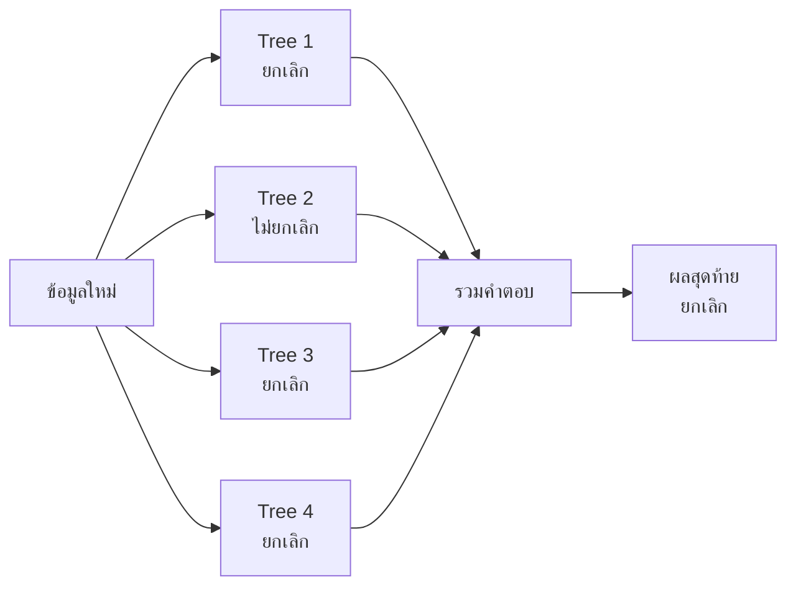
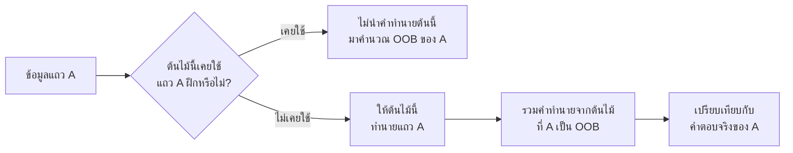

# Random Forest

Random Forest คือโมเดลที่นำ **[Decision Tree](DecisionTree.md) หลายต้นมาช่วยกันทำนาย** แล้วรวมคำตอบของต้นไม้ทั้งหมด

เปรียบเหมือนถามความเห็นจากผู้เชี่ยวชาญหลายคนแทนการเชื่อคนเดียว ต้นไม้แต่ละต้นเห็นข้อมูลและ Features ต่างกันเล็กน้อย จึงมักพลาดไม่เหมือนกัน เมื่อนำคำตอบมารวมกัน ผลลัพธ์จึงเสถียรกว่า Decision Tree ต้นเดียว

> [!NOTE]
> `RandomForest` มีขั้นตอนสุ่ม จึงควรกำหนด `random_state` เมื่อต้องการให้ฝึกซ้ำแล้วได้ผลเดิม

Random Forest ใช้ได้กับสองประเภทงาน:
- `RandomForestClassifier` ทำนายคลาส เช่น ลูกค้าจะยกเลิกหรือไม่
- `RandomForestRegressor` ทำนายตัวเลข เช่น ราคาบ้าน

## 1. จาก Decision Tree ไปเป็น Random Forest

Decision Tree เรียนรู้คำถามแบบ `if/else`:

```text
ยอดใช้งานน้อยกว่า 5 ครั้งหรือไม่?
├── ใช่
│   └── มียอดค้างชำระหรือไม่?
│       ├── ใช่ → อาจยกเลิก
│       └── ไม่ใช่ → อาจไม่ยกเลิก
└── ไม่ใช่ → อาจไม่ยกเลิก
```

ต้นไม้ต้นเดียวเข้าใจง่าย แต่หากปล่อยให้ลึกมากอาจจำข้อมูล Train จนเกิด Overfitting

Random Forest ลดปัญหานี้ด้วยต้นไม้หลายต้น:


___
## 2. ต้นไม้แต่ละต้นแตกต่างกันอย่างไร?

Random Forest ใช้การสุ่มสองส่วนหลัก
### 2.1 สุ่มแถวข้อมูล

ต้นไม้แต่ละต้นได้ข้อมูล Train คนละชุด โดยสุ่มแบบอนุญาตให้แถวเดิมถูกเลือกซ้ำ เรียกว่า **Bootstrap sampling**

```text
ข้อมูลเดิม: A B C D E

Tree 1:    A C C D E
Tree 2:    B B C D A
Tree 3:    E D E B C
```

### 2.2 สุ่ม Features ตอนแบ่ง Node

ถ้ามี Features เช่น อายุ รายได้ ยอดใช้งาน ยอดค้างชำระ และอายุสมาชิก ต้นไม้จะพิจารณาเพียง Features บางส่วนในแต่ละจุดแบ่ง

การสุ่มสองส่วนนี้ช่วยให้ต้นไม้ไม่เหมือนกันทั้งหมด หากต้นไม้ทุกต้นเหมือนกัน การมีหลายต้นก็ไม่ได้ช่วยมากนัก
___
## 3. รวมคำตอบอย่างไร? พร้อมวิธีคำนวณ

เมื่อนำข้อมูลใหม่เข้า Random Forest ต้นไม้ทุกต้นจะทำนายข้อมูลเดียวกันก่อน จากนั้นโมเดลจึงรวมคำตอบทั้งหมดเป็นคำตอบสุดท้าย

### 3.1 ความหมายของสัญลักษณ์

| สัญลักษณ์ | อ่านว่า | ความหมาย |
|---|---|---|
| $\hat{y}$ | วายแฮต | คำตอบสุดท้ายของ Random Forest |
| $\hat{y}_t$ | วายแฮตของต้นที่ $t$ | คำตอบจากต้นไม้หนึ่งต้น |
| $t$ | ที | ลำดับของต้นไม้ เช่น ต้นที่ 1, 2, 3 |
| $T$ | ทีตัวใหญ่ | จำนวนต้นไม้ทั้งหมด ตรงกับ `n_estimators` |
| $\operatorname{mode}$ | โหมด | ค่าที่ปรากฏบ่อยที่สุด |
| $\sum$ | ซิกมา | นำค่าตามช่วงที่กำหนดมาบวกกัน |

ถ้ากำหนด `n_estimators=200` จะได้ $T=200$ หมายความว่าโมเดลสร้างต้นไม้ 200 ต้นแล้วนำคำตอบจากทั้ง 200 ต้นมารวมกัน

### 3.2 Classification: ใช้คลาสที่ได้เสียงมากที่สุด

สูตรแบบเข้าใจง่ายคือ:

$$
\hat{y}=\operatorname{mode}
\left(\hat{y}_1,\hat{y}_2,\ldots,\hat{y}_T\right)
$$

สมมติให้ต้นไม้ 5 ต้นทำนายว่าลูกค้าจะยกเลิกหรือไม่ โดย `1` หมายถึงยกเลิก และ `0` หมายถึงไม่ยกเลิก:

| ต้นไม้ | คำทำนาย $\hat{y}_t$ |
|---|---:|
| Tree 1 | 1 |
| Tree 2 | 0 |
| Tree 3 | 1 |
| Tree 4 | 1 |
| Tree 5 | 0 |

แทนค่าลงในสูตร:

$$
\begin{aligned}
\hat{y}
&=\operatorname{mode}(1,0,1,1,0)\\
&=1
\end{aligned}
$$

วิธีคิดทีละขั้น:
1. นับจำนวน `1` ได้ 3 เสียง
2. นับจำนวน `0` ได้ 2 เสียง
3. คลาส `1` ได้เสียงมากที่สุด ดังนั้นคำตอบสุดท้ายคือ $\hat{y}=1$

เขียนแนวคิดเดียวกันแบบละเอียดขึ้นได้ว่า:

$$
N_c=\sum_{t=1}^{T}\mathbf{1}(\hat{y}_t=c)
$$

$$
\hat{y}=\underset{c}{\operatorname{argmax}}\;N_c
$$

โดย:
- $c$ คือคลาสที่กำลังนับ เช่น `0` หรือ `1`
- $\mathbf{1}(\hat{y}_t=c)$ ให้ค่า 1 เมื่อต้นไม้ทำนายเป็นคลาส $c$ และให้ค่า 0 เมื่อทำนายเป็นคลาสอื่น
- $N_c$ คือจำนวนเสียงทั้งหมดของคลาส $c$
- $\operatorname{argmax}$ เลือกคลาสที่มี $N_c$ มากที่สุด

คำนวณตัวอย่างนี้ด้วย Python ได้ดังนี้:

```python
from collections import Counter

tree_predictions = [1, 0, 1, 1, 0]
vote_counts = Counter(tree_predictions)
final_prediction = vote_counts.most_common(1)[0][0]

print(vote_counts)       # Counter({1: 3, 0: 2})
print(final_prediction)  # 1
```

> [!NOTE]
> สูตรเสียงข้างมากช่วยอธิบายแนวคิดของ Random Forest ได้ง่าย ส่วน `RandomForestClassifier` ของ scikit-learn จะหาค่าเฉลี่ยของความน่าจะเป็นจากทุกต้นไม้ แล้วเลือกคลาสที่มีค่าเฉลี่ยสูงที่สุด

ตัวอย่าง ถ้าต้นไม้ 3 ต้นให้ความน่าจะเป็นของคลาส `1` เท่ากับ $0.80$, $0.60$ และ $0.40$:

$$
\begin{aligned}
P(y=1\mid x)
&=\frac{0.80+0.60+0.40}{3}\\
&=\frac{1.80}{3}\\
&=0.60
\end{aligned}
$$

เมื่อความน่าจะเป็นเฉลี่ยของคลาส `1` เท่ากับ $0.60$ และสูงกว่าของคลาส `0` ซึ่งเท่ากับ $0.40$ โมเดลจึงเลือกคลาส `1`

### 3.3 Regression: ใช้ค่าเฉลี่ย

สำหรับการทำนายตัวเลข แต่ละต้นไม้ให้ค่าตัวเลขหนึ่งค่า แล้ว Random Forest หาค่าเฉลี่ย:

$$
\hat{y}=\frac{1}{T}\sum_{t=1}^{T}\hat{y}_t
$$

เครื่องหมายซิกมาในสูตรขยายได้เป็น:

$$
\sum_{t=1}^{T}\hat{y}_t
=\hat{y}_1+\hat{y}_2+\cdots+\hat{y}_T
$$

ดังนั้นสูตรเต็มจึงมีความหมายว่า:

$$
\hat{y}
=\frac{\text{ผลรวมคำทำนายจากต้นไม้ทุกต้น}}
{\text{จำนวนต้นไม้ทั้งหมด}}
$$

สมมติต้นไม้ 4 ต้นทำนายราคาบ้านหน่วยเป็นล้านบาทดังนี้:

| ต้นไม้ | คำทำนาย $\hat{y}_t$ |
| ------ | ------------------: |
| Tree 1 |                 2.4 |
| Tree 2 |                 2.8 |
| Tree 3 |                 2.6 |
| Tree 4 |                 3.0 |

ในตัวอย่างนี้ $T=4$ จึงคำนวณได้ว่า:

$$
\begin{aligned}
\hat{y}
&=\frac{1}{4}(2.4+2.8+2.6+3.0)\\
&=\frac{10.8}{4}\\
&=2.7
\end{aligned}
$$

คำตอบสุดท้ายของ Random Forest คือราคาบ้าน $2.7$ ล้านบาท

คำนวณด้วย Python ได้ดังนี้:

```python
tree_predictions = [2.4, 2.8, 2.6, 3.0]
final_prediction = sum(tree_predictions) / len(tree_predictions)

print(final_prediction)  # 2.7
```

การเฉลี่ยช่วยลดผลกระทบจากความผิดพลาดของต้นไม้บางต้น เมื่อแต่ละต้นไม่ได้พลาดไปในทิศทางเดียวกันทั้งหมด

## 4. ตัวอย่าง Classification

ตัวอย่างนี้สร้างข้อมูลจำลอง แบ่ง Train/Test ฝึกโมเดล แล้ววัด Precision และ Recall:

```python
from sklearn.datasets import make_classification
from sklearn.ensemble import RandomForestClassifier
from sklearn.metrics import classification_report, confusion_matrix
from sklearn.model_selection import train_test_split

SEED = 42

X, y = make_classification(
    n_samples=1000,
    n_features=10,
    n_informative=6,
    n_redundant=2,
    weights=[0.8, 0.2],
    random_state=SEED,
)

X_train, X_test, y_train, y_test = train_test_split(
    X,
    y,
    test_size=0.2,
    random_state=SEED,
    stratify=y,
)

model = RandomForestClassifier(
    n_estimators=200,
    max_depth=8,
    min_samples_leaf=2,
    random_state=SEED,
    n_jobs=-1,
)

model.fit(X_train, y_train)
predictions = model.predict(X_test)

print(confusion_matrix(y_test, predictions))
print(classification_report(y_test, predictions))
```

`stratify=y` ช่วยรักษาสัดส่วนของแต่ละคลาสใน Train และ Test
___
## 5. ความน่าจะเป็นและ Threshold

`predict_proba()` คืนความน่าจะเป็นของแต่ละคลาส:

```python
# ใช้ model และ X_test จากตัวอย่าง Classification
probabilities = model.predict_proba(X_test)

# คอลัมน์ที่ 1 คือความน่าจะเป็นของคลาส 1
positive_probabilities = probabilities[:, 1]

threshold = 0.40
predictions = (positive_probabilities >= threshold).astype(int)

print(positive_probabilities[:5])
print(predictions[:5])
```

การลด Threshold มักช่วยตรวจพบคลาส 1 มากขึ้น แต่ False Positives อาจเพิ่มขึ้นด้วย ต้องเลือก Threshold จาก Validation ตามเป้าหมายของงาน
___
## 6. ตัวอย่าง Regression

```python
import numpy as np
from sklearn.datasets import make_regression
from sklearn.ensemble import RandomForestRegressor
from sklearn.metrics import mean_squared_error
from sklearn.model_selection import train_test_split

SEED = 42

X, y = make_regression(
    n_samples=1000,
    n_features=5,
    noise=20,
    random_state=SEED,
)

X_train, X_test, y_train, y_test = train_test_split(
    X,
    y,
    test_size=0.2,
    random_state=SEED,
)

model = RandomForestRegressor(
    n_estimators=200,
    max_depth=10,
    min_samples_leaf=2,
    random_state=SEED,
    n_jobs=-1,
)

model.fit(X_train, y_train)
predictions = model.predict(X_test)

rmse = np.sqrt(mean_squared_error(y_test, predictions))
print("Test RMSE:", rmse)
```
___
## 7. Hyperparameters สำคัญ

### `n_estimators`

จำนวนต้นไม้ในป่า:

```python
n_estimators=200
```

ต้นไม้มากขึ้นมักทำให้ผลเสถียรขึ้น แต่ใช้เวลาและหน่วยความจำมากขึ้น ผลดีจะเริ่มเพิ่มน้อยลงเมื่อมีต้นไม้เพียงพอแล้ว

### `max_depth`

ความลึกสูงสุดของแต่ละต้น:

```python
max_depth=10
```

- ลึกมาก: เรียนรู้รายละเอียดมาก แต่เสี่ยง Overfitting
- ตื้นมาก: อาจเรียนรู้ไม่เพียงพอจน Underfitting
- `None`: ปล่อยให้ต้นไม้โตจนถึงเงื่อนไขหยุดอื่น

### `min_samples_split`

จำนวนตัวอย่างขั้นต่ำที่ Node ต้องมีก่อนอนุญาตให้แบ่ง:

```python
min_samples_split=10
```

เพิ่มค่านี้ช่วยลดการแบ่งข้อมูลที่ละเอียดเกินไป

### `min_samples_leaf`

จำนวนตัวอย่างขั้นต่ำที่ต้องเหลือใน Leaf:

```python
min_samples_leaf=5
```

เพิ่มค่านี้ช่วยลด Leaf ที่เกิดจากข้อมูลเพียงหนึ่งหรือสองแถว

### `max_features`

จำนวน Features ที่อนุญาตให้พิจารณาในแต่ละจุดแบ่ง:

```python
max_features="sqrt"
```

ค่านี้ช่วยทำให้ต้นไม้แต่ละต้นแตกต่างกัน

### `random_state`

ควบคุมการสุ่มแถวและ Features ภายใน Random Forest:

```python
random_state=42
```

การใช้ Seed เดิมทำให้ฝึกซ้ำด้วยข้อมูลและพารามิเตอร์เดิมแล้วได้ผลเดิม

### `n_jobs`

กำหนดจำนวนแกนประมวลผลที่ใช้:

```python
n_jobs=-1
```

`-1` หมายถึงใช้ CPU ที่มีอยู่ทั้งหมด

### `class_weight`

ช่วยเพิ่มน้ำหนักให้คลาสที่มีจำนวนน้อยในงาน Classification:

```python
class_weight="balanced"
```

ควรประเมินผลด้วย Precision, Recall, F1 หรือ metric ที่ตรงกับเป้าหมาย ไม่ควรดู Accuracy อย่างเดียว
___
## 8. ต้องใช้ StandardScaler หรือไม่?

โดยทั่วไป Random Forest ไม่จำเป็นต้องปรับสเกลข้อมูล เพราะต้นไม้แบ่งข้อมูลด้วยเงื่อนไขลักษณะนี้:

```text
ยอดค้างชำระ <= 500 หรือไม่?
```

การเปลี่ยนหน่วยไม่เปลี่ยนลำดับของข้อมูล อย่างไรก็ตาม ยังต้องจัดการ:

- Missing values
- ข้อมูลข้อความหรือ Category
- Data Leakage
- การแบ่ง Train และ Test
- Class imbalance

scikit-learn ไม่สามารถรับข้อความดิบอย่าง `"Bangkok"` เข้า Random Forest ได้โดยตรง ต้องเข้ารหัส Category ก่อน เช่นใช้ `OneHotEncoder`
___
## 9. Feature Importance

ดูได้ว่าโมเดลใช้ Feature ใดในการแบ่งข้อมูลมาก:

```python
import pandas as pd

feature_names = [
    "tenure",
    "monthly_usage",
    "overdue_amount",
    "support_calls",
    "monthly_fee",
]

importance = pd.Series(
    model.feature_importances_,
    index=feature_names,
).sort_values(ascending=False)

print(importance)
```

> [!CAUTION]
> Feature Importance สูงไม่ได้แปลว่า Feature นั้นเป็นสาเหตุของ Target และ Importance แบบค่าเริ่มต้นอาจให้ความสำคัญกับ Feature ที่มีค่าหลากหลายมากเกินไป

หากต้องการวัดว่าคะแนนลดลงเท่าไรเมื่อสลับค่าของ Feature สามารถใช้ `permutation_importance` บน Validation หรือ Test ที่แยกไว้
___
## 10. Out-of-Bag Score

### 10.1 Bootstrap คืออะไร?

**Bootstrap sampling** คือการสุ่มข้อมูลจากชุด Train แบบ **สุ่มแล้วคืนกลับ** หรือ *sampling with replacement*

สมมติมีข้อมูล Train จำนวน 5 แถว:

```text
A B C D E
```

เมื่อต้องสร้าง Tree 1 โมเดลจะสุ่มทั้งหมด 5 ครั้ง หลังจากสุ่มแต่ละครั้งจะคืนแถวนั้นกลับเข้าไปก่อนสุ่มครั้งถัดไป จึงสามารถสุ่มเจอแถวเดิมซ้ำได้:

```text
ครั้งที่สุ่ม:    1  2  3  4  5
แถวที่ได้:      A  C  C  D  E
```

ผลลัพธ์คือ:

- Tree 1 ใช้ `A C C D E` ฝึกโมเดล
- แถว `C` ถูกเลือกซ้ำ 2 ครั้ง
- แถว `B` ไม่ถูกเลือกเลย
- แถว `B` จึงเป็น **Out-of-Bag sample ของ Tree 1**

ต้นไม้ต้นต่อไปจะสุ่มใหม่ จึงอาจได้ชุดข้อมูลและ OOB samples ต่างจาก Tree 1:

```text
Tree 1 ใช้: A C C D E    → OOB คือ B
Tree 2 ใช้: B B C E A    → OOB คือ D
Tree 3 ใช้: E D E B C    → OOB คือ A
```

คำว่า **Bag** ในที่นี้หมายถึงชุดข้อมูลที่สุ่มมาใช้ฝึกต้นไม้หนึ่งต้น ส่วน **Out-of-Bag** หมายถึงแถวที่อยู่นอกชุดนั้น

### 10.2 ทำไมแต่ละต้นจึงมีข้อมูล OOB ประมาณ 36.8%?

สมมติชุด Train มี $n$ แถว โอกาสที่แถวหนึ่งจะ **ไม่ถูกเลือก** ในการสุ่มหนึ่งครั้งคือ:

$$
1-\frac{1}{n}=\frac{n-1}{n}
$$

Bootstrap สุ่มทั้งหมด $n$ ครั้ง ดังนั้นโอกาสที่แถวนั้นไม่ถูกเลือกเลยตลอดทั้ง $n$ ครั้งคือ:

$$
P(\text{แถวหนึ่งเป็น OOB})
=\left(1-\frac{1}{n}\right)^n
$$

เมื่อ $n$ มีค่ามาก:

$$
\left(1-\frac{1}{n}\right)^n
\approx e^{-1}
\approx 0.3679
$$

จึงคาดว่าในต้นไม้แต่ละต้น:

- ประมาณ $36.8\%$ ของแถวจะไม่ได้ถูกเลือก และกลายเป็น OOB samples
- ประมาณ $63.2\%$ ของแถวจะถูกเลือกอย่างน้อยหนึ่งครั้ง

> [!NOTE]
> โมเดลยังคงสุ่มครบ $n$ ครั้ง แต่เนื่องจากบางแถวถูกเลือกซ้ำ จำนวนแถวที่ไม่ซ้ำกันใน Bootstrap sample จึงมักเหลือประมาณ $63.2\%$ ของข้อมูล Train

ตัวอย่าง ถ้ามีข้อมูล $n=1{,}000$ แถว ต้นไม้หนึ่งต้นจะมี OOB samples โดยเฉลี่ยประมาณ:

$$
1{,}000\times0.368\approx368\text{ แถว}
$$

ตัวเลขจริงของแต่ละต้นอาจมากหรือน้อยกว่า 368 เล็กน้อยเพราะเป็นการสุ่ม

### 10.3 OOB Score คำนวณอย่างไร?

แต่ละแถวจะถูกใช้ประเมินเฉพาะกับต้นไม้ที่ **ไม่ได้ใช้แถวนั้นตอนฝึก**:



ขั้นตอนคือ:

1. เลือกแถว Train หนึ่งแถว
2. หาเฉพาะต้นไม้ที่ไม่ได้ใช้แถวนั้นตอนฝึก
3. นำคำทำนายจากต้นไม้เหล่านั้นมารวมกัน
4. เปรียบเทียบคำทำนาย OOB กับ Target จริง
5. ทำซ้ำกับทุกแถวแล้วคำนวณคะแนนรวม

สำหรับ Classification ถ้าใช้ Accuracy คะแนนคำนวณได้จาก:

$$
\text{OOB Accuracy}
=\frac{\text{จำนวนแถวที่ทำนาย OOB ถูก}}
{\text{จำนวนแถวที่มีคำทำนาย OOB ทั้งหมด}}
$$

ตัวอย่าง มีคำทำนาย OOB ทั้งหมด 1,000 แถวและทำนายถูก 850 แถว:

$$
\text{OOB Accuracy}
=\frac{850}{1{,}000}
=0.85
=85\%
$$

ใน scikit-learn เปิดการคำนวณนี้ด้วย `bootstrap=True` และ `oob_score=True`:

```python
from sklearn.datasets import make_classification
from sklearn.ensemble import RandomForestClassifier

X_train, y_train = make_classification(
    n_samples=800,
    n_features=10,
    n_informative=6,
    weights=[0.8, 0.2],
    random_state=42,
)

model = RandomForestClassifier(
    n_estimators=200,
    bootstrap=True,
    oob_score=True,
    random_state=42,
    n_jobs=-1,
)

model.fit(X_train, y_train)
print("OOB score:", model.oob_score_)
```

ในตัวอย่าง Classification นี้ `model.oob_score_` ใช้ Accuracy เป็นค่าเริ่มต้น ส่วน `RandomForestRegressor` ใช้ $R^2$ เป็นค่าเริ่มต้น

OOB score ช่วยประเมินโมเดลจากข้อมูล Train ที่ไม่ได้ถูกใช้สร้างต้นไม้แต่ละต้น จึงมีประโยชน์สำหรับการตรวจเบื้องต้น แต่ยังไม่ควรใช้แทน Test set ที่เก็บไว้สำหรับประเมินผลขั้นสุดท้าย
___
## 11. ตัวอย่าง Tuning ด้วย RandomizedSearchCV

```python
from sklearn.datasets import make_classification
from sklearn.ensemble import RandomForestClassifier
from sklearn.model_selection import RandomizedSearchCV, StratifiedKFold

SEED = 42

X, y = make_classification(
    n_samples=1000,
    n_features=10,
    n_informative=6,
    weights=[0.8, 0.2],
    random_state=SEED,
)

model = RandomForestClassifier(
    random_state=SEED,
    n_jobs=-1,
)

search_space = {
    "n_estimators": [100, 200, 500],
    "max_depth": [5, 10, 20, None],
    "min_samples_split": [2, 5, 10],
    "min_samples_leaf": [1, 2, 5],
    "max_features": ["sqrt", "log2"],
}

cv = StratifiedKFold(
    n_splits=5,
    shuffle=True,
    random_state=SEED,
)

search = RandomizedSearchCV(
    estimator=model,
    param_distributions=search_space,
    n_iter=20,
    scoring="f1",
    cv=cv,
    random_state=SEED,
    n_jobs=-1,
    refit=True,
)

search.fit(X, y)

print("Best parameters:", search.best_params_)
print("Best CV F1:", search.best_score_)
```

ตัวอย่างนี้ใช้:

$$
20\text{ combinations}\times5\text{ folds}=100\text{ CV fits}
$$

จากนั้น `refit=True` จะฝึกชุดที่ดีที่สุดอีกหนึ่งครั้ง รวมเป็น 101 fits

## 12. ข้อดีและข้อจำกัด

### ข้อดี

- จับความสัมพันธ์ที่ไม่เป็นเส้นตรงได้
- รองรับการทำงานร่วมกันของหลาย Features
- มักให้ผลดีโดยไม่ต้องปรับแต่งมาก
- ไม่จำเป็นต้องใช้ StandardScaler
- ลด Overfitting เมื่อเทียบกับ Decision Tree ต้นเดียว

### ข้อจำกัด

- อธิบายยากกว่า Linear Regression และ Decision Tree ต้นเดียว
- ใช้หน่วยความจำและเวลามากกว่า
- ต้นไม้จำนวนมากทำให้ทำนายช้าลง
- ทำนายค่านอกช่วงข้อมูลได้ไม่ดีในงาน Regression
- Feature Importance ต้องตีความอย่างระมัดระวัง
___
## 13. Checklist ก่อนใช้ Random Forest

- แยก Train, Validation และ Test แล้ว
- ใช้ `StratifiedKFold` เมื่อเป็น Classification ที่คลาสไม่สมดุล
- กำหนด `random_state` ทุกจุดที่มีการสุ่ม
- เลือก Metric ให้ตรงกับเป้าหมาย
- เริ่มจาก `n_estimators`, `max_depth` และ `min_samples_leaf`
- ตรวจคะแนน Train เทียบกับ Validation เพื่อหา Overfitting
- ตรวจ Data Leakage ก่อนเชื่อคะแนน
- ประเมิน Test เพียงหลังเลือกโมเดลเสร็จแล้ว

หลักจำง่ายคือ:

> [!IMPORTANT]
> Decision Tree คือผู้ตัดสินหนึ่งคน ส่วน Random Forest คือผู้ตัดสินหลายคนที่เห็นข้อมูลต่างกันแล้วช่วยกันลงความเห็น

## 14. แหล่งอ้างอิง

- [scikit-learn: RandomForestClassifier](https://scikit-learn.org/stable/modules/generated/sklearn.ensemble.RandomForestClassifier.html) อธิบายว่าความน่าจะเป็นของแต่ละคลาสคำนวณจากค่าเฉลี่ยของความน่าจะเป็นที่ต้นไม้ให้มา
- [scikit-learn: RandomForestRegressor](https://scikit-learn.org/stable/modules/generated/sklearn.ensemble.RandomForestRegressor.html) ระบุว่าค่าทำนายสุดท้ายคำนวณจากค่าเฉลี่ยของค่าทำนายจากต้นไม้ในป่า
- [Breiman, Random Forests (2001)](https://doi.org/10.1023/A:1010933404324) งานวิจัยต้นฉบับที่อธิบายแนวคิด Random Forest สำหรับ Classification และ Regression

---

[สารบัญ Machine Learning](../ML/index.md) · [Decision Tree](DecisionTree.md) · [Hyperparameter Tuning](../ML/hyperparameter-tuning.md) · [Search Space](../ML/search-space.md)
