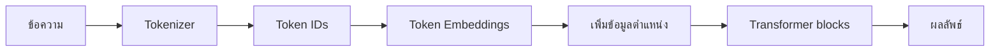
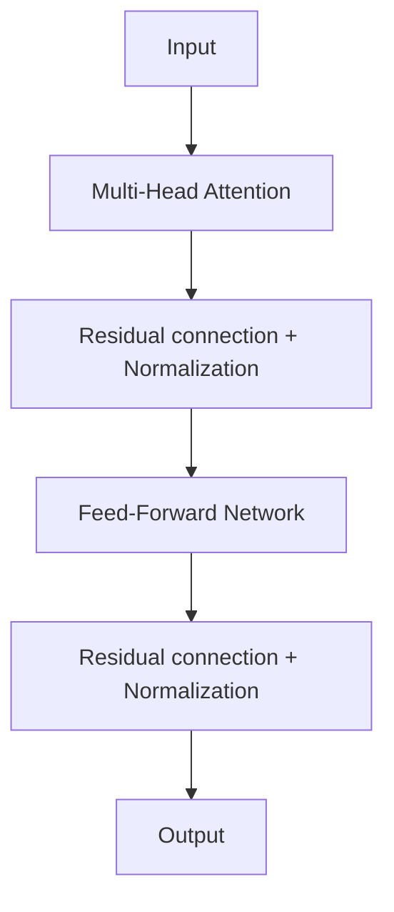

# Transformer

**Transformer** คือสถาปัตยกรรม Neural Network ที่ใช้ **Attention** เป็นแกนหลัก เพื่อให้แต่ละตำแหน่งในข้อมูลมองตำแหน่งอื่นและเลือกว่าส่วนใดสำคัญต่อการสร้างผลลัพธ์

Transformer ถูกเสนอในงานวิจัย *Attention Is All You Need* ปี 2017 สำหรับงานแปลภาษา และต่อมากลายเป็นพื้นฐานของโมเดลภาษา โมเดลภาพ และโมเดลหลายรูปแบบจำนวนมาก

## 1. จากข้อความเป็นตัวเลข



ตัวอย่างข้อความ:

```text
แมว นั่ง บน เสื่อ
```

Tokenizer อาจแบ่งเป็น Tokens แล้วแปลงแต่ละ Token เป็นหมายเลข จากนั้น Embedding table แปลงหมายเลขเป็นเวกเตอร์ที่โมเดลเรียนรู้ได้

## 2. ทำไมต้องมี Positional information?

Self-attention เพียงอย่างเดียวไม่รู้ลำดับ Tokens จึงต้องเพิ่มข้อมูลตำแหน่ง เช่น Positional encoding ใน Transformer ต้นฉบับ:

$$
PE_{(pos,2i)}=\sin\left(\frac{pos}{10000^{2i/d_{model}}}\right)
$$

$$
PE_{(pos,2i+1)}=\cos\left(\frac{pos}{10000^{2i/d_{model}}}\right)
$$

โมเดลสมัยใหม่อาจใช้วิธีระบุตำแหน่งแบบอื่น แต่เป้าหมายเหมือนกันคือทำให้โมเดลรู้ลำดับและระยะระหว่าง Tokens

## 3. Query, Key และ Value

แต่ละ Token ถูกแปลงเป็นเวกเตอร์สามชุด:

$$
Q=XW_Q,qquad K=XW_K,qquad V=XW_V
$$

- **Query**: Token นี้กำลังมองหาอะไร
- **Key**: Token นี้มีข้อมูลลักษณะใด
- **Value**: ข้อมูลที่จะส่งต่อหาก Token นี้ได้รับความสนใจ

## 4. Scaled Dot-Product Attention

$$
\operatorname{Attention}(Q,K,V)
=\operatorname{softmax}\left(
\frac{QK^T}{\sqrt{d_k}}
\right)V
$$

ขั้นตอนคือ:

1. คูณ $QK^T$ เพื่อวัดความสัมพันธ์ระหว่าง Tokens
2. หารด้วย $\sqrt{d_k}$ เพื่อไม่ให้คะแนนมีขนาดใหญ่เกินไป
3. ใช้ Softmax แปลงเป็นน้ำหนักที่รวมกันได้ 1
4. ใช้น้ำหนักรวมข้อมูลจาก $V$

## 5. ตัวอย่าง Attention ขนาดเล็ก

```python
import numpy as np


def softmax(values):
    shifted = values - values.max(axis=-1, keepdims=True)
    exp_values = np.exp(shifted)
    return exp_values / exp_values.sum(axis=-1, keepdims=True)


def scaled_dot_product_attention(query, key, value):
    d_key = query.shape[-1]
    scores = query @ key.T / np.sqrt(d_key)
    weights = softmax(scores)
    output = weights @ value
    return output, weights


query = np.array([[1.0, 0.0], [0.0, 1.0]])
key = np.array([[1.0, 0.0], [0.0, 1.0]])
value = np.array([[10.0, 0.0], [0.0, 20.0]])

output, attention_weights = scaled_dot_product_attention(
    query,
    key,
    value,
)

print("Attention weights:")
print(attention_weights)
print("Output:")
print(output)
```

ตัวอย่างนี้ใช้เพื่อดูสูตร ไม่ใช่ Transformer สำหรับงานจริง

## 6. Multi-Head Attention

Attention หลาย Head ช่วยให้โมเดลมองความสัมพันธ์หลายแบบพร้อมกัน:

$$
\operatorname{head}_h
=\operatorname{Attention}(QW_h^Q,KW_h^K,VW_h^V)
$$

$$
\operatorname{MultiHead}(Q,K,V)
=\operatorname{Concat}(\operatorname{head}_1,\ldots,\operatorname{head}_H)W^O
$$

Head หนึ่งอาจเรียนรู้ความสัมพันธ์ระยะใกล้ ขณะที่อีก Head สนใจคำอ้างอิงที่อยู่ไกลออกไป การตีความ Head แบบนี้เป็นเพียงตัวอย่างและไม่รับประกันว่าแต่ละ Head จะมีความหมายชัดเจนเสมอ

## 7. ส่วนประกอบของ Transformer block



Feed-Forward Network ทำงานกับแต่ละตำแหน่ง:

$$
\operatorname{FFN}(x)
=\operatorname{Activation}(xW_1+b_1)W_2+b_2
$$

Residual connection ช่วยส่งข้อมูลเดิมข้ามชั้น:

$$
y=x+\operatorname{Sublayer}(x)
$$

Normalization ช่วยให้การฝึกมีเสถียรภาพมากขึ้น

## 8. Encoder และ Decoder

| รูปแบบ | มองข้อมูล | งานตัวอย่าง |
|---|---|---|
| Encoder-only | มองบริบททั้งซ้ายและขวา | Classification, Embeddings |
| Decoder-only | มองเฉพาะ Tokens ก่อนหน้าในการสร้างข้อความ | Text generation |
| Encoder–Decoder | Encoder อ่าน Input, Decoder สร้าง Output | Translation, Summarization |

Decoder สำหรับสร้างข้อความใช้ **Causal mask** เพื่อไม่ให้ตำแหน่งหนึ่งเห็น Token ในอนาคตระหว่างฝึก

## 9. การฝึกโมเดลภาษา

งานทำนาย Token ถัดไปต้องการเพิ่ม Probability ของคำตอบจริง ใช้ Cross-entropy loss:

$$
L=-\frac{1}{N}\sum_{i=1}^{N}\log P(y_i\mid x_{\le i})
$$

Perplexity มักคำนวณจากค่าเฉลี่ย Cross-entropy:

$$
\mathrm{Perplexity}=e^L
$$

Perplexity ต่ำหมายถึงโมเดลให้ Probability กับ Token จริงสูงขึ้นเมื่อวัดบนข้อมูลและ Tokenization เดียวกัน ไม่ควรเปรียบเทียบตรง ๆ ระหว่างระบบที่ใช้ Tokenizer หรือชุดข้อมูลต่างกัน

## 10. Fine-tuning และ Embeddings

- **Pretraining:** ฝึกบนข้อมูลจำนวนมากด้วยงานทั่วไป เช่นทำนาย Token
- **Fine-tuning:** ฝึกต่อด้วยข้อมูลเฉพาะงาน
- **Embeddings:** ใช้เวกเตอร์จากโมเดลแทนความหมายของข้อความ เพื่อค้นหา จัดกลุ่ม หรือเป็น Features
- **Inference:** ใช้โมเดลที่ฝึกแล้วสร้างผลลัพธ์

งานทั่วไปควรเริ่มจากโมเดลที่ Pretrain แล้ว การฝึก Transformer ตั้งแต่ต้นต้องใช้ข้อมูลและทรัพยากรจำนวนมาก

## 11. Context window และความซับซ้อน

Self-attention มาตรฐานสร้างตารางความสัมพันธ์ระหว่างทุกคู่ของ Tokens จึงใช้เวลาและหน่วยความจำโดยประมาณ:

$$
O(n^2)
$$

$n$ คือจำนวน Tokens เมื่อ Context ยาวขึ้นสองเท่า ตาราง Attention อาจใหญ่ขึ้นประมาณสี่เท่า สถาปัตยกรรมสมัยใหม่จึงมีวิธีลดต้นทุนหลายแบบ

## 12. จุดเด่นและข้อจำกัด

จุดเด่น:

- เชื่อมความสัมพันธ์ระยะไกลได้
- ประมวลผล Tokens หลายตำแหน่งพร้อมกันระหว่างการฝึก
- ขยายขนาดและนำไปใช้กับข้อความ ภาพ เสียง และข้อมูลหลายรูปแบบได้

ข้อจำกัด:

- ต้องใช้ข้อมูล Compute และหน่วยความจำมาก
- Attention มาตรฐานมีต้นทุนกำลังสองตามความยาว Sequence
- ผลลัพธ์อาจผิดหรือสร้างข้อมูลที่ไม่มีในแหล่งข้อมูล
- ข้อมูลฝึกสามารถส่งต่อ Bias มายังโมเดล
- Attention weight ไม่ใช่คำอธิบายเชิงเหตุผลที่สมบูรณ์

## 13. Checklist

- ระบุว่างานต้องการ Encoder, Decoder หรือ Encoder–Decoder
- เลือกโมเดล Pretrained ที่ขนาดเหมาะกับทรัพยากร
- ตรวจ Tokenizer และ Context length
- แบ่ง Train/Validation/Test โดยป้องกันข้อความซ้ำข้ามชุด
- ใช้ Metric ที่ตรงกับงาน ไม่ดู Training loss เพียงอย่างเดียว
- ตรวจคุณภาพ ความถูกต้อง Bias และความปลอดภัยของผลลัพธ์
- บันทึกเวอร์ชันโมเดล Tokenizer และ Prompt

## แหล่งอ้างอิง

- [Attention Is All You Need](https://arxiv.org/abs/1706.03762)
- [NeurIPS: Attention Is All You Need](https://papers.neurips.cc/paper/7181-attention-is-all-you-need)

---

[สารบัญ](../ML/index.md) · [รวมสูตร](../ML/formulas.md) · [Neural Network](NeuralNetwork.md)
