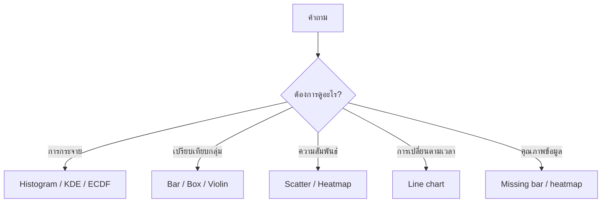

# 1. พื้นฐานและการเลือกกราฟ

Data Visualization มีสองเป้าหมายหลัก:

1. **Exploratory:** สำรวจข้อมูลเพื่อค้นหารูปแบบและปัญหา
2. **Explanatory:** สื่อสารข้อค้นพบให้ผู้อื่นเข้าใจ

กราฟสำหรับสำรวจอาจมีรายละเอียดหลายอย่าง ส่วนกราฟสำหรับนำเสนอควรเน้นคำตอบที่ต้องการสื่อ

## เริ่มจากชนิดข้อมูล

| ชนิดข้อมูล | ตัวอย่าง | กราฟที่มักเหมาะ |
|---|---|---|
| Numeric | อายุ รายได้ ยอดขาย | Histogram, KDE, Box plot |
| Categorical | จังหวัด Segment | Bar chart, Count plot |
| Datetime | วันที่สั่งซื้อ | Line chart |
| Numeric สองตัว | รายได้กับยอดใช้จ่าย | Scatter plot |
| Numeric หลายตัว | Features หลายคอลัมน์ | Pair plot, Correlation heatmap |

## เลือกจากคำถาม



## Grammar of graphics

กราฟประกอบด้วยส่วนสำคัญ:

- **Data:** ตารางที่นำมาแสดง
- **Aesthetics:** การจับคอลัมน์กับแกน สี ขนาด หรือรูปร่าง
- **Geometry:** รูปแบบการแสดง เช่น จุด เส้น หรือแท่ง
- **Scale:** ช่วงตัวเลข หน่วย และสี
- **Facet:** แบ่งกราฟย่อยตามกลุ่ม
- **Annotation:** ชื่อกราฟ ชื่อแกน และข้อความอธิบาย

ตัวอย่าง:

```python
import matplotlib.pyplot as plt
import pandas as pd
import seaborn as sns

sns.set_theme(style="whitegrid")

customers = pd.DataFrame({
    "age": [22, 25, 29, 35, 42, 48, 55, 61],
    "income": [18000, 22000, 30000, 42000, 55000, 65000, 72000, 80000],
    "spending": [5000, 7000, 9000, 15000, 18000, 21000, 17000, 16000],
    "segment": ["A", "A", "A", "B", "B", "B", "C", "C"],
})

sns.scatterplot(
    data=customers,
    x="income",
    y="spending",
    hue="segment",
)
plt.title("Income and spending by segment")
plt.xlabel("Monthly income (THB)")
plt.ylabel("Monthly spending (THB)")
plt.show()
```

## คำถามก่อนสร้างกราฟ

- หนึ่งแถวหมายถึงอะไร?
- คอลัมน์มีชนิดข้อมูลและหน่วยอะไร?
- มีข้อมูลกี่แถว และแต่ละกลุ่มมีกี่แถว?
- มี Missing, Duplicate หรือ Outlier หรือไม่?
- กราฟนี้ใช้สำรวจหรือใช้สื่อสาร?
- ผู้ชมต้องตัดสินใจอะไรจากกราฟ?

## Matplotlib กับ Seaborn

- **Matplotlib** ควบคุมรายละเอียดระดับ Figure, Axes และการส่งออก
- **Seaborn** สร้างกราฟเชิงสถิติจาก DataFrame ได้สะดวก

มักใช้ร่วมกัน: Seaborn วาดข้อมูล และ Matplotlib ตั้งชื่อ แกน ขนาด และบันทึกไฟล์

## Checklist

- เริ่มจากคำถามก่อนเลือกชนิดกราฟ
- ใส่ชื่อแกนและหน่วย
- ระบุช่วงเวลาและจำนวนข้อมูล
- ใช้สีอย่างมีความหมาย
- แยกกราฟเมื่อข้อมูลหลายมิติจนอ่านยาก

---

[สารบัญ](index.md) | [บทถัดไป: Distribution →](02-distribution.md)
