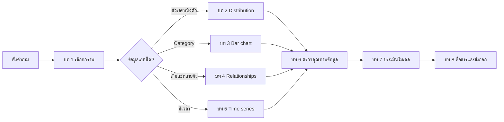

# Data Visualizations สำหรับ Machine Learning

เอกสารชุดนี้ขยายเนื้อหาจาก [บท Data Visualization](../ML/data-visualization.md) โดยเริ่มจากคำถามที่ต้องการตอบ แล้วจึงเลือกกราฟ วิธีอ่าน และข้อจำกัด

## สารบัญ

| บท | เอกสาร | เนื้อหา |
|---:|---|---|
| 1 | [พื้นฐานและการเลือกกราฟ](01-foundations.md) | ชนิดข้อมูล, Grammar of graphics และชุดข้อมูลตัวอย่าง |
| 2 | [Distribution](02-distribution.md) | Histogram, KDE, ECDF, Box plot และ Violin plot |
| 3 | [Category และ Bar Chart](03-category-bar-chart.md) | Count, Aggregate, Error bar และการเรียง Category |
| 4 | [ความสัมพันธ์](04-relationships.md) | Scatter, Regression line, Hexbin, Pair plot และ Heatmap |
| 5 | [ข้อมูลตามเวลา](05-time-series.md) | Line chart, Frequency, Missing periods และ Rolling average |
| 6 | [คุณภาพข้อมูลและ Dataset Shift](06-data-quality-shift.md) | Missing values และ Train/Validation comparison |
| 7 | [กราฟประเมินโมเดล](07-model-evaluation.md) | Regression, Classification, Calibration และ Learning curve |
| 8 | [ออกแบบและส่งออกกราฟ](08-design-export.md) | สี แกน กราฟชวนเข้าใจผิด และการบันทึกไฟล์ |

## เส้นทางการอ่าน

## หลักคิดสำคัญ

- กราฟหนึ่งรูปควรตอบคำถามหลักหนึ่งข้อ
- ตรวจจำนวนข้อมูล Missing values, Outliers และหน่วยก่อนสรุป
- รูปแบบที่เห็นช่วยตั้งสมมติฐาน แต่ไม่ยืนยันเหตุและผล
- เก็บโค้ดและการตั้งค่าเพื่อสร้างกราฟซ้ำได้

---

[กลับไปหลักสูตร Machine Learning](../ML/index.md)
