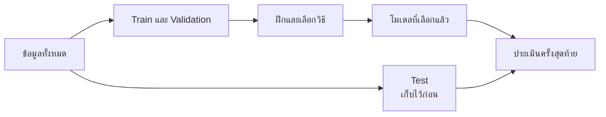

# 2. ทำไมต้องแยกข้อมูลไว้สอบ?


ถ้าให้นักเรียนทำข้อสอบชุดเดิมที่เคยเห็นเฉลย คะแนนสูงอาจเกิดจากการจำ เราจึงต้องมีข้อสอบที่ยังไม่เคยเห็น โมเดลก็เช่นกัน

| ชุดข้อมูล | ใช้ทำอะไร | เปรียบกับการเรียน |
|---|---|---|
| Train | ให้โมเดลเรียนรู้ | แบบฝึกหัดพร้อมเฉลย |
| Validation | เปรียบเทียบวิธีและปรับตัวเลือก | ข้อสอบทดลอง |
| Test | วัดผลหลังเลือกวิธีเสร็จแล้ว | ข้อสอบปลายภาค |

ลำดับคือ **ฝึก → ลองสอบและเลือกวิธี → สอบครั้งสุดท้าย**



ภาพนี้ให้จำว่า Train ใช้ฝึก, Validation ใช้ช่วยเลือก และ Test ถูกเก็บไว้ประเมินหลังเลือกโมเดลเสร็จแล้ว

ถ้าโมเดลทำได้ดีมากกับ Train แต่ทำได้แย่กับข้อมูลใหม่ เราเรียกว่า **Overfitting** หรือเรียนรู้ติดกับตัวอย่างฝึกมากเกินไป

อย่านำผล Test กลับมาปรับโมเดลซ้ำ ๆ เพราะ Test จะเริ่มกลายเป็นข้อมูลที่เราใช้เลือกวิธีด้วย

## ตัวอย่าง Python: แบ่งข้อมูล 60% / 20% / 20%

```python
import numpy as np
from sklearn.model_selection import train_test_split

# สร้างข้อมูลตัวอย่าง 100 แถว
X = np.arange(100).reshape(-1, 1)
y = X.ravel() * 2

# ขั้นที่ 1: เก็บ Test ไว้ 20% เหลือ Train + Validation 80%
X_train_valid, X_test, y_train_valid, y_test = train_test_split(
    X, y, test_size=0.20, random_state=42
)

# ขั้นที่ 2: แบ่ง 25% ของส่วนที่เหลือเป็น Validation
# 25% ของ 80 แถว = 20 แถว จึงได้สัดส่วนรวม 60/20/20
X_train, X_valid, y_train, y_valid = train_test_split(
    X_train_valid,
    y_train_valid,
    test_size=0.25,
    random_state=42,
)

print("Train:", len(X_train))       # 60
print("Validation:", len(X_valid))  # 20
print("Test:", len(X_test))         # 20
```

## `random_state` และ Seed คืออะไร?

การแบ่งข้อมูลใช้การสุ่มเพื่อเลือกว่าจะนำแถวใดไปอยู่ใน Train, Validation หรือ Test ส่วน `random_state` คือ **seed** หรือเลขเริ่มต้นของกระบวนการสุ่ม

```python
SEED = 42
```

เลข `42` ไม่ได้มีความหมายพิเศษ และไม่ได้ทำให้โมเดลแม่นขึ้น จะใช้ `1`, `10` หรือ `123` ก็ได้ ประโยชน์ของ seed คือ เมื่อข้อมูล ลำดับแถว และพารามิเตอร์เหมือนเดิม การใช้ seed เดิมจะทำให้ได้การแบ่งข้อมูลเดิม

```python
from sklearn.model_selection import train_test_split

data = list(range(10))

train_1, valid_1 = train_test_split(
    data,
    test_size=0.2,
    random_state=42,
)

train_2, valid_2 = train_test_split(
    data,
    test_size=0.2,
    random_state=42,
)

print(valid_1)
print(valid_2)
print(valid_1 == valid_2)  # True
```

ถ้าเปลี่ยน seed แถวที่ถูกเลือกอาจเปลี่ยนตามไปด้วย:

```python
random_state=10  # ได้ลำดับการสุ่มอีกชุดหนึ่ง
```

`random_state` ควบคุมเฉพาะคำสั่งที่เราใส่ค่าให้เท่านั้น การกำหนดให้ `train_test_split()` ไม่ได้ทำให้โมเดลหรือ Cross-validation ใช้ seed เดียวกันโดยอัตโนมัติ

แนวทางที่อ่านง่ายคือสร้างตัวแปรกลาง แล้วส่งให้ทุกส่วนที่มีการสุ่ม:

```python
from sklearn.ensemble import RandomForestClassifier
from sklearn.model_selection import KFold, train_test_split

SEED = 42

X_train, X_test, y_train, y_test = train_test_split(
    X,
    y,
    test_size=0.2,
    random_state=SEED,
    stratify=y,
)

cv = KFold(
    n_splits=5,
    shuffle=True,
    random_state=SEED,
)

model = RandomForestClassifier(
    n_estimators=100,
    random_state=SEED,
)
```

ในตัวอย่างนี้ seed ควบคุมคนละเรื่อง:

| ตำแหน่ง                  | สิ่งที่ควบคุม              |
| ------------------------ | -------------------------- |
| `train_test_split`       | แถวใดอยู่ Train หรือ Test  |
| `KFold`                  | แถวใดอยู่ในแต่ละ Fold      |
| `RandomForestClassifier` | การสุ่มภายใน Random Forest |
> [!NOTE]
> โมเดลที่ไม่มีขั้นตอนสุ่ม เช่น `LinearRegression` แบบปกติ ไม่จำเป็นต้องมี `random_state`

> [!WARNING]
> ไม่ควรลองหลาย seed แล้วเลือกเฉพาะ seed ที่ให้คะแนนดีที่สุด เพราะเท่ากับเลือกการแบ่งข้อมูลที่เข้าข้างโมเดล หากต้องการประเมินให้มั่นคงขึ้น ควรใช้ Cross-validation และถ้าเป็นข้อมูลตามเวลา ให้แบ่งตามเวลาแทนการสุ่ม

---

[← บทก่อนหน้า: โมเดลเรียนรู้อะไร?](01-model-learning.md) · [สารบัญ](index.md) · [บทถัดไป: Probability และ Statistics สำหรับ Machine Learning →](03-probability-statistics.md)
