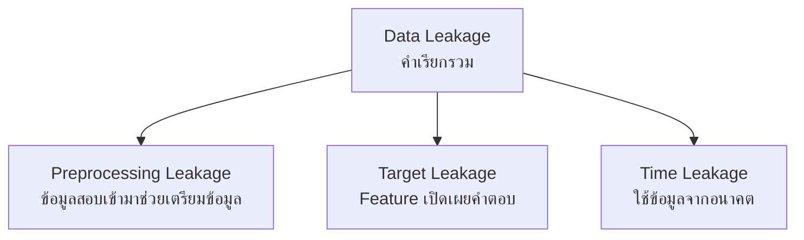
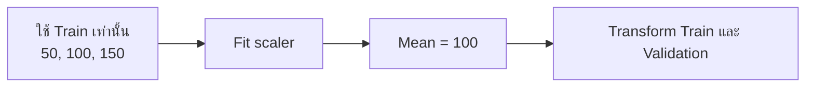
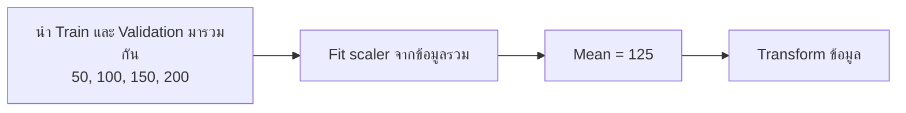
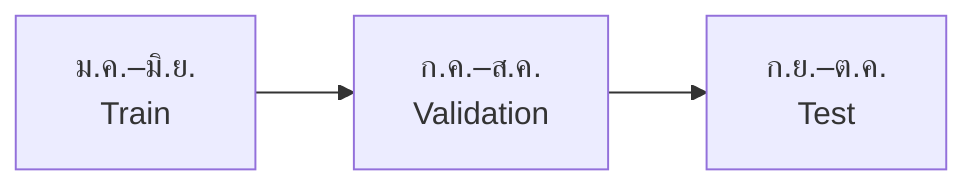

# 12. Data Leakage: ข้อมูลที่ไม่ควรเห็นหลุดเข้ามาช่วยโมเดล

**Data Leakage** คือเหตุการณ์ที่ข้อมูลซึ่งไม่ควรมีอยู่ในขั้นตอนฝึก หลุดเข้ามาช่วยสร้าง Features, เตรียมข้อมูล หรือเลือกโมเดล ทำให้คะแนนประเมินดูดีกว่าความสามารถจริง

Data Leakage เป็นคำเรียกรวมที่ครอบคลุมหลายกรณี:



| ประเภท | คำถามที่ใช้ตรวจ | ตัวอย่าง |
|---|---|---|
| Preprocessing Leakage | ขั้นตอนเตรียมข้อมูลเรียนรู้จาก Validation หรือ Test หรือไม่? | Fit StandardScaler ก่อนแบ่งข้อมูล |
| Target Leakage | Feature เปิดเผย Target หรือเป็นผลจาก Target หรือไม่? | ใช้เหตุผลที่ยกเลิกเพื่อทำนายการยกเลิก |
| Time Leakage | Feature มาจากเวลาหลังจุดที่ต้องทำนายหรือไม่? | ใช้ยอดใช้งานเดือนหน้าเพื่อทำนายเดือนนี้ |

หลายประเภทสามารถเกิดพร้อมกันได้ เช่น `cancel_reason` อาจเปิดเผย Target และเกิดขึ้นหลังเวลาทำนาย จึงเป็นทั้ง Target Leakage และ Time Leakage

## 1. Preprocessing Leakage

สมมติว่าเราจะปรับสเกลพื้นที่บ้านด้วย StandardScaler ซึ่งต้องหาค่าเฉลี่ยจากข้อมูลก่อน

| ชุดข้อมูล | พื้นที่บ้าน |
|---|---|
| Train | 50, 100, 150 |
| Validation | 200 |

ค่าเฉลี่ยที่ควรใช้ต้องมาจาก Train เท่านั้น:

$$
\text{Train mean}=\frac{50+100+150}{3}=100
$$

ถ้าเผลอรวม Validation จะได้:

$$
\text{All-data mean}=\frac{50+100+150+200}{4}=125
$$

ค่า 200 จากชุดสอบเข้ามาเปลี่ยนวิธีเตรียมข้อมูลฝึกแล้ว นี่คือตัวอย่างของ **Data Leakage** ซึ่งทำให้ผลประเมินอาจดูดีเกินจริง แม้เราไม่ได้เอาคำตอบของ Validation มาฝึกโมเดลตรง ๆ

### 1.1 วิธีที่ถูก



### 1.2 วิธีที่ผิด: ข้อมูลรั่ว



ทั้งสองภาพอ่านจากซ้ายไปขวา จุดต่างอยู่ที่ข้อมูลซึ่งถูกส่งเข้า `Fit scaler` วิธีที่ถูกใช้เฉพาะ Train ส่วนวิธีที่ผิดนำ Validation เข้ามาคำนวณด้วย

### 1.3 StandardScaler คิดอย่างไร?

มันถามว่า **ค่านี้ห่างจากค่าเฉลี่ยกี่ส่วนเบี่ยงเบนมาตรฐาน?** ส่วนเบี่ยงเบนมาตรฐานคือค่าที่บอกว่าข้อมูลกระจายห่างจากค่าเฉลี่ยมากเพียงใด

$$
z=\frac{x-\mu}{\sigma}
$$

- $x$ คือค่าที่ต้องการแปลง เช่น พื้นที่บ้าน
- $\mu$ (มิว) คือค่าเฉลี่ยที่คำนวณจาก Train
- $\sigma$ (ซิกมา) คือส่วนเบี่ยงเบนมาตรฐานที่คำนวณจาก Train
- $z$ คือค่าหลังแปลง

สำหรับ Train ในตัวอย่าง เรารู้แล้วว่าค่าเฉลี่ยคือ 100 หาส่วนเบี่ยงเบนมาตรฐานได้ดังนี้:

$$
\sigma=\sqrt{\frac{(50-100)^2+(100-100)^2+(150-100)^2}{3}}
\approx40.82
$$

วิธีอ่าน: ลบแต่ละค่าด้วยค่าเฉลี่ย → ยกกำลังสอง → หาค่าเฉลี่ย → ถอดราก

เมื่อต้องแปลงบ้าน Validation ที่มีพื้นที่ 200 ให้ใช้ค่า 100 และ 40.82 ที่หาไว้จาก Train:

$$
z=\frac{200-100}{40.82}\approx2.45
$$

แปลว่าบ้านหลังนี้มีพื้นที่สูงกว่าค่าเฉลี่ย Train ประมาณ 2.45 ส่วนเบี่ยงเบนมาตรฐาน **ห้ามหาค่าเฉลี่ยใหม่จาก Validation เพื่อมาแทนค่าเดิม**

### 1.4 เชื่อมกับคำสั่งในโค้ด

| คำสั่ง | ความหมายสำหรับ StandardScaler |
|---|---|
| `fit()` | หาค่าเฉลี่ยและส่วนเบี่ยงเบนมาตรฐาน แล้วเก็บไว้ |
| `transform()` | แปลงข้อมูลโดยใช้ค่าที่เก็บไว้ |
| `fit_transform()` | ทำสองขั้นข้างต้นต่อกัน |

```python
import numpy as np
from sklearn.preprocessing import StandardScaler

X_train = np.array([[50.0], [100.0], [150.0]])
X_valid = np.array([[200.0]])

scaler = StandardScaler()
scaler.fit(X_train)                 # เรียนรู้สถิติจาก Train เท่านั้น
X_train_scaled = scaler.transform(X_train)
X_valid_scaled = scaler.transform(X_valid)  # ใช้สถิติเดิม

print("Mean จาก Train:", scaler.mean_[0])      # 100
print("Validation หลังแปลง:", X_valid_scaled[0, 0])  # ประมาณ 2.45
```

**จำก่อน:** Train ใช้เรียนรู้วิธีแปลง ส่วน Validation และ Test ใช้วิธีที่เรียนรู้ไว้แล้ว

## 2. Target Leakage: โมเดลแอบเห็นคำตอบ

สมมติว่าเราต้องการทำนายว่า **ลูกค้าจะยกเลิกบริการภายใน 30 วันหรือไม่** เพื่อให้ทีมดูแลลูกค้าติดต่อไปก่อน

เราต้องกำหนดเวลาให้ชัดเจน:


หลักสำคัญคือ โมเดลใช้ข้อมูลทางซ้ายของ “วันนี้” เพื่อทำนายสิ่งที่จะเกิดทางขวาเท่านั้น

เขียนแบบสั้นได้ว่า:

$$
X=\text{ข้อมูลที่รู้ก่อนเวลาทำนาย}
$$

$$
y=\begin{cases}
1 & \text{ถ้าลูกค้ายกเลิกภายใน 30 วัน} \\
0 & \text{ถ้าไม่ยกเลิก}
\end{cases}
$$

### 2.1 ตัวอย่าง Feature ที่ใช้ได้และใช้ไม่ได้

| Feature | ใช้ได้ไหม? | เหตุผล |
|---|---|---|
| อายุการเป็นลูกค้าจนถึงวันนี้ | ได้ | มีข้อมูลแล้วตอนทำนาย |
| จำนวนครั้งที่ใช้งานใน 30 วันที่ผ่านมา | ได้ | เป็นข้อมูลจากอดีต |
| ยอดค้างชำระ ณ วันนี้ | ได้ | รู้ก่อนเกิดเหตุการณ์ |
| วันที่ปิดบัญชี | ไม่ได้ | มักเกิดหลังรู้แล้วว่าลูกค้ายกเลิก |
| เหตุผลที่ยกเลิก | ไม่ได้ | เป็นข้อมูลที่เกิดพร้อมหรือหลังคำตอบ |
| เงินคืนหลังยกเลิก | ไม่ได้ | เป็นผลจากการยกเลิก |

ถ้าใส่ `cancel_reason` เข้าโมเดล โมเดลอาจทำคะแนนเกือบสมบูรณ์ เพราะคนที่มีเหตุผลยกเลิกก็คือคนที่ยกเลิกแล้ว แต่ตอนที่เราต้องการทำนายจริง ข้อมูลนี้ยังไม่มี จึงนำไปใช้ไม่ได้


วิธีตรวจที่ง่ายที่สุดคือถามทุก Feature ว่า:

> ณ วินาทีที่ต้องกดปุ่มทำนาย เรารู้ค่านี้แล้วจริงหรือไม่?

ถ้าคำตอบคือ “ยังไม่รู้” หรือ “รู้หลังเกิดเหตุการณ์” ให้ตัด Feature นั้นออก

### 2.2 ตัวอย่าง Python: เลือกเฉพาะ Feature ที่รู้ตอนทำนาย

```python
import pandas as pd

customers = pd.DataFrame({
    "tenure_months": [3, 24, 10],
    "usage_last_30_days": [2, 18, 6],
    "overdue_amount": [900, 0, 200],
    "cancel_reason": ["ราคาแพง", None, None],       # เกิดหลังรู้คำตอบ
    "refund_after_cancel": [500, 0, 0],              # เกิดหลังยกเลิก
    "churn_next_30_days": [1, 0, 0],                 # Target
})

# ระบุรายการอย่างชัดเจน แทนการหยิบทุกคอลัมน์มาเป็น Feature
safe_features = [
    "tenure_months",
    "usage_last_30_days",
    "overdue_amount",
]

X = customers[safe_features]
y = customers["churn_next_30_days"]

print("Features ที่ใช้:", X.columns.tolist())
print("Target:", y.tolist())
```

การเขียน `safe_features` ไว้ชัดเจนช่วยให้ตรวจสอบได้ง่ายกว่า `drop()` เพียงไม่กี่คอลัมน์ เพราะคอลัมน์ใหม่ที่เพิ่มภายหลังจะยังไม่ถูกใช้โดยอัตโนมัติ

## 3. Time Leakage: ข้อมูลจากอนาคตย้อนกลับมาช่วย

Time Leakage เกิดเมื่อข้อมูลที่อยู่หลังเวลาทำนายย้อนเข้ามาช่วยสร้าง Feature หรือเลือกโมเดล

ตัวอย่าง เราทำนายวันที่ 1 ตุลาคมว่าลูกค้าจะยกเลิกในเดือนตุลาคม:

- ใช้ยอดใช้งานเดือนกันยายนได้ เพราะเป็นอดีต
- ใช้ยอดใช้งานวันที่ 15 ตุลาคมไม่ได้ เพราะเป็นอนาคตเมื่อเทียบกับวันที่ทำนาย
- ใช้จำนวนการติดต่อหลังวันที่ยกเลิกไม่ได้ เพราะเหตุการณ์เกิดไปแล้ว


อ่านจากซ้ายไปขวา ข้อมูลเดือนตุลาคมมีไว้ตรวจคำตอบ จึงต้องไม่นำกลับมาเป็น Feature ของการทำนายในวันที่ 1 ตุลาคม

### 3.1 ทำไมการสุ่มแบ่งข้อมูลอาจผิดกับข้อมูลตามเวลา?

สมมติมีข้อมูลตั้งแต่เดือนมกราคมถึงตุลาคม ถ้าสุ่มแถวทั้งหมด เดือนตุลาคมบางแถวอาจเข้า Train ขณะที่เดือนกุมภาพันธ์บางแถวอยู่ Validation เท่ากับโมเดลได้เรียนจากอนาคตแล้วไปสอบกับอดีต

สำหรับงานที่เวลาเป็นส่วนสำคัญ ควรแบ่งตามลำดับเวลา:



ทุกลูกศรเดินจากอดีตไปอนาคต วิธีนี้ใกล้กับการใช้งานจริง คือใช้ข้อมูลเก่าฝึกแล้วทำนายช่วงที่ใหม่กว่า

### 3.2 ตัวอย่าง Python: แบ่งข้อมูลตามเวลา

```python
import pandas as pd

# ข้อมูลตัวอย่างหนึ่งแถวต่อหนึ่งเดือน
df = pd.DataFrame({
    "snapshot_date": pd.date_range("2025-01-01", periods=10, freq="MS"),
    "usage_last_30_days": [12, 10, 11, 9, 8, 7, 6, 5, 4, 3],
    "overdue_amount": [0, 0, 100, 0, 200, 0, 300, 100, 400, 500],
    "churn_next_30_days": [0, 0, 0, 0, 0, 0, 1, 0, 1, 1],
})

# เรียงข้อมูลตามเวลาก่อนเสมอ
df = df.sort_values("snapshot_date")

train = df[df["snapshot_date"] < "2025-07-01"]
valid = df[
    (df["snapshot_date"] >= "2025-07-01")
    & (df["snapshot_date"] < "2025-09-01")
]
test = df[df["snapshot_date"] >= "2025-09-01"]

feature_columns = ["usage_last_30_days", "overdue_amount"]

X_train = train[feature_columns]
y_train = train["churn_next_30_days"]

X_valid = valid[feature_columns]
y_valid = valid["churn_next_30_days"]

X_test = test[feature_columns]
y_test = test["churn_next_30_days"]

print("Train dates:", train["snapshot_date"].min(), "ถึง", train["snapshot_date"].max())
print("Validation dates:", valid["snapshot_date"].min(), "ถึง", valid["snapshot_date"].max())
print("Test dates:", test["snapshot_date"].min(), "ถึง", test["snapshot_date"].max())
```

วันที่ในตัวอย่างมีไว้แสดงวิธีแบ่ง ต้องเลือกวันให้ตรงกับช่วงข้อมูลจริง หากลูกค้าคนเดียวมีหลายแถว ต้องตรวจเพิ่มเติมว่าแถวของลูกค้าคนเดียวกันรั่วข้ามชุดหรือไม่ และ Feature ทุกตัวต้องคำนวณจากข้อมูลก่อน `snapshot_date` ของแถวนั้น

## 4. Checklist ตรวจ Data Leakage ก่อน Train

1. เขียนก่อนว่า **ทำนายอะไร** และ **ทำนาย ณ เวลาใด**
2. กำหนดช่วงอดีตที่ใช้สร้าง Features
3. กำหนดช่วงอนาคตที่ใช้สร้าง Target
4. ตรวจ Feature ทีละตัวว่ามีอยู่แล้ว ณ เวลาทำนายหรือไม่
5. แบ่งข้อมูลตามเวลาเมื่อการใช้งานจริงต้องทำนายอนาคต
6. Fit preprocessing ด้วย Train เท่านั้น
7. ใส่ preprocessing ใน Pipeline เพื่อป้องกันการรั่วระหว่าง Cross-validation folds
8. เก็บ Test ไว้ประเมินเพียงหลังเลือกโมเดลเสร็จแล้ว

### 4.1 ตัวอย่าง Python: ทำบัญชี Feature ก่อนสร้างโมเดล

```python
import pandas as pd

feature_catalog = pd.DataFrame({
    "feature": [
        "usage_last_30_days",
        "overdue_amount",
        "cancel_reason",
        "refund_after_cancel",
    ],
    "known_at_prediction_time": [True, True, False, False],
    "uses_target_or_result": [False, False, True, True],
})

unsafe = feature_catalog[
    (~feature_catalog["known_at_prediction_time"])
    | feature_catalog["uses_target_or_result"]
]

print("Feature ที่ต้องตรวจหรือตัดออก:")
print(unsafe["feature"].tolist())
```

ในโปรเจกต์จริงควรเพิ่มคอลัมน์บอกแหล่งข้อมูล เจ้าของข้อมูล และเวลาที่ Feature พร้อมใช้งาน เพื่อให้ทีมตรวจย้อนหลังได้

## 5. แบบฝึกหัดทบทวน Data Leakage

โจทย์: วันที่ 1 ตุลาคม เราต้องการทำนายว่าลูกค้าจะยกเลิกภายใน 30 วัน Feature ใดเสี่ยงรั่ว?

1. จำนวนครั้งที่ใช้งานในเดือนกันยายน
2. แพ็กเกจที่ใช้ ณ วันที่ 1 ตุลาคม
3. เหตุผลที่ยกเลิกซึ่งบันทึกวันที่ 20 ตุลาคม
4. จำนวนครั้งที่ใช้งานตั้งแต่วันที่ 1–15 ตุลาคม
5. ยอดค้างชำระ ณ วันที่ 30 กันยายน

### 5.1 เฉลยพร้อมเหตุผล

- ข้อ 1 ใช้ได้ เพราะเป็นข้อมูลก่อนเวลาทำนาย
- ข้อ 2 ใช้ได้ เพราะรู้ค่าแล้วในเวลาทำนาย
- ข้อ 3 เป็นทั้ง Target Leakage และ Time Leakage เพราะเปิดเผยคำตอบและเกิดในอนาคต
- ข้อ 4 เป็น Time Leakage เพราะใช้ข้อมูลหลังวันที่ 1 ตุลาคม
- ข้อ 5 ใช้ได้ เพราะเกิดก่อนเวลาทำนาย

ถ้าจำได้เพียงประโยคเดียว ให้จำว่า **โมเดลต้องเห็นเฉพาะข้อมูลที่เราจะมีอยู่จริง ณ เวลาที่ใช้งาน**

### 5.2 แบบฝึกเขียนโค้ด

ลองเติมชื่อคอลัมน์ที่ปลอดภัยลงใน `safe_features` ก่อนดูเฉลยด้านล่าง:

```python
columns = [
    "usage_in_september",
    "plan_on_october_1",
    "cancel_reason_on_october_20",
    "usage_october_1_to_15",
    "overdue_on_september_30",
]

safe_features = [
    # เติมชื่อ Feature ที่รู้แล้ว ณ วันที่ 1 ตุลาคม
]

print(safe_features)
```

เฉลย:

```python
safe_features = [
    "usage_in_september",
    "plan_on_october_1",
    "overdue_on_september_30",
]
```

---

[← บทก่อนหน้า: Cross-validation คือการลองสอบหลายรอบ](11-cross-validation.md) · [สารบัญ](index.md) · [บทถัดไป: Pipeline ช่วยทำขั้นตอนให้ถูกลำดับ →](13-pipeline.md)
