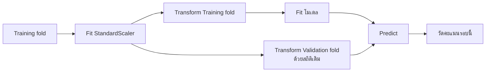

# 13. Pipeline ช่วยทำขั้นตอนให้ถูกลำดับ


ถ้าต้องแปลงข้อมูลก่อนฝึกโมเดล เราสามารถต่อสองขั้นตอนเข้าด้วยกัน เรียกว่า **Pipeline**:

**ข้อมูล → ปรับสเกล → โมเดล → คำทำนาย**

```python
from sklearn.pipeline import Pipeline
from sklearn.preprocessing import StandardScaler
from sklearn.linear_model import Ridge

pipeline = Pipeline([
    ("scaler", StandardScaler()),
    ("model", Ridge()),
])
```

`Ridge` เป็นโมเดลทำนายตัวเลขที่คล้าย Linear Regression แต่เพิ่มการควบคุมไม่ให้ weights ใหญ่เกินไป ตอนนี้ให้เข้าใจหน้าที่ของมันก่อน ยังไม่ต้องจำสมการ

เมื่อเรียก `pipeline.fit()` จะเรียนรู้สถิติสำหรับแปลงข้อมูล แล้วฝึกโมเดล เมื่อเรียก `pipeline.predict()` จะใช้สถิติเดิมแปลงข้อมูลใหม่ก่อนทำนาย

## ทำไมต้องส่งทั้ง Pipeline เข้า Cross-validation?

ย้อนกลับไป 3-fold CV ในแต่ละรอบ ส่วนที่ใช้ฝึกกับส่วนที่ใช้สอบเปลี่ยนไป ดังนั้น **แต่ละรอบต้องหาสถิติจากส่วนฝึกของตัวเอง**

หาก fit scaler จากข้อมูลฝึกทั้งหมดก่อนเริ่ม CV ข้อมูลที่จะเป็น Validation fold ก็เข้ามามีส่วนกำหนดสถิติแล้ว

การส่ง Pipeline เข้า CV ทำให้แต่ละรอบทำตามลำดับนี้:

1. หาสถิติจาก Training fold
2. แปลง Training fold แล้วฝึกโมเดล
3. ใช้สถิติจากข้อ 1 แปลง Validation fold
4. ทำนายและวัดผลบน Validation fold



ขั้นตอนนี้เกิดใหม่ทุก fold จึงไม่มี Validation fold ใดช่วยกำหนดค่าเฉลี่ยหรือส่วนเบี่ยงเบนมาตรฐานของรอบตัวเอง

## ตัวอย่าง Python แบบครบกระบวนการ

อ่านความหมายของแต่ละช่วงจากคอมเมนต์ ไม่จำเป็นต้องจำชื่อคำสั่งทั้งหมด

```python
from sklearn.datasets import make_regression
from sklearn.model_selection import train_test_split, KFold, GridSearchCV
from sklearn.pipeline import Pipeline
from sklearn.preprocessing import StandardScaler
from sklearn.linear_model import Ridge
from sklearn.metrics import mean_squared_error

# 1. สร้างข้อมูลตัวอย่าง: X คือข้อมูลเข้า y คือคำตอบจริง
X, y = make_regression(
    n_samples=300, n_features=3, noise=20, random_state=42
)

# 2. เก็บ Test ไว้ 20% สำหรับประเมินตอนจบ
X_train, X_test, y_train, y_test = train_test_split(
    X, y, test_size=0.2, random_state=42
)

# 3. รวมการปรับสเกลกับโมเดล
pipeline = Pipeline([
    ("scaler", StandardScaler()),
    ("model", Ridge()),
])

# 4. ลอง alpha 3 ค่า แต่ละค่าใช้ CV 3 รอบ
# alpha ควบคุมแรงกดให้ weights มีขนาดเล็กลง
search = GridSearchCV(
    pipeline,
    param_grid={"model__alpha": [0.1, 1, 10]},
    cv=KFold(n_splits=3, shuffle=True, random_state=42),
    scoring="neg_mean_squared_error",
    refit=True,
)
search.fit(X_train, y_train)

# 5. หลังเลือกค่าจาก CV และ refit แล้ว จึงประเมิน Test
predictions = search.predict(X_test)
test_mse = mean_squared_error(y_test, predictions)
print("ค่าที่เลือก:", search.best_params_)
print("Test RMSE:", test_mse ** 0.5)
```

จุดที่ควรเชื่อมโยงให้ได้:

- `model__alpha` คือค่า `alpha` ของขั้นตอนที่ตั้งชื่อว่า `model`
- ลอง 3 ค่า × 3 folds = 9 CV fits แล้ว refit อีก 1 ครั้ง รวม 10 fits
- `neg_mean_squared_error` คือ MSE ที่ใส่เครื่องหมายลบ เพราะระบบค้นหาเลือกคะแนนที่มากกว่า ค่าลบที่ใกล้ศูนย์จึงดีกว่า
- Test ไม่ได้มีส่วนในการเลือก `alpha`

Pipeline ช่วยจัดการการแปลงข้อมูลภายใน CV แต่ยังต้องตรวจว่าข้อมูลเข้าไม่มีข้อมูลอนาคต และแบ่งข้อมูลให้เหมาะกับงาน เช่น ข้อมูลตามเวลา

---

[← บทก่อนหน้า: Data Leakage: ข้อมูลที่ไม่ควรเห็นหลุดเข้ามาช่วยโมเดล](12-data-leakage.md) · [สารบัญ](index.md) · [บทถัดไป: เตรียมข้อมูลจริง: Missing Values และ Category →](14-preprocessing-real-data.md)
