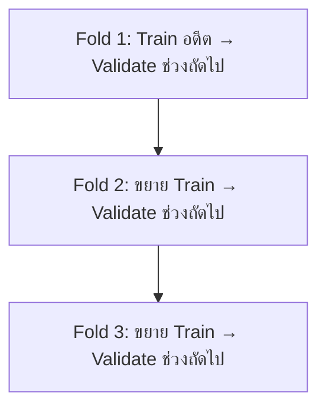

# 26. Time Series และ Forecasting

Time Series คือข้อมูลที่มีลำดับเวลา เช่นยอดขายรายวัน ราคา หรือค่าจาก Sensor การแบ่งข้อมูลต้องรักษาลำดับเวลาเพื่อจำลองการทำนายอนาคต

## ส่วนประกอบ

- Trend: แนวโน้มระยะยาว
- Seasonality: รูปแบบที่เกิดซ้ำ
- Cycle: การขึ้นลงที่ช่วงไม่แน่นอน
- Noise: ความผันผวนที่อธิบายไม่ได้

## แบ่งข้อมูลตามเวลา

```text
อดีต                           อนาคต
|--------- Train ---------|--- Validation ---|--- Test ---|
```

ห้าม Shuffle ก่อนแบ่ง เพราะข้อมูลอนาคตจะหลุดเข้า Train

```python
train = df[df["date"] < "2025-01-01"]
valid = df[(df["date"] >= "2025-01-01") & (df["date"] < "2025-04-01")]
test = df[df["date"] >= "2025-04-01"]
```

## Baseline

Naive forecast:

$$
\hat{y}_t=y_{t-1}
$$

Seasonal naive:

$$
\hat{y}_t=y_{t-s}
$$

$s=7$ อาจหมายถึงใช้วันเดียวกันของสัปดาห์ก่อนสำหรับข้อมูลรายวัน

## Lag และ Rolling Features

```python
df = df.sort_values("date")
df["lag_1"] = df["sales"].shift(1)
df["lag_7"] = df["sales"].shift(7)
df["rolling_mean_7"] = df["sales"].shift(1).rolling(7).mean()
```

ต้อง `shift(1)` ก่อน Rolling เพื่อไม่ให้ Target ของเวลาปัจจุบันเข้า Feature ของแถวเดียวกัน

## Time-series Cross-validation



```python
from sklearn.model_selection import TimeSeriesSplit

splitter = TimeSeriesSplit(n_splits=5)
for train_index, valid_index in splitter.split(X):
    X_train, X_valid = X.iloc[train_index], X.iloc[valid_index]
```

## Metrics

ใช้ MAE หรือ RMSE ตามต้นทุนของความผิดพลาด MAPE มีปัญหาเมื่อค่าจริงเป็นศูนย์หรือใกล้ศูนย์ ควรเปรียบเทียบกับ Naive baseline เสมอ

## Time Leakage

- ใช้ยอดขายปลายวันทำนายเหตุการณ์ตอนเช้า
- Rolling window รวมค่าปัจจุบันหรืออนาคต
- เติม Missing ด้วยข้อมูลจากอนาคต
- สุ่มแบ่งแถวที่อยู่ติดกันไปคนละชุด
- Features ที่ระบบจริงยังไม่ทราบ ณ เวลาทำนาย

## Checklist

- เรียงและตรวจ Timestamp, Time zone และความถี่
- กำหนด Forecast horizon
- สร้าง Naive และ Seasonal baseline
- แบ่งข้อมูลตามเวลา
- สร้าง Lag/Rolling จากอดีตเท่านั้น
- ใช้ Backtesting หลายช่วง
- ติดตาม Drift และ Retraining schedule

## แหล่งอ้างอิง

- [scikit-learn: TimeSeriesSplit](https://scikit-learn.org/stable/modules/generated/sklearn.model_selection.TimeSeriesSplit.html)
- [Forecasting: Principles and Practice](https://otexts.com/fpp3/)

---

[← บทก่อนหน้า: อธิบายผลโมเดล](25-model-explainability.md) · [สารบัญ](index.md) · [บทถัดไป: นำโมเดลไปใช้งานจริงและติดตามผล →](27-production-monitoring.md)
