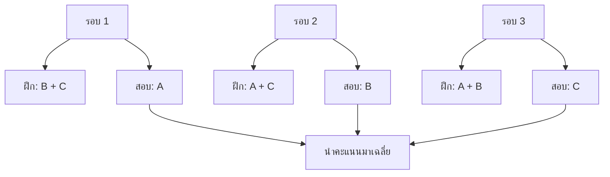

# 15. Cross-validation คือการลองสอบหลายรอบ

การลองสอบด้วยข้อมูลส่วนเดียวอาจได้ผลดีหรือแย่เพราะบังเอิญเลือกข้อสอบชุดนั้น เราจึงแบ่งข้อมูลฝึกเป็นส่วน ๆ แล้วสลับส่วนที่ใช้สอบ

> [!NOTE]
> **Fold** คือส่วนย่อยหนึ่งส่วนของข้อมูลที่ใช้ใน Cross-validation ส่วน `n_splits` คือจำนวน Folds ที่ต้องการแบ่ง

สมมติมีข้อมูล 100 แถว และกำหนด `n_splits=5` ข้อมูลจะถูกแบ่งเป็น 5 ส่วน ส่วนละประมาณ 20 แถว ในแต่ละรอบจะใช้ 1 Fold เป็น Validation และใช้ 4 Folds ที่เหลือเป็น Train

ตัวอย่าง **3-fold cross-validation** แบ่งข้อมูลเป็น 3 ส่วน คือ A, B และ C:

| รอบ | ใช้ฝึก | ใช้สอบ |
|---|---|---|
| 1 | B + C | A |
| 2 | A + C | B |
| 3 | A + B | C |



แต่ละรอบฝึกโมเดลใหม่ และใช้ส่วนสอบของรอบนั้นวัดผล คำว่า **fold** หมายถึงส่วนข้อมูลที่แบ่งไว้

ทุกแถวจึงถูกใช้เป็น Validation หนึ่งครั้ง และเป็น Train อีก $K-1$ ครั้ง เมื่อใช้ $K$ Folds

ถ้าได้ Accuracy ของแต่ละรอบเป็น 80%, 85% และ 75% คะแนนเฉลี่ยคือ:

$$
\text{Average score}=\frac{80+85+75}{3}=80\%
$$

ส่วนที่ใช้สอบในแต่ละรอบเรียกว่า **Validation fold** เราสลับกันเฉพาะภายในข้อมูลสำหรับฝึกและเลือกโมเดล ส่วน Test สุดท้ายยังเก็บแยกไว้

## `n_splits` มีผลอย่างไร?

ถ้ามีข้อมูล $N$ แถวและแบ่งเป็น $K$ Folds แต่ละ Validation fold จะมีข้อมูลประมาณ:

$$
\text{Validation rows per fold}\approx\frac{N}{K}
$$

ตัวอย่างข้อมูล 1,000 แถว:

| จำนวน Folds | Validation ต่อรอบ | Train ต่อรอบ | จำนวนรอบที่ฝึก |
|---:|---:|---:|---:|
| 2 | 500 | 500 | 2 |
| 5 | 200 | 800 | 5 |
| 10 | 100 | 900 | 10 |

เมื่อเพิ่มจำนวน Folds แต่ละรอบจะมีข้อมูล Train มากขึ้น แต่ต้องฝึกโมเดลหลายรอบขึ้นและใช้เวลามากขึ้น

## ตัวอย่าง Python: ดูแถวของแต่ละ Fold

```python
import numpy as np
from sklearn.model_selection import KFold

X = np.arange(10)

cv = KFold(
    n_splits=5,
    shuffle=True,
    random_state=42,
)

for round_number, (train_index, valid_index) in enumerate(
    cv.split(X),
    start=1,
):
    print("รอบ:", round_number)
    print("Train indexes:", train_index)
    print("Validation indexes:", valid_index)
    print()
```

- `n_splits=5` แบ่งข้อมูลเป็น 5 Folds
- `shuffle=True` สับลำดับแถวก่อนแบ่ง
- `random_state=42` ทำให้การสับได้ผลเดิมเมื่อรันซ้ำ

## ตัวอย่าง Python: ดูคะแนนของแต่ละ Fold

```python
import numpy as np
from sklearn.datasets import make_regression
from sklearn.linear_model import LinearRegression
from sklearn.model_selection import KFold, cross_val_score

X, y = make_regression(
    n_samples=120,
    n_features=3,
    noise=15,
    random_state=42,
)

model = LinearRegression()
cv = KFold(n_splits=3, shuffle=True, random_state=42)

# sklearn คืนค่า MSE ติดลบ เพราะระบบเลือกคะแนนที่มีค่ามากกว่า
negative_mse_scores = cross_val_score(
    model,
    X,
    y,
    cv=cv,
    scoring="neg_mean_squared_error",
)

rmse_each_fold = np.sqrt(-negative_mse_scores)
print("RMSE แต่ละ Fold:", rmse_each_fold)
print("RMSE เฉลี่ย:", rmse_each_fold.mean())
```

ค่าที่พิมพ์ออกมาอาจต่างกันระหว่าง folds เป็นเรื่องปกติ หากต่างกันมาก ควรตรวจจำนวนข้อมูล การแบ่งข้อมูล และความสม่ำเสมอของข้อมูลแต่ละส่วน

## ควรเลือกกี่ Folds?

แนวทางเริ่มต้น:

| ค่า | เหมาะกับสถานการณ์ |
|---:|---|
| 3 | ข้อมูลเยอะหรือโมเดลใช้เวลาฝึกนาน |
| 5 | จุดเริ่มต้นที่สมดุลและนิยมใช้ |
| 10 | ข้อมูลไม่ใหญ่มากและโมเดลฝึกได้เร็ว |

จำนวน Folds ต้องไม่มากกว่าจำนวนตัวอย่าง และควรมีตัวอย่างในแต่ละ Validation fold มากพอให้คะแนนน่าเชื่อถือ

## Classification ใช้ `StratifiedKFold`

ถ้า Target เป็นคลาส ควรรักษาสัดส่วนของแต่ละคลาสไว้ในแต่ละ Fold เช่น มีลูกค้ายกเลิกเพียง 10% ก็ควรให้แต่ละ Fold มีผู้ยกเลิกใกล้เคียง 10%

```python
from sklearn.model_selection import StratifiedKFold

cv = StratifiedKFold(
    n_splits=5,
    shuffle=True,
    random_state=42,
)
```

จำนวน Folds ต้องไม่มากกว่าจำนวนตัวอย่างของคลาสที่มีน้อยที่สุด เช่น ถ้ามีผู้ยกเลิกเพียง 4 คน การใช้ 5 Folds จะทำให้บาง Fold ไม่มีตัวอย่างคลาสนี้เพียงพอ

## ข้อมูลตามเวลาใช้ `TimeSeriesSplit`

ข้อมูลที่มีลำดับเวลาไม่ควรถูกสับ เพราะข้อมูลอนาคตอาจรั่วเข้าไปใน Train ให้แบ่งจากอดีตไปหาอนาคตแทน:

```python
from sklearn.model_selection import TimeSeriesSplit

cv = TimeSeriesSplit(n_splits=5)
```

ตัวอย่างลำดับการแบ่ง:

```text
รอบ 1: Train [ม.ค.]             → Validation [ก.พ.]
รอบ 2: Train [ม.ค.–ก.พ.]        → Validation [มี.ค.]
รอบ 3: Train [ม.ค.–มี.ค.]       → Validation [เม.ย.]
```

## จำนวน Folds กับจำนวน Fits

หนึ่งชุด Hyperparameters ต้องถูกฝึกหนึ่งครั้งต่อหนึ่ง Fold ถ้าลอง 6 ชุดและใช้ 5 Folds:

$$
\text{CV fits}=6\times5=30
$$

ถ้า `refit=True` ระบบจะนำชุดที่ดีที่สุดไปฝึกบนข้อมูล Train ทั้งหมดอีกหนึ่งครั้ง:

$$
\text{Total fits}=30+1=31
$$

ดังนั้นการเพิ่ม Folds ทำให้จำนวนครั้งที่ฝึกและเวลาที่ใช้เพิ่มขึ้นโดยตรง

---

[← บทก่อนหน้า: Underfitting และ Overfitting](underfitting-overfitting.md) | [สารบัญ](index.md) | [บทถัดไป: Data Leakage: ข้อมูลที่ไม่ควรเห็นหลุดเข้ามาช่วยโมเดล →](data-leakage.md)
