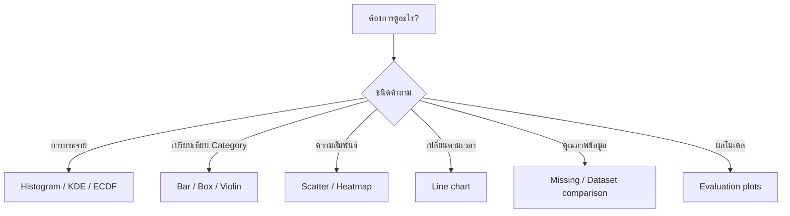

# 5. Data Visualization

Data Visualization คือการใช้กราฟเพื่อสำรวจและสื่อสารข้อมูล ให้เริ่มจากคำถามแล้วเลือกกราฟที่เหมาะสม

คำอธิบายเชิงลึกอยู่ที่ [ชุดบทเรียน Data Visualizations](../DATA-VISUALIZATIONS/index.md)

## เตรียมข้อมูลตัวอย่าง

```python
import matplotlib.pyplot as plt
import pandas as pd
import seaborn as sns

sns.set_theme(style="whitegrid")

customers = pd.DataFrame({
    "age": [22, 25, 29, 35, 42, 48, 55, 61],
    "income": [18000, 22000, 30000, 42000, 55000, 65000, 72000, 80000],
    "spending": [5000, 7000, 9000, 15000, 18000, 21000, 17000, 16000],
    "segment": ["A", "A", "A", "B", "B", "B", "C", "C"],
})
```

## มีกราฟอะไรบ้าง และใช้เมื่อไร?

| ต้องการดู | กราฟที่ใช้ | ตัวอย่างคำถาม |
|---|---|---|
| การกระจายของตัวเลข | Histogram, KDE, ECDF | รายได้ส่วนใหญ่อยู่ช่วงใด? |
| ค่ากลางและ Outliers | Box plot, Violin plot | แต่ละกลุ่มใช้จ่ายต่างกันอย่างไร? |
| จำนวนหรือค่าของ Category | Bar chart | Segment ใดมีลูกค้ามากที่สุด? |
| ความสัมพันธ์ของตัวเลขสองตัว | Scatter plot | รายได้สัมพันธ์กับยอดใช้จ่ายหรือไม่? |
| ความสัมพันธ์หลาย Features | Pair plot, Correlation heatmap | Feature ใดสัมพันธ์กันมาก? |
| การเปลี่ยนตามเวลา | Line chart | ยอดขายเพิ่มหรือลดตามเวลา? |
| ตำแหน่งที่ข้อมูลหาย | Missing bar, Missing heatmap | คอลัมน์ใดมี Missing มาก? |
| เปรียบเทียบชุดข้อมูล | Histogram, KDE, ECDF แยกสี | Train กับ Validation ต่างกันหรือไม่? |
| ประเมินโมเดล Regression | Actual vs Predicted, Residual plot | โมเดลพลาดในช่วงใด? |
| ประเมินโมเดล Classification | Confusion matrix, ROC, PR curve | โมเดลแยก Class ได้ดีแค่ไหน? |

## 1. Histogram

ใช้ดูการกระจายของตัวแปรตัวเลข

```python
sns.histplot(data=customers, x="income", bins=6)
plt.show()
```

อ่านเพิ่ม: [Distribution](../DATA-VISUALIZATIONS/02-distribution.md)

## 2. KDE และ ECDF

KDE แสดงการกระจายแบบเส้นต่อเนื่อง ส่วน ECDF แสดงสัดส่วนสะสม

```python
sns.kdeplot(data=customers, x="income", fill=True)
plt.show()

sns.ecdfplot(data=customers, x="income")
plt.show()
```

## 3. Bar chart

ใช้เปรียบเทียบจำนวนหรือค่าระหว่าง Category

```python
segment_counts = customers["segment"].value_counts().sort_values()
segment_counts.plot(kind="barh")
plt.xlabel("Number of customers")
plt.show()
```

อ่านเพิ่ม: [Category และ Bar Chart](../DATA-VISUALIZATIONS/03-category-bar-chart.md)

## 4. Scatter plot

ใช้ดูความสัมพันธ์ของตัวแปรตัวเลขสองตัว รวมถึงกลุ่มและ Outliers

```python
sns.scatterplot(
    data=customers,
    x="income",
    y="spending",
    hue="segment",
)
plt.show()
```

อ่านเพิ่ม: [ความสัมพันธ์ระหว่างตัวแปร](../DATA-VISUALIZATIONS/04-relationships.md)

## 5. Box plot และ Violin plot

ใช้เปรียบเทียบการกระจายของตัวเลขระหว่างหลายกลุ่ม

```python
sns.boxplot(data=customers, x="segment", y="spending")
plt.show()

sns.violinplot(data=customers, x="segment", y="spending")
plt.show()
```

## 6. Line chart

ใช้แสดงค่าที่เปลี่ยนตามเวลา ต้องแปลงวันที่และเรียงเวลาก่อนวาด

```python
sales = pd.DataFrame({
    "date": pd.date_range("2026-01-01", periods=7, freq="D"),
    "sales": [100, 120, 115, 140, 135, 160, 155],
})

sns.lineplot(
    data=sales.sort_values("date"),
    x="date",
    y="sales",
    marker="o",
)
plt.xticks(rotation=45)
plt.tight_layout()
plt.show()
```

อ่านเพิ่ม: [ข้อมูลตามเวลา](../DATA-VISUALIZATIONS/05-time-series.md)

## 7. Correlation heatmap

ใช้ดูค่าสหสัมพันธ์ระหว่าง Features ตัวเลขหลายตัว

```python
correlation = customers.select_dtypes(include="number").corr()

sns.heatmap(
    correlation,
    annot=True,
    fmt=".2f",
    cmap="coolwarm",
    center=0,
    vmin=-1,
    vmax=1,
)
plt.show()
```

Correlation ไม่ได้ยืนยันว่า Feature หนึ่งเป็นสาเหตุของอีก Feature

## 8. Missing-value chart

ใช้ดูว่าคอลัมน์ใดมีข้อมูลหายมาก

```python
missing_percent = customers.isna().mean().mul(100)
missing_percent = missing_percent[missing_percent > 0].sort_values()

missing_percent.plot(kind="barh")
plt.xlabel("Missing values (%)")
plt.show()
```

อ่านเพิ่ม: [คุณภาพข้อมูลและ Dataset Shift](../DATA-VISUALIZATIONS/06-data-quality-shift.md)

## 9. เปรียบเทียบ Train กับ Validation

ใช้ดูว่าการกระจายของสองชุดข้อมูลแตกต่างกันหรือไม่

```python
train_plot = X_train.assign(dataset="train")
valid_plot = X_valid.assign(dataset="validation")
comparison = pd.concat([train_plot, valid_plot], ignore_index=True)

sns.histplot(
    data=comparison,
    x="income",
    hue="dataset",
    stat="density",
    common_norm=False,
    element="step",
)
plt.show()
```

## 10. กราฟประเมินโมเดล

| ประเภทงาน | กราฟที่ใช้บ่อย |
|---|---|
| Regression | Actual vs Predicted, Residual plot |
| Binary classification | Confusion matrix, ROC curve, PR curve |
| Probability | Calibration curve |
| Underfitting/Overfitting | Learning curve |
| Hyperparameter tuning | Validation curve |
| Explainability | Feature importance, Partial dependence |

อ่านเพิ่ม: [กราฟประเมินโมเดล](../DATA-VISUALIZATIONS/07-model-evaluation.md)

## วิธีเลือกอย่างรวดเร็ว



## Checklist

- เลือกกราฟจากคำถาม
- ใส่ชื่อกราฟ ชื่อแกน และหน่วย
- ตรวจจำนวนข้อมูล Missing และ Outliers
- เรียงเวลาก่อนวาด Line chart
- เริ่มแกนค่าของ Bar chart ที่ศูนย์
- ไม่สรุปเหตุและผลจาก Correlation เพียงอย่างเดียว
- ใช้ Validation/Test ที่เหมาะสมสำหรับกราฟประเมินโมเดล

อ่านหลักการออกแบบและการบันทึกไฟล์ที่ [ออกแบบและส่งออกกราฟ](../DATA-VISUALIZATIONS/08-design-export.md)

## แหล่งอ้างอิง

- [Matplotlib: Tutorials](https://matplotlib.org/stable/tutorials/index.html)
- [Seaborn: User guide](https://seaborn.pydata.org/tutorial.html)
- [Pandas: Chart visualization](https://pandas.pydata.org/docs/user_guide/visualization.html)

---

[← บทก่อนหน้า: Exploratory Data Analysis (EDA)](eda.md) | [สารบัญ](index.md) | [บทถัดไป: Data Cleansing และ Missing Data →](data-cleansing-missing-data.md)
