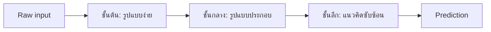

# 30. Deep Learning

**Deep Learning** คือ Machine Learning ที่ใช้ Neural Network หลายชั้นเพื่อเรียนรู้ตัวแทนข้อมูลจากระดับง่ายไปซับซ้อน เช่น ขอบภาพ → รูปร่าง → วัตถุ หรืออักขระ → คำ → ความหมายของประโยค

## 1. Deep ต่างจาก Neural Network อย่างไร?

Neural Network เป็นชื่อโครงสร้างโดยรวม ส่วน Deep Learning มักหมายถึง Neural Network ที่มีหลายชั้นและเรียนรู้ Representation จากข้อมูลจำนวนมาก



## 2. Forward pass และ Loss

แต่ละชั้นคำนวณ:

$$
z^{(l)}=W^{(l)}a^{(l-1)}+b^{(l)}
$$

$$
a^{(l)}=g^{(l)}(z^{(l)})
$$

Forward pass ส่งข้อมูลจาก Input ไป Output จากนั้น Loss เปรียบเทียบ Prediction กับ Target

## 3. Backpropagation

Backpropagation ใช้ Chain rule ส่งข้อมูลความผิดพลาดย้อนกลับเพื่อหา Gradient ของพารามิเตอร์ทุกชั้น:

$$
\frac{\partial L}{\partial W^{(l)}}
=\frac{\partial L}{\partial a^{(l)}}
\frac{\partial a^{(l)}}{\partial z^{(l)}}
\frac{\partial z^{(l)}}{\partial W^{(l)}}
$$

Optimizer ใช้ Gradient ปรับ Weights:

$$
W\leftarrow W-\eta\frac{\partial L}{\partial W}
$$

## 4. สถาปัตยกรรมที่พบบ่อย

| สถาปัตยกรรม | เหมาะกับ |
|---|---|
| MLP | ข้อมูลตารางและพื้นฐาน Neural Network |
| CNN | ภาพและข้อมูลที่มีโครงสร้างเชิงพื้นที่ |
| RNN/LSTM/GRU | Sequence และ Time series โดยเฉพาะระบบเดิม |
| Transformer | ข้อความ ภาพ เสียง และข้อมูลหลายรูปแบบ |
| Autoencoder | ลดมิติ เรียนรู้ Representation และตรวจความผิดปกติ |

## 5. ตัวอย่าง MLP

```python
from sklearn.datasets import load_digits
from sklearn.model_selection import train_test_split
from sklearn.neural_network import MLPClassifier
from sklearn.pipeline import make_pipeline
from sklearn.preprocessing import StandardScaler

X, y = load_digits(return_X_y=True)
X_train, X_valid, y_train, y_valid = train_test_split(
    X,
    y,
    test_size=0.25,
    random_state=42,
    stratify=y,
)

model = make_pipeline(
    StandardScaler(),
    MLPClassifier(
        hidden_layer_sizes=(128, 64),
        activation="relu",
        early_stopping=True,
        max_iter=500,
        random_state=42,
    ),
)
model.fit(X_train, y_train)

print("Validation accuracy:", model.score(X_valid, y_valid))
```

ตัวอย่างนี้ใช้ MLP ขนาดเล็กเพื่อเรียนรู้แนวคิด งานภาพหรือภาษาขนาดใหญ่ควรใช้ Framework ที่รองรับ GPU และสถาปัตยกรรมเฉพาะทาง

## 6. Regularization

วิธีลด Overfitting ที่ใช้บ่อย:

- L1/L2 weight penalty
- Dropout ซึ่งสุ่มปิด Neurons บางส่วนระหว่างฝึก
- Data augmentation
- Early stopping
- Batch normalization หรือ Layer normalization ตามสถาปัตยกรรม
- เพิ่มข้อมูลที่เป็นตัวแทนของงานจริง

Dropout probability $p$ คือโอกาสที่หน่วยหนึ่งถูกปิดระหว่างฝึก ไม่ได้ใช้แบบเดียวกันในขั้นตอนทำนาย

## 7. Transfer Learning

แทนการฝึกตั้งแต่ศูนย์ สามารถใช้โมเดลที่ Pretrain แล้ว:

1. เลือกโมเดลที่เรียนรู้จากข้อมูลคล้ายงาน
2. ใช้เป็น Feature extractor หรือ Fine-tune
3. ใช้ Learning rate ต่ำและติดตาม Validation
4. ประเมิน Bias และข้อจำกัดจากข้อมูล Pretraining

Transfer Learning ช่วยลดข้อมูล เวลา และ Compute ที่ต้องใช้

## 8. Hardware และ Reproducibility

GPU/Accelerator ช่วยคำนวณเมทริกซ์ขนาดใหญ่ แต่การกำหนด Seed ไม่รับประกันผลเหมือนกันทุก Hardware, Driver หรือ Operation ควรบันทึก:

- Seed
- เวอร์ชันไลบรารีและ Driver
- สถาปัตยกรรมและ Hyperparameters
- ชุดข้อมูลและวิธีแบ่ง
- Model checkpoint

## 9. เมื่อใดควรใช้?

เหมาะเมื่อมีข้อมูลไม่เป็นโครงสร้าง เช่น ภาพ เสียง หรือข้อความ มีข้อมูลและทรัพยากรเพียงพอ หรือมีโมเดล Pretrained ที่ตรงงาน สำหรับข้อมูลตารางขนาดไม่ใหญ่มาก ควรเปรียบเทียบกับ Linear models และ Gradient Boosting ก่อน

## 10. Checklist

- สร้าง Baseline ก่อน
- แบ่งข้อมูลก่อนทำ preprocessing หรือ augmentation
- เลือกสถาปัตยกรรมให้ตรงชนิดข้อมูล
- Scale หรือ Normalize ตามที่โมเดลต้องการ
- ติดตาม Train/Validation loss และ Metric
- ใช้ Early stopping และ Checkpoints
- ตรวจ Class imbalance, Leakage และข้อมูลซ้ำ
- วัด Latency หน่วยความจำ และต้นทุนการใช้งานจริง
- ตรวจ Bias ความปลอดภัย และความถูกต้องของผลลัพธ์

## แหล่งอ้างอิง

- [scikit-learn: Neural network models](https://scikit-learn.org/stable/modules/neural_networks_supervised.html)
- [Deep Learning book](https://www.deeplearningbook.org/)

---

[← บทก่อนหน้า: เปรียบเทียบโมเดลอย่างยุติธรรม](model-comparison.md) | [สารบัญ](index.md) | [บทถัดไป: อธิบายผลโมเดล →](model-explainability.md)
