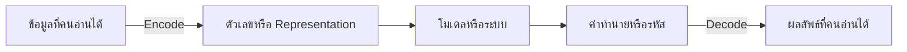

# 19. Encoding และ Decoding

คำว่า **Encoding** หมายถึงการแปลงข้อมูลจากรูปแบบหนึ่งเป็นอีกรูปแบบที่ระบบหรือโมเดลใช้งานได้ ส่วน **Decoding** คือการแปลงผลลัพธ์กลับให้อ่านหรือใช้งานได้

คำสองคำนี้ใช้ในหลายบริบทและไม่ได้หมายถึงสิ่งเดียวกันเสมอไป:

| บริบท | Encoding | Decoding |
|---|---|---|
| Category | ชื่อเมือง → คอลัมน์ตัวเลข | เวกเตอร์หรือรหัส → ชื่อเมือง |
| Target label | ชื่อคลาส → หมายเลข | หมายเลขที่ทำนาย → ชื่อคลาส |
| ข้อความ | ข้อความ → Tokens/Token IDs | Token IDs → ข้อความ |
| Neural Network | Input → Latent representation | Latent representation → Output |
| ไฟล์ข้อความ | ตัวอักษร → Bytes เช่น UTF-8 | Bytes → ตัวอักษร |



## 1. One-Hot Encoding

ใช้กับ Category ที่ไม่มีลำดับ เช่น เมืองหรือสี:

| city | city_Bangkok | city_Chiang_Mai | city_Phuket |
|---|---:|---:|---:|
| Bangkok | 1 | 0 | 0 |
| Phuket | 0 | 0 | 1 |

```python
import pandas as pd
from sklearn.preprocessing import OneHotEncoder

X = pd.DataFrame(
    {"city": ["Bangkok", "Chiang Mai", "Phuket", "Bangkok"]}
)

encoder = OneHotEncoder(
    handle_unknown="ignore",
    sparse_output=False,
)
encoded = encoder.fit_transform(X[["city"]])

encoded_df = pd.DataFrame(
    encoded,
    columns=encoder.get_feature_names_out(["city"]),
)

print(encoded_df)
```

`handle_unknown="ignore"` ทำให้ Category ใหม่ไม่ทำให้ `transform()` หยุดด้วย Error แต่ Category ใหม่นั้นจะกลายเป็นศูนย์ทุกคอลัมน์ จึงควรติดตามอัตรา Unknown categories ในระบบจริง

### Decode One-Hot กลับ

```python
decoded = encoder.inverse_transform(encoded)
print(decoded)
```

ถ้าแถวหนึ่งเป็นศูนย์ทั้งหมดจาก Unknown category ผล `inverse_transform()` อาจคืน `None` เพราะไม่สามารถรู้ชื่อเดิมได้

## 2. Ordinal Encoding

ใช้กับ Category ที่มีลำดับจริง เช่น `low < medium < high`:

```python
import pandas as pd
from sklearn.preprocessing import OrdinalEncoder

X = pd.DataFrame(
    {"risk": ["low", "medium", "high", "medium"]}
)

encoder = OrdinalEncoder(
    categories=[["low", "medium", "high"]],
    handle_unknown="use_encoded_value",
    unknown_value=-1,
)

encoded = encoder.fit_transform(X[["risk"]])
print(encoded)
print(encoder.inverse_transform(encoded))
```

อย่าใช้ Ordinal Encoding กับ Category ที่ไม่มีลำดับ เพราะหมายเลขอาจทำให้โมเดลตีความว่า `3` มากกว่า `1` หรือมีระยะห่างที่มีความหมาย

## 3. Label Encoding สำหรับ Target

`LabelEncoder` เหมาะกับ Target `y` ไม่ใช่คอลัมน์ Features ทั่วไป:

```python
from sklearn.preprocessing import LabelEncoder

y = ["cat", "dog", "cat", "bird"]

label_encoder = LabelEncoder()
y_encoded = label_encoder.fit_transform(y)

print("Classes:", label_encoder.classes_)
print("Encoded:", y_encoded)

y_decoded = label_encoder.inverse_transform(y_encoded)
print("Decoded:", y_decoded)
```

หลังโมเดลทำนายหมายเลขคลาส สามารถ Decode กลับเป็นชื่อที่ผู้ใช้เข้าใจ:

```python
predicted_ids = model.predict(X_valid)
predicted_labels = label_encoder.inverse_transform(predicted_ids)
```

> [!IMPORTANT]
> หมายเลขคลาสเป็นรหัส ไม่ได้หมายความว่าคลาสหมายเลข 2 มีค่ามากกว่าคลาสหมายเลข 1

## 4. One-Hot กับ Ordinal เลือกอย่างไร?

| ลักษณะข้อมูล | วิธีเริ่มต้น |
|---|---|
| ไม่มีลำดับ เช่น จังหวัด | One-Hot Encoding |
| มีลำดับจริง เช่น S/M/L | Ordinal Encoding โดยกำหนดลำดับเอง |
| Target เป็นชื่อคลาส | Label Encoding |
| Category มีค่าจำนวนมาก | พิจารณา Frequency/Target encoding หรือโมเดลเฉพาะทาง |

## 5. Frequency Encoding

แทน Category ด้วยจำนวนหรือสัดส่วนที่พบใน Train:

$$
\operatorname{freq}(c)=\frac{n_c}{n}
$$

```python
frequency = X_train["city"].value_counts(normalize=True)

X_train_encoded = X_train.copy()
X_valid_encoded = X_valid.copy()

X_train_encoded["city_frequency"] = X_train["city"].map(frequency)
X_valid_encoded["city_frequency"] = (
    X_valid["city"].map(frequency).fillna(0.0)
)
```

Mapping ต้องคำนวณจาก Train เท่านั้น แม้วิธีนี้ไม่ใช้ Target ก็ไม่ควรให้ Validation หรือ Test มีส่วนสร้าง Mapping

## 6. Target Encoding

Target Encoding แทน Category ด้วยสถิติของ Target เช่นค่าเฉลี่ย:

$$
\operatorname{TE}(c)
=\frac{1}{n_c}\sum_{i:x_i=c}y_i
$$

วิธีนี้เสี่ยง Target Leakage สูง หากคำนวณจากข้อมูลทั้งชุดหรือคำนวณค่าให้แถวหนึ่งโดยใช้ Target ของแถวนั้นเอง

แนวทางที่ปลอดภัยกว่า:

1. แยก Train/Validation/Test ก่อน
2. สร้าง Mapping จาก Train เท่านั้น
3. ใช้ Out-of-fold encoding ภายใน Train
4. ใช้ Smoothing กับ Category ที่มีข้อมูลน้อย
5. กำหนดค่ารองรับ Category ใหม่

> [!WARNING]
> อย่าคำนวณ Target Encoding ก่อนแบ่งข้อมูล และอย่าใช้ Target จาก Validation/Test สร้าง Mapping

## 7. Encoding ภายใน Pipeline

```python
from sklearn.compose import ColumnTransformer
from sklearn.impute import SimpleImputer
from sklearn.linear_model import LogisticRegression
from sklearn.pipeline import make_pipeline
from sklearn.preprocessing import OneHotEncoder, StandardScaler

numeric_features = ["age", "income"]
categorical_features = ["city", "plan"]

numeric_pipeline = make_pipeline(
    SimpleImputer(strategy="median"),
    StandardScaler(),
)

categorical_pipeline = make_pipeline(
    SimpleImputer(strategy="most_frequent"),
    OneHotEncoder(handle_unknown="ignore"),
)

preprocessor = ColumnTransformer(
    [
        ("numeric", numeric_pipeline, numeric_features),
        ("category", categorical_pipeline, categorical_features),
    ]
)

model = make_pipeline(
    preprocessor,
    LogisticRegression(max_iter=1000),
)

model.fit(X_train, y_train)
```

Pipeline ทำให้ Encoder เรียนรู้ Categories จาก Train ของแต่ละ Cross-validation Fold ลด Data Leakage และทำให้ขั้นตอนตอน `predict()` ตรงกับตอน `fit()`

## 8. Decode Probability เป็นคลาส

Probability ไม่ใช่คลาสจนกว่าจะกำหนด Threshold:

$$
\hat{y}=
\begin{cases}
1,&P(y=1\mid x)\ge\tau\\
0,&P(y=1\mid x)<\tau
\end{cases}
$$

```python
probability = model.predict_proba(X_valid)[:, 1]
threshold = 0.35
predicted_class = (probability >= threshold).astype(int)
```

การเลือก Threshold เป็นการตัดสินใจตามต้นทุนของ FP/FN ไม่ใช่การ Decode ทางคณิตศาสตร์แบบย้อนกลับอย่างสมบูรณ์

## 9. Text Encoding และ Tokenization

Transformer ไม่รับข้อความดิบโดยตรง กระบวนการทั่วไปคือ:

```text
ข้อความ → Tokens → Token IDs → Embeddings → โมเดล
```

- Tokenizer แบ่งข้อความเป็น Tokens
- Vocabulary จับคู่ Token กับ ID
- Embedding table แปลง ID เป็นเวกเตอร์
- Positional information บอกลำดับของ Tokens

ตัวอย่างแนวคิดอย่างง่าย:

```python
vocabulary = {
    "<unknown>": 0,
    "แมว": 1,
    "นั่ง": 2,
    "บน": 3,
    "เสื่อ": 4,
}

tokens = ["แมว", "นั่ง", "บน", "เสื่อ"]
token_ids = [vocabulary.get(token, 0) for token in tokens]

inverse_vocabulary = {
    token_id: token for token, token_id in vocabulary.items()
}
decoded_tokens = [inverse_vocabulary[token_id] for token_id in token_ids]

print(token_ids)
print(decoded_tokens)
```

Tokenizer จริงอาจแบ่งคำเป็น Subwords และการ Decode อาจต้องรวมชิ้นส่วนกลับ รวมถึงตัด Special tokens

## 10. Encoder–Decoder ใน Transformer

คำว่า Encoder และ Decoder ในสถาปัตยกรรม Transformer ต่างจาก `OneHotEncoder`:

- **Encoder:** อ่าน Input และสร้าง Contextual representations
- **Decoder:** สร้าง Output ทีละ Token โดยดู Context และ Tokens ก่อนหน้า
- **Encoder-only:** เหมาะกับ Classification และ Embeddings
- **Decoder-only:** เหมาะกับการสร้างข้อความ
- **Encoder–Decoder:** เหมาะกับ Translation และ Summarization

Decoder ไม่ได้ย้อนการคำนวณของ Encoder แบบหนึ่งต่อหนึ่ง แต่เรียนรู้การสร้าง Output ที่เหมาะสมจาก Representation

## 11. Autoencoder

Autoencoder เป็น Neural Network ที่เรียนรู้ให้ Output ใกล้ Input:

$$
z=f_{\text{encoder}}(x)
$$

$$
\hat{x}=g_{\text{decoder}}(z)
$$

$$
L=\frac{1}{n}\sum_{i=1}^{n}\|x_i-\hat{x}_i\|^2
$$

$z$ คือ Latent representation ที่มีขนาดเล็กหรือมีข้อจำกัด ใช้ลดมิติ เรียนรู้ Representation หรือช่วยตรวจ Anomaly ได้

## 12. Character Encoding เช่น UTF-8

Character encoding เป็นเรื่องของการเก็บตัวอักษรเป็น Bytes ไม่ใช่ Feature encoding สำหรับโมเดล

```python
text = "ภาษาไทย"

encoded_bytes = text.encode("utf-8")
decoded_text = encoded_bytes.decode("utf-8")

print(encoded_bytes)
print(decoded_text)
```

ใน pandas:

```python
import pandas as pd

df = pd.read_csv("customers.csv", encoding="utf-8-sig")
df.to_csv("customers-clean.csv", index=False, encoding="utf-8-sig")
```

หาก Decode ด้วย Character encoding ที่ไม่ตรงกับตอน Encode อาจเกิด Error หรือข้อความเพี้ยน

## 13. ข้อผิดพลาดที่พบบ่อย

- ใช้ `LabelEncoder` กับ Features ที่ไม่มีลำดับ
- `fit_transform()` Encoder กับข้อมูลทั้งหมดก่อนแบ่ง Train/Test
- ไม่รองรับ Category ใหม่ตอน Predict
- ใช้ Target Encoding โดยไม่มี Out-of-fold strategy
- ทิ้ง Encoder หลัง Train ทำให้ Decode ชื่อคลาสไม่ได้
- ใช้ Tokenizer คนละเวอร์ชันกับโมเดล
- สับสนระหว่าง Feature encoding กับ UTF-8
- คิดว่า Transformer Decoder ย้อนกลับ Encoder แบบตรงตัว

## 14. Checklist

- ระบุว่า Encoding อยู่ในบริบทใด
- เลือก One-Hot หรือ Ordinal ตามความหมายของ Category
- ใช้ `LabelEncoder` กับ Target
- `fit` Encoder จาก Train เท่านั้น
- วาง Encoder ที่เรียนรู้จากข้อมูลไว้ใน Pipeline
- กำหนดวิธีรับมือ Unknown categories
- บันทึก Encoder, Category order, Vocabulary และ Tokenizer version
- Decode ผลลัพธ์กลับเป็นชื่อที่ผู้ใช้เข้าใจ
- ตรวจ Data Leakage โดยเฉพาะ Target Encoding

## แหล่งอ้างอิง

- [scikit-learn: OneHotEncoder](https://scikit-learn.org/stable/modules/generated/sklearn.preprocessing.OneHotEncoder.html)
- [scikit-learn: OrdinalEncoder](https://scikit-learn.org/stable/modules/generated/sklearn.preprocessing.OrdinalEncoder.html)
- [scikit-learn: LabelEncoder](https://scikit-learn.org/stable/modules/generated/sklearn.preprocessing.LabelEncoder.html)
- [scikit-learn: TargetEncoder](https://scikit-learn.org/stable/modules/generated/sklearn.preprocessing.TargetEncoder.html)
- [Python: Unicode HOWTO](https://docs.python.org/3/howto/unicode.html)

---

[← บทก่อนหน้า: เตรียมข้อมูลจริง: Missing Values และ Category](preprocessing-real-data.md) | [สารบัญ](index.md) | [บทถัดไป: Scaling และ Normalization →](scaling-normalization.md)
