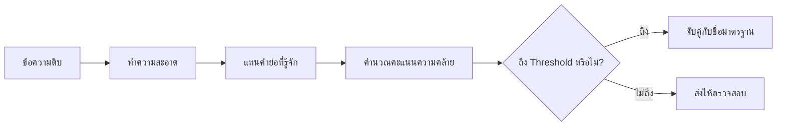
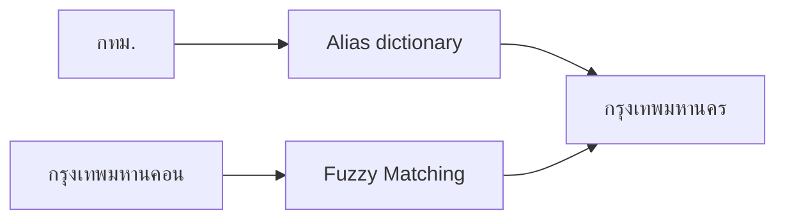

# 8. Fuzzy Matching: จับคู่ข้อความที่สะกดไม่เหมือนกัน

ข้อมูลจริงมักมีชื่อสถานที่สะกดผิด ใช้คำย่อ หรือเว้นวรรคไม่เหมือนกัน เช่น:

```text
กรุงเทพมหานคร
กรุงเทพมหานคอน
กุรงเทพมหานคร
กรุงเทพฯ
กทม.
```

การเปรียบเทียบด้วย `==` จะมองว่าข้อความเหล่านี้ไม่เท่ากัน แต่ **Fuzzy String Matching** จะวัดว่าข้อความคล้ายกันเพียงใด



## 1. `fuzzywuzzy` คืออะไร?

`fuzzywuzzy` เป็นไลบรารี Python สำหรับเปรียบเทียบความคล้ายของข้อความ โดยให้คะแนนตั้งแต่ `0–100`:

- `100` หมายถึงข้อความเหมือนกัน
- คะแนนสูงหมายถึงข้อความคล้ายกันมาก
- คะแนนต่ำหมายถึงข้อความต่างกันมาก

อย่างไรก็ตาม งานใหม่มักใช้ **RapidFuzz** เพราะ API คล้ายกัน ทำงานเร็ว และติดตั้งได้ง่าย:

```bash
python -m pip install rapidfuzz
```

ตัวอย่างในบทนี้จึงใช้ `RapidFuzz` แต่แนวคิดเดียวกันใช้กับ `fuzzywuzzy` ได้

## 2. เปรียบเทียบข้อความสองค่า

```python
from rapidfuzz import fuzz

correct_name = "กรุงเทพมหานคร"
input_name = "กรุงเทพมหานคอน"

score = fuzz.ratio(correct_name, input_name)

print(f"คะแนนความคล้าย: {score:.2f}")
```

คะแนนยิ่งสูงยิ่งมีแนวโน้มว่าเป็นชื่อเดียวกัน แต่คะแนนไม่ใช่ Probability เช่น คะแนน `90` ไม่ได้หมายความว่ามีโอกาสถูกต้อง 90%

## 3. Levenshtein Distance

แนวคิดพื้นฐานคือจำนวนการแก้ไขขั้นต่ำที่ต้องทำเพื่อเปลี่ยนข้อความหนึ่งให้เป็นอีกข้อความ:

- เพิ่มตัวอักษร
- ลบตัวอักษร
- แทนที่ตัวอักษร

กำหนดให้ข้อความสองชุดเป็น $a$ และ $b$:

$$
d(a,b)=\text{จำนวนการแก้ไขขั้นต่ำจาก }a\text{ ไปเป็น }b
$$

ตัวอย่าง `กรุงเทพมหานคอน` ต้องเปลี่ยนตัวท้ายจาก `น` เป็น `ร` หนึ่งครั้งเพื่อเป็น `กรุงเทพมหานคร` ระยะทางจึงเท่ากับ `1`

```python
from rapidfuzz.distance import Levenshtein

distance = Levenshtein.distance(
    "กรุงเทพมหานคร",
    "กรุงเทพมหานคอน",
)

print(distance)
```

ระยะทางต่ำหมายถึงแก้ไขน้อย แต่ต้องพิจารณาความยาวข้อความด้วย การผิด 1 ตัวในคำยาวมีผลน้อยกว่าการผิด 1 ตัวในคำสั้น

## 4. ฟังก์ชันเปรียบเทียบหลัก

```python
from rapidfuzz import fuzz

text_1 = "จังหวัด กรุงเทพมหานคร"
text_2 = "กรุงเทพมหานคร"

print("ratio:", fuzz.ratio(text_1, text_2))
print("partial_ratio:", fuzz.partial_ratio(text_1, text_2))
print("token_sort_ratio:", fuzz.token_sort_ratio(text_1, text_2))
print("token_set_ratio:", fuzz.token_set_ratio(text_1, text_2))
```

| ฟังก์ชัน | ใช้เมื่อ | ตัวอย่าง |
|---|---|---|
| `ratio()` | เปรียบเทียบข้อความทั้งชุด | คำสะกดผิดเล็กน้อย |
| `partial_ratio()` | ข้อความหนึ่งอยู่ในอีกข้อความ | `กรุงเทพมหานคร` กับ `จังหวัด กรุงเทพมหานคร` |
| `token_sort_ratio()` | คำเหมือนกันแต่ลำดับต่างกัน | ชื่อและนามสกุลสลับตำแหน่ง |
| `token_set_ratio()` | มีคำซ้ำหรือมีบางคำเพิ่ม | ชื่อบริษัทที่มีคำประกอบเพิ่ม |

ภาษาไทยไม่ได้เว้นวรรคทุกคำเหมือนภาษาอังกฤษ ฟังก์ชันแบบ Token จึงขึ้นกับวิธีเว้นวรรคหรือการตัดคำด้วย

## 5. ค้นหาชื่อที่ใกล้ที่สุด

```python
from rapidfuzz import process

locations = [
    "กรุงเทพมหานคร",
    "สมุทรปราการ",
    "นนทบุรี",
    "ปทุมธานี",
    "นครปฐม",
]

result = process.extractOne(
    "กรุงเทพมหานคอน",
    locations,
)

print(result)
```

ผลลัพธ์มีรูปแบบ:

```text
(ข้อความที่ใกล้ที่สุด, คะแนน, ตำแหน่งในรายการ)
```

เช่น:

```text
('กรุงเทพมหานคร', 93.33, 0)
```

## 6. ดูหลายคำตอบก่อนตัดสินใจ

หากชื่อหลายชื่อคล้ายกัน ไม่ควรดูเพียงคำตอบอันดับแรก:

```python
from rapidfuzz import process

locations = [
    "กรุงเทพมหานคร",
    "กรุงเทพใหญ่",
    "กรุงเก่า",
    "นนทบุรี",
]

matches = process.extract(
    "กรุงเทพ",
    locations,
    limit=3,
)

for name, score, index in matches:
    print(name, score, index)
```

ควรตรวจส่วนต่างระหว่างอันดับ 1 และอันดับ 2 ด้วย หากคะแนนใกล้กันมาก คำตอบยังมีความกำกวม

## 7. คำย่อต้องใช้ตาราง Alias

Fuzzy Matching เปรียบเทียบตัวอักษร แต่ไม่รู้เองว่า `กทม.` และ `กรุงเทพมหานคร` หมายถึงที่เดียวกัน จึงควรแทนคำย่อที่รู้จักก่อน:

```python
aliases = {
    "กรุงเทพ": "กรุงเทพมหานคร",
    "กรุงเทพฯ": "กรุงเทพมหานคร",
    "กทม": "กรุงเทพมหานคร",
    "กทม.": "กรุงเทพมหานคร",
}

input_name = "กทม."
normalized_name = aliases.get(input_name, input_name)

print(normalized_name)
```



- Alias เหมาะกับคำย่อหรือชื่อเรียกที่รู้แน่นอน
- Fuzzy Matching เหมาะกับการสะกดผิดเล็กน้อย

## 8. ทำความสะอาดข้อความก่อนเปรียบเทียบ

```python
import re


def normalize_location(value):
    if value is None:
        return ""

    value = str(value).strip().lower()
    value = re.sub(r"\s+", " ", value)
    value = value.replace("จังหวัด", "")
    return value.strip()


print(normalize_location("  จังหวัด   กรุงเทพมหานคร "))
```

ขั้นตอนที่เลือกใช้ต้องเหมาะกับความหมายของข้อมูล อย่าลบอักขระหรือคำโดยไม่ตรวจว่าอาจทำให้ชื่อคนละแห่งกลายเป็นชื่อเดียวกันหรือไม่

## 9. การกำหนด Threshold

Threshold คือคะแนนขั้นต่ำที่ยอมรับว่าเป็นคู่เดียวกัน:

$$
\text{match}=
\begin{cases}
1, & \text{score}\geq\tau\\
0, & \text{score}<\tau
\end{cases}
$$

$\tau$ คือ Threshold เช่น `90`

```python
from rapidfuzz import fuzz

threshold = 90
score = fuzz.ratio("กรุงเทพมหานคร", "กรุงเทพมหานคอน")

if score >= threshold:
    print("ยอมรับการจับคู่")
else:
    print("ส่งให้ตรวจสอบ")
```

ไม่ควรเลือก `80`, `85` หรือ `90` จากความรู้สึกเพียงอย่างเดียว ควรสร้างตัวอย่างคู่ข้อความที่รู้คำตอบ แล้วทดลอง Threshold หลายค่า

| ช่วงคะแนน | การทำงานตัวอย่าง |
|---:|---|
| `95–100` | จับคู่อัตโนมัติ |
| `80–94.99` | ส่งให้คนตรวจสอบ |
| ต่ำกว่า `80` | ยังไม่จับคู่ |

ช่วงนี้เป็นเพียงจุดเริ่มต้น ต้องปรับจากข้อมูลจริงและผลเสียของการจับคู่ผิด

## 10. Precision และ Recall ของการจับคู่

การลด Threshold ทำให้จับคู่ได้มากขึ้น แต่อาจจับคู่ผิดมากขึ้น:

- **Precision สูง:** คู่ที่ระบบยอมรับส่วนใหญ่ถูกต้อง
- **Recall สูง:** ระบบค้นพบคู่ที่ควรตรงกันได้มาก

ถ้าการรวมคนละคนเข้าด้วยกันสร้างความเสียหายสูง ควรเน้น Precision และส่งกรณีไม่แน่ใจให้ตรวจสอบ

## 11. ใช้กับ Pandas

```python
import pandas as pd
from rapidfuzz import process, fuzz

master_locations = [
    "กรุงเทพมหานคร",
    "สมุทรปราการ",
    "นนทบุรี",
    "ปทุมธานี",
]

df = pd.DataFrame({
    "location_raw": [
        "กรุงเทพมหานคอน",
        "นนทบุร",
        "ปทุมทานี",
        "ไม่ทราบ",
    ]
})


def find_best_match(value):
    result = process.extractOne(
        value,
        master_locations,
        scorer=fuzz.ratio,
        score_cutoff=80,
    )

    if result is None:
        return pd.Series([pd.NA, pd.NA])

    name, score, _ = result
    return pd.Series([name, score])


df[["location_matched", "match_score"]] = (
    df["location_raw"].apply(find_best_match)
)

print(df)
```

เก็บทั้งชื่อที่จับคู่และคะแนนไว้ เพื่อให้ตรวจย้อนหลังและปรับ Threshold ได้

## 12. ป้องกันการจับคู่ผิด

ชื่อที่คล้ายกันไม่ได้หมายถึงสิ่งเดียวกันเสมอ ควรใช้ข้อมูลประกอบเมื่อมี:

- จังหวัดและอำเภอ
- รหัสไปรษณีย์
- รหัสลูกค้า
- เบอร์โทรศัพท์
- พิกัด

ตัวอย่าง `บางรัก` อาจเป็นชื่อเขตหรือตำบลในคนละจังหวัด การจับคู่จากชื่ออย่างเดียวจึงไม่เพียงพอ

## 13. Fuzzy Matching ต่างจาก Machine Learning อย่างไร?

Fuzzy Matching เป็นกฎคำนวณความคล้ายของข้อความ ไม่ได้ Train จากข้อมูลโดยอัตโนมัติ ส่วนโมเดล Machine Learning สามารถเรียนรู้ว่าคู่ใดควรตรงกันจาก Features หลายตัว เช่น:

- คะแนนความคล้ายของชื่อ
- ที่อยู่ตรงกันหรือไม่
- เบอร์โทรศัพท์ตรงกันหรือไม่
- ระยะห่างของพิกัด

เริ่มจาก Alias และ Fuzzy Matching ก่อน หากกฎซับซ้อนหรือข้อมูลมีขนาดใหญ่มากจึงค่อยพิจารณา Record Linkage หรือโมเดลสำหรับ Entity Matching

## 14. Checklist

- สร้างชื่อมาตรฐานหรือ Master data ก่อน
- ทำความสะอาดข้อความด้วยกฎเดียวกันทั้งสองฝั่ง
- ใช้ Alias กับคำย่อที่รู้แน่นอน
- เลือก Scorer ให้เหมาะกับข้อมูล
- เก็บคะแนนและผู้สมัครหลายอันดับ
- หา Threshold จากชุดข้อมูลที่ตรวจคำตอบแล้ว
- แยกช่วงตรวจสอบโดยคน
- วัด Precision และ Recall
- ตรวจข้อมูลประกอบก่อนรวม Record
- เก็บประวัติการแก้ไขเพื่อย้อนกลับได้

## สรุป

Fuzzy Matching ช่วยค้นหาข้อความที่สะกดใกล้เคียงกัน แต่คะแนนไม่ได้ยืนยันว่าข้อความหมายถึงสิ่งเดียวกัน สำหรับข้อมูล “กรุงเทพมหานคร” ควรใช้ Alias จัดการ `กทม.` หรือ `กรุงเทพฯ` ก่อน แล้วใช้ RapidFuzz ตรวจคำสะกดผิด กำหนด Threshold จากข้อมูลจริง และส่งกรณีกำกวมให้ตรวจสอบ

## แหล่งอ้างอิง

- [RapidFuzz documentation](https://rapidfuzz.github.io/RapidFuzz/)
- [RapidFuzz: Fuzz](https://rapidfuzz.github.io/RapidFuzz/Usage/fuzz.html)
- [RapidFuzz: Process](https://rapidfuzz.github.io/RapidFuzz/Usage/process.html)
- [RapidFuzz: Levenshtein distance](https://rapidfuzz.github.io/RapidFuzz/Usage/distance/Levenshtein.html)

---

[← บทก่อนหน้า: Parsing Dates: แปลงข้อความให้เป็นวันและเวลา](parsing-dates.md) | [สารบัญ](index.md) | [บทถัดไป: Baseline: เกณฑ์ขั้นต่ำสำหรับเปรียบเทียบโมเดล →](baseline.md)
