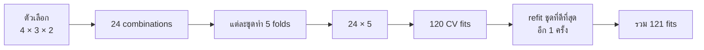

# 22. Hyperparameter คือค่าที่เราเลือกให้โมเดล


ย้อนกลับไปบทแรก ค่า $w$ และ $b$ เป็นค่าที่โมเดลเรียนรู้เอง เรียกว่า **parameters**

ส่วน **hyperparameters** เป็นตัวเลือกที่เรากำหนด เช่น ความลึกสูงสุดของ Decision Tree หรือจำนวนต้นไม้ใน Random Forest

หากยังไม่คุ้นกับโมเดลนี้ ให้อ่าน [Random Forest](../ALGORITHMS/RandomForest.md) ก่อน แล้วค่อยกลับมาดูวิธี Tuning ในบทนี้

**Tuning** คือการลองตัวเลือกหลายชุด แล้วดูว่าชุดไหนได้คะแนน Validation ดี

## GridSearchCV: ลองครบทุกชุด

สมมติจะลอง Random Forest โดยเลือก:

- `max_depth`: ความลึก 2 ค่า คือ 3 และ 5
- `n_estimators`: จำนวนต้นไม้ 2 ค่า คือ 50 และ 100

จะจับคู่ได้ 4 ชุด:

| ชุด | ความลึก | จำนวนต้นไม้ |
|---|---:|---:|
| 1 | 3 | 50 |
| 2 | 3 | 100 |
| 3 | 5 | 50 |
| 4 | 5 | 100 |

ทำไมต้องคูณ? เพราะความลึกแต่ละค่าจับคู่กับจำนวนต้นไม้ได้ 2 แบบ:

$$
\text{Combinations}=2\times2=4
$$

**Combination คือชุดตัวเลือกหนึ่งชุด ส่วน Fit คือการฝึกโมเดลหนึ่งครั้ง**

ถ้าแต่ละชุดใช้ 3-fold CV ก็ต้องฝึกชุดละ 3 ครั้ง:

$$
\text{CV fits}=4\times3=12
$$

หลักคิดคือ **จำนวนชุด × จำนวนรอบต่อชุด**

กลับไปโจทย์ในบทสนทนา: มีตัวเลือก 4 ค่า, 3 ค่า และ 2 ค่า ใช้ 5 folds:

$$
\text{Combinations}=4\times3\times2=24
$$

$$
\text{CV fits}=24\times5=120
$$

ดังนั้น 24 คือจำนวนชุด แต่ 120 คือจำนวนครั้งที่ฝึกระหว่างค้นหา



เมื่อเลือกชุดดีที่สุดแล้ว ถ้าเปิด `refit=True` จะฝึกชุดนั้นบนข้อมูลฝึกทั้งหมดอีก 1 ครั้ง:

$$
\text{Total fits}=120+1=121
$$

## RandomizedSearchCV: สุ่มมาลองบางชุด

ถ้ามีตัวเลือกเป็นร้อยชุด เราอาจไม่มีเวลาลองครบ จึงกำหนดว่าจะสุ่มมาลองกี่ชุดด้วย `n_iter`

เช่น `n_iter=8` แปลว่า **ลอง 8 ชุด** เมื่อใช้ `cv=5` จะได้:

$$
\text{CV fits}=8\times5=40
$$

การลองน้อยลงประหยัดจำนวนครั้งที่ฝึก แต่ก็อาจพลาดชุดที่ให้คะแนนดีที่สุด

## มีงบ 60 ครั้ง จะลองได้กี่ชุด?

คิดแบบแบ่งของ: หนึ่งชุดต้องใช้ 5 ครั้ง เรามีงบฝึก 60 ครั้ง จึงเอา 60 หาร 5:

$$
\text{Number of trials}=\frac{60}{5}=12
$$

ดังนั้นตั้ง `n_iter=12` ได้ ถ้างบนี้นับเฉพาะ CV และมีชุดค่าให้สุ่มเพียงพอ

ถ้าหารไม่ลงตัว เช่น งบ 62 ครั้ง ก็ยังลองได้เพียง 12 ชุด เพราะ 13 ชุดต้องใช้ 65 ครั้ง ให้ **ปัดเศษลง** เสมอ

ถ้างบ 60 ครั้งต้องรวม refit ด้วย ให้หักไว้ 1 ครั้งก่อน เหลืองบ CV 59 ครั้ง จะลองได้ 11 ชุด:

$$
11\times5+1=56
$$

ส่วน 12 ชุดจะใช้ทั้งหมด 61 ครั้ง ซึ่งเกินงบ

## ตัวอย่าง Python: Grid Search และ Randomized Search

```python
from sklearn.datasets import make_regression
from sklearn.ensemble import RandomForestRegressor
from sklearn.model_selection import GridSearchCV, RandomizedSearchCV

X, y = make_regression(
    n_samples=300,
    n_features=5,
    noise=20,
    random_state=42,
)

model = RandomForestRegressor(random_state=42)
search_space = {
    "max_depth": [3, 5, None],
    "n_estimators": [50, 100],
}

# Grid Search ลองครบ 3 × 2 = 6 ชุด และแต่ละชุดใช้ 3 folds
grid_search = GridSearchCV(
    model,
    param_grid=search_space,
    cv=3,
    scoring="neg_mean_squared_error",
    n_jobs=-1,
)
grid_search.fit(X, y)
print("Grid best:", grid_search.best_params_)

# Randomized Search สุ่มเพียง 4 จาก 6 ชุด
random_search = RandomizedSearchCV(
    model,
    param_distributions=search_space,
    n_iter=4,
    cv=3,
    scoring="neg_mean_squared_error",
    random_state=42,
    n_jobs=-1,
)
random_search.fit(X, y)
print("Random best:", random_search.best_params_)
```

ตัวอย่างนี้ใช้ข้อมูลจำลองเพื่อดูขั้นตอน ค่า `best_params_` ที่ได้ไม่ใช่ค่าที่เหมาะกับทุก Dataset

---

[← บทก่อนหน้า: Optimization: โมเดลหาค่าที่ดีขึ้นได้อย่างไร](optimization.md) · [สารบัญ](index.md) · [บทถัดไป: Search Space: เลือกช่วงค่าที่จะค้นหา →](search-space.md)
