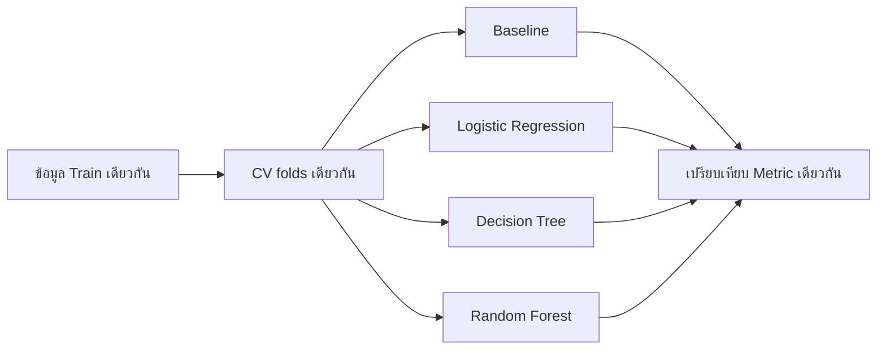

# 29. เปรียบเทียบโมเดลอย่างยุติธรรม

การบอกว่าโมเดลหนึ่งดีกว่าอีกโมเดลต้องให้ทุกโมเดลสอบด้วยข้อมูลและกติกาเดียวกัน

## 1. เริ่มจาก Baseline

Baseline คือวิธีง่ายที่โมเดลใหม่ควรทำได้ดีกว่า:

- Classification: ทายคลาสที่พบบ่อยที่สุด
- Regression: ทายค่าเฉลี่ยหรือ Median

```python
from sklearn.dummy import DummyClassifier, DummyRegressor

classification_baseline = DummyClassifier(strategy="most_frequent")
regression_baseline = DummyRegressor(strategy="mean")
```

ถ้าโมเดลซับซ้อนไม่ชนะ Baseline อย่างสม่ำเสมอ ควรตรวจข้อมูล Features และวิธีประเมินก่อนเพิ่มความซับซ้อน

## 2. กติกาที่ต้องเหมือนกัน

ทุกโมเดลควรใช้:

- แถวข้อมูลชุดเดียวกัน
- Features และ Target เดียวกัน
- Cross-validation folds เดียวกัน
- Metric เดียวกัน
- preprocessing ที่เหมาะกับโมเดลและอยู่ใน Pipeline



## 3. ตัวอย่าง Classification

```python
from sklearn.datasets import make_classification
from sklearn.dummy import DummyClassifier
from sklearn.ensemble import RandomForestClassifier
from sklearn.linear_model import LogisticRegression
from sklearn.model_selection import StratifiedKFold, cross_validate
from sklearn.pipeline import make_pipeline
from sklearn.preprocessing import StandardScaler
from sklearn.tree import DecisionTreeClassifier

SEED = 42

X, y = make_classification(
    n_samples=1000,
    n_features=10,
    n_informative=6,
    weights=[0.75, 0.25],
    random_state=SEED,
)

models = {
    "baseline": DummyClassifier(strategy="most_frequent"),
    "logistic": make_pipeline(
        StandardScaler(),
        LogisticRegression(max_iter=1000, random_state=SEED),
    ),
    "decision_tree": DecisionTreeClassifier(
        max_depth=5,
        random_state=SEED,
    ),
    "random_forest": RandomForestClassifier(
        n_estimators=200,
        random_state=SEED,
        n_jobs=-1,
    ),
}

cv = StratifiedKFold(
    n_splits=5,
    shuffle=True,
    random_state=SEED,
)

for name, model in models.items():
    scores = cross_validate(
        model,
        X,
        y,
        cv=cv,
        scoring=["precision", "recall", "f1", "roc_auc"],
    )
    print(
        name,
        "F1=", round(scores["test_f1"].mean(), 3),
        "ROC-AUC=", round(scores["test_roc_auc"].mean(), 3),
    )
```

## 4. ค่าเฉลี่ยอย่างเดียวไม่พอ

ควรดูส่วนเบี่ยงเบนมาตรฐานของคะแนนแต่ละ Fold ด้วย:

$$
\text{รายงาน}=\operatorname{mean}\pm\operatorname{std}
$$

```python
f1_scores = scores["test_f1"]
print("F1:", f1_scores.mean(), "+/-", f1_scores.std())
```

โมเดลที่ค่าเฉลี่ยสูงขึ้นเล็กน้อยแต่แกว่งมาก อาจไม่น่าเชื่อถือกว่ารุ่นที่คะแนนสม่ำเสมอ

## 5. Test มีหน้าที่อะไร?

```text
Train/CV → เลือกโมเดลและ Hyperparameters
Test     → ประเมินตัวเลือกสุดท้ายครั้งเดียว
```

> [!CAUTION]
> ถ้าดูคะแนน Test แล้วกลับไปเปลี่ยนโมเดล Test ได้ทำหน้าที่เป็น Validation ไปแล้ว และคะแนนสุดท้ายจะเริ่มลำเอียง

## 6. อย่าดูแต่คะแนน

พิจารณาร่วมกับ:

- เวลา Train และเวลา Predict
- หน่วยความจำ
- ความง่ายในการอธิบาย
- ความเสถียรเมื่อข้อมูลเปลี่ยน
- ความสะดวกในการดูแลระบบ

## 7. Checklist

- มี Dummy baseline
- ใช้ folds เดียวกัน
- preprocessing อยู่ใน Pipeline
- Metric ตรงกับเป้าหมาย
- รายงานค่าเฉลี่ยและการกระจาย
- เลือกจาก Validation/CV
- ใช้ Test หลังตัดสินใจเสร็จแล้ว

## 8. แหล่งอ้างอิง

- [scikit-learn: Cross-validation](https://scikit-learn.org/stable/modules/cross_validation.html)
- [scikit-learn: Dummy estimators](https://scikit-learn.org/stable/modules/model_evaluation.html#dummy-estimators)
- [scikit-learn: cross_validate](https://scikit-learn.org/stable/modules/generated/sklearn.model_selection.cross_validate.html)

---

[← บทก่อนหน้า: Class Imbalance และการเลือก Threshold](class-imbalance-threshold.md) | [สารบัญ](index.md) | [บทถัดไป: Deep Learning →](deep-learning.md)
