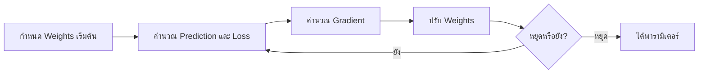

# 25. Optimization: โมเดลหาค่าที่ดีขึ้นได้อย่างไร

**Optimization** คือกระบวนการค้นหาค่าพารามิเตอร์ที่ทำให้ Objective หรือ Loss ต่ำลง การฝึกโมเดลจึงต่างจาก Hyperparameter tuning: การฝึกหา Weights ภายในโมเดล ส่วน Tuning ทดลองค่าที่ผู้พัฒนากำหนด เช่น `max_depth` หรือ `C`

## 1. Loss, Cost และ Objective

- **Loss:** ความผิดพลาดของข้อมูลหนึ่งแถว
- **Cost:** ค่าเฉลี่ยหรือผลรวม Loss หลายแถว
- **Objective:** สิ่งที่ต้องทำให้ต่ำ ซึ่งอาจรวม Cost กับ Regularization

ตัวอย่าง Ridge:

$$
J(w,b)=\frac{1}{n}\sum_{i=1}^{n}(y_i-\hat{y}_i)^2
+\lambda\sum_{j=1}^{p}w_j^2
$$

## 2. Gradient คืออะไร?

Derivative บอกความชันของฟังก์ชันหนึ่งตัวแปร ส่วน Gradient รวมความชันของพารามิเตอร์ทุกตัว:

$$
\nabla J(w)=
\left[
\frac{\partial J}{\partial w_1},\ldots,
\frac{\partial J}{\partial w_p}
\right]
$$

Gradient ชี้ไปทางที่ Objective เพิ่มเร็ว จึงเดินไปทิศตรงข้าม

## 3. Gradient Descent

$$
w\leftarrow w-\eta\nabla J(w)
$$

$\eta$ คือ Learning rate:

- ต่ำเกินไป: เรียนรู้ช้า
- สูงเกินไป: ข้ามจุดที่ดี แกว่ง หรือไม่ลู่เข้า
- เหมาะสม: Loss ลดลงอย่างมีเสถียรภาพ



## 4. Batch, Stochastic และ Mini-batch

| วิธี | ข้อมูลต่อการอัปเดต | ลักษณะ |
|---|---:|---|
| Batch Gradient Descent | ทั้งชุด Train | Gradient นิ่ง แต่อัปเดตช้าเมื่อข้อมูลใหญ่ |
| Stochastic Gradient Descent | 1 แถว | อัปเดตเร็วแต่แกว่งมาก |
| Mini-batch Gradient Descent | หลายแถวขนาดเล็ก | สมดุลและใช้บ่อยใน Deep Learning |

หนึ่ง **Epoch** คือการใช้ข้อมูล Train ครบหนึ่งรอบ

## 5. ตัวอย่าง Gradient Descent

```python
import numpy as np

X = np.array([1.0, 2.0, 3.0, 4.0])
y = np.array([3.0, 5.0, 7.0, 9.0])

weight = 0.0
bias = 0.0
learning_rate = 0.05

for epoch in range(1000):
    prediction = weight * X + bias
    error = prediction - y

    weight_gradient = 2 * np.mean(error * X)
    bias_gradient = 2 * np.mean(error)

    weight -= learning_rate * weight_gradient
    bias -= learning_rate * bias_gradient

print("weight:", weight)
print("bias:", bias)
```

## 6. Convex กับ Non-convex

Convex objective มีโครงสร้างคล้ายชาม จุดต่ำสุดเฉพาะที่เป็นจุดต่ำสุดรวมด้วย Linear Regression แบบ MSE เป็นตัวอย่างหนึ่ง ส่วน Neural Network มี Objective แบบ Non-convex ที่ซับซ้อนและมีจุดราบหรือจุดต่ำหลายบริเวณ

## 7. เงื่อนไขหยุด

- Loss เปลี่ยนน้อยกว่า `tol`
- Gradient มีขนาดเล็ก
- ถึงจำนวนรอบสูงสุด
- Validation score ไม่ดีขึ้นตามจำนวนรอบที่กำหนด หรือ Early stopping

หยุดเพราะถึง `max_iter` ไม่ได้ยืนยันว่าโมเดลลู่เข้าแล้ว ควรอ่าน Warning และดู Learning curve

## 8. Optimizers ใน Deep Learning

- **SGD:** เรียบง่ายและควบคุมได้
- **Momentum:** สะสมทิศทางเดิมเพื่อลดการแกว่ง
- **Adam:** ปรับ Learning rate แยกตามพารามิเตอร์และใช้ค่าเฉลี่ยเคลื่อนที่ของ Gradient

Optimizer ที่ซับซ้อนไม่รับประกันว่า Validation จะดีกว่า ต้องทดลองด้วยเงื่อนไขเดียวกัน

## 9. Feature scaling

Features ที่มีสเกลต่างกันมากทำให้พื้นผิว Loss ยืดยาวและ Gradient Descent เดินช้าหรือแกว่ง การ Scale จึงสำคัญกับ Linear models, SVM, KNN และ Neural Networks หลายกรณี

## 10. Checklist

- แยก Model parameters ออกจาก Hyperparameters
- วาด Train และ Validation loss
- ตรวจ Convergence warning
- Scale Features เมื่ออัลกอริทึมไวต่อสเกล
- ปรับ Learning rate ก่อนเพิ่มจำนวนรอบอย่างเดียว
- ใช้ Early stopping จาก Validation ไม่ใช่ Test
- กำหนด Seed เพื่อช่วยทำซ้ำผลที่มีการสุ่ม

## แหล่งอ้างอิง

- [scikit-learn: Stochastic Gradient Descent](https://scikit-learn.org/stable/modules/sgd.html)
- [scikit-learn: Neural network optimization](https://scikit-learn.org/stable/modules/neural_networks_supervised.html)

---

[← บทก่อนหน้า: Feature Selection และ PCA](feature-selection-pca.md) | [สารบัญ](index.md) | [บทถัดไป: Hyperparameter คือค่าที่เราเลือกให้โมเดล →](hyperparameter-tuning.md)
