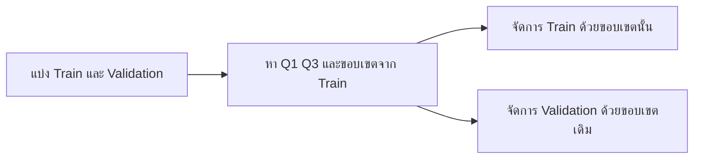

# 17. Outliers: ค่าที่ห่างจากข้อมูลส่วนใหญ่

**Outlier** คือข้อมูลที่มีค่าห่างจากข้อมูลส่วนใหญ่มากผิดปกติ ภาษาไทยมักเรียกว่า **ค่าผิดปกติ** หรือ **ค่าสุดโต่ง**

ตัวอย่างราคาบ้านหน่วยล้านบาท:

```text
2.0, 2.5, 3.0, 3.5, 100.0
```

ค่า `100.0` ห่างจากข้อมูลส่วนใหญ่มาก จึงอาจเป็น Outlier แต่ยังสรุปไม่ได้ว่าเป็นข้อมูลผิด เพราะอาจเป็นบ้านหรูที่มีอยู่จริง

## 1. Outlier ส่งผลอย่างไร?

Outlier สามารถดึงค่าเฉลี่ยให้ห่างจากข้อมูลส่วนใหญ่:

$$
\bar{x}
=\frac{2.0+2.5+3.0+3.5+100.0}{5}
=22.2
$$

แต่ค่ามัธยฐานยังอยู่ตรงกลางของข้อมูล:

$$
\operatorname{Median}=3.0
$$

ดังนั้น Baseline ที่ทายค่าเฉลี่ยจะทาย `22.2` ซึ่งไม่ใกล้บ้านทั่วไปในชุดนี้ ส่วน Baseline ที่ทายค่ามัธยฐานอาจเหมาะกว่า

Outlier อาจทำให้:

- ค่าเฉลี่ยและส่วนเบี่ยงเบนมาตรฐานเปลี่ยนมาก
- Linear Regression ถูกค่าบางจุดดึงเส้น
- MSE และ RMSE สูงมาก เพราะยกความผิดพลาดกำลังสอง
- StandardScaler ให้สเกลที่ไม่เหมาะกับข้อมูลส่วนใหญ่
- กราฟอ่านยาก เพราะแกนต้องขยายไปรองรับค่าสุดโต่ง

## 2. Outlier เกิดจากอะไร?

| สาเหตุ | ตัวอย่าง | วิธีเริ่มตรวจ |
|---|---|---|
| กรอกข้อมูลผิด | อายุ 250 ปี | เทียบกับกฎของงานหรือข้อมูลต้นทาง |
| หน่วยไม่ตรงกัน | บางแถวเป็นบาท บางแถวเป็นล้านบาท | ตรวจหน่วยและ Metadata |
| อุปกรณ์หรือระบบผิดพลาด | Sensor ส่งค่า 9999 | ตรวจ Log และช่วงค่าของอุปกรณ์ |
| ขั้นตอนรวมข้อมูลผิด | ยอดขายถูกนับซ้ำ | ตรวจ Key และการ Join |
| เหตุการณ์จริงที่พบไม่บ่อย | บ้านหรู 100 ล้านบาท | ยืนยันกับผู้เชี่ยวชาญของงาน |

> [!IMPORTANT]
> Outlier ไม่ได้แปลว่าข้อมูลผิดเสมอไป อย่าลบข้อมูลเพียงเพราะค่าดูสูงหรือต่ำ ต้องตรวจสาเหตุและผลกระทบต่อเป้าหมายของงานก่อน

## 3. ตรวจด้วยกราฟ

### Box plot

```python
import matplotlib.pyplot as plt
import pandas as pd

prices = pd.Series([2.0, 2.5, 3.0, 3.5, 100.0])

plt.boxplot(prices)
plt.ylabel("Price (million baht)")
plt.title("Box plot of house prices")
plt.show()
```

จุดที่อยู่นอกหนวดของ Box plot เป็นค่าที่ควรตรวจเพิ่ม ไม่ได้หมายความว่าต้องลบโดยอัตโนมัติ

### Histogram

```python
import matplotlib.pyplot as plt

prices = [2.0, 2.5, 3.0, 3.5, 100.0]

plt.hist(prices, bins=10, edgecolor="black")
plt.xlabel("Price (million baht)")
plt.ylabel("Count")
plt.title("Distribution of house prices")
plt.show()
```

กราฟช่วยให้เห็นการกระจาย แต่ควรดูร่วมกับความรู้ของข้อมูลและวิธีเชิงตัวเลข

## 4. ตรวจด้วย IQR

IQR คือระยะห่างระหว่าง Quartile ที่ 1 และ Quartile ที่ 3:

$$
\mathrm{IQR}=Q_3-Q_1
$$

กำหนดขอบเขตเบื้องต้น:

$$
\mathrm{Lower}=Q_1-1.5\times\mathrm{IQR}
$$

$$
\mathrm{Upper}=Q_3+1.5\times\mathrm{IQR}
$$

ค่าที่ต่ำกว่า Lower หรือสูงกว่า Upper จะถูกระบุเป็น Outlier ตามกฎ IQR

```python
import pandas as pd

prices = pd.Series([2.0, 2.5, 3.0, 3.5, 100.0])

q1 = prices.quantile(0.25)
q3 = prices.quantile(0.75)
iqr = q3 - q1

lower = q1 - 1.5 * iqr
upper = q3 + 1.5 * iqr

is_outlier = (prices < lower) | (prices > upper)

print("Lower:", lower)
print("Upper:", upper)
print("Outliers:", prices[is_outlier].tolist())
```

ข้อดีของ IQR คือไม่ถูกค่าสุดโต่งดึงมากเท่าค่าเฉลี่ยและส่วนเบี่ยงเบนมาตรฐาน จึงเหมาะกับข้อมูลที่เบ้ได้ดี

## 5. ตรวจด้วย Z-score

Z-score วัดว่าค่าหนึ่งอยู่ห่างจากค่าเฉลี่ยกี่เท่าของส่วนเบี่ยงเบนมาตรฐาน:

$$
z_i=\frac{x_i-\mu}{\sigma}
$$

กฎง่ายที่พบบ่อยคือพิจารณาค่าที่ $|z_i|>3$ แต่เลข 3 ไม่ใช่กฎตายตัว

```python
import numpy as np

values = np.array([48, 50, 51, 49, 52, 150], dtype=float)
mean = values.mean()
std = values.std(ddof=0)
z_scores = (values - mean) / std

print(values[np.abs(z_scores) > 3])
```

Z-score เหมาะกว่าเมื่อข้อมูลมีการกระจายใกล้เคียง Normal distribution ถ้าข้อมูลเบ้มาก Outlier สามารถดึงทั้ง $\mu$ และ $\sigma$ จนตรวจจับได้ยาก

## 6. IQR กับ Z-score ต่างกันอย่างไร?

| ประเด็น | IQR | Z-score |
|---|---|---|
| ใช้ค่าหลัก | $Q_1$, $Q_3$ และ Median | Mean และ Standard deviation |
| ทนต่อค่าสุดโต่ง | มากกว่า | น้อยกว่า |
| เหมาะกับ | ข้อมูลเบ้หรือไม่ทราบรูปการกระจาย | ข้อมูลใกล้ Normal distribution |
| เกณฑ์ที่พบบ่อย | นอก $1.5\times\mathrm{IQR}$ | $|z|>3$ |

เกณฑ์ทั้งสองใช้คัดกรองค่าที่ควรตรวจ ไม่ใช่คำตัดสินว่าข้อมูลผิด

## 7. วิธีจัดการ Outliers

### แก้ค่าที่ผิด

ถ้ายืนยันจากข้อมูลต้นทางว่าราคา `100` เกิดจากการใส่หน่วยผิด ให้แก้เป็นค่าที่ถูกต้องและบันทึกเหตุผล

### ลบแถว

ลบได้เมื่อยืนยันว่าข้อมูลผิด ใช้งานไม่ได้ และไม่สามารถแก้คืนได้ ควรรายงานจำนวนแถวที่ลบด้วย

### เก็บไว้

ถ้าเป็นเหตุการณ์จริงที่ระบบต้องรองรับ ควรเก็บไว้และเลือกโมเดลหรือ Metric ที่เหมาะสม

### จำกัดค่า หรือ Capping

```python
import pandas as pd

values = pd.Series([2.0, 2.5, 3.0, 3.5, 100.0])
lower = values.quantile(0.01)
upper = values.quantile(0.99)

capped = values.clip(lower=lower, upper=upper)
print(capped)
```

การ Capping เปลี่ยนข้อมูล จึงต้องอธิบายเหตุผลและเก็บค่าขอบเขตที่ใช้ไว้

### แปลงด้วย Log

```python
import numpy as np

prices = np.array([2.0, 2.5, 3.0, 3.5, 100.0])
log_prices = np.log1p(prices)

print(log_prices)
```

`log1p(x)` คำนวณ $\log(1+x)$ และใช้กับค่า 0 ได้ แต่ Feature ต้องไม่ต่ำกว่า `-1` การแปลง Log เหมาะกับข้อมูลค่าบวกที่เบ้ขวา เช่น ราคาและรายได้

### ใช้วิธีที่ทนต่อ Outliers

- ใช้ Median แทน Mean
- ใช้ MAE แทน MSE เมื่อไม่ต้องการให้ค่าพลาดใหญ่ครองคะแนน
- ใช้ `RobustScaler` แทน `StandardScaler`
- ทดลองโมเดลแบบต้นไม้ เช่น Decision Tree หรือ Random Forest

วิธีเหล่านี้ไม่ได้ทำให้ Outlier หายไป แต่ช่วยลดอิทธิพลของ Outlier ต่อบางขั้นตอน

## 8. ป้องกัน Data Leakage

ต้องหา $Q_1$, $Q_3$, IQR หรือขอบเขต Capping จาก **Train เท่านั้น** แล้วนำขอบเขตเดิมไปใช้กับ Validation และ Test



ตัวอย่างฟังก์ชันที่แยกขั้นตอนหาและใช้ขอบเขต:

```python
import pandas as pd


def fit_iqr_bounds(train_series):
    q1 = train_series.quantile(0.25)
    q3 = train_series.quantile(0.75)
    iqr = q3 - q1
    return q1 - 1.5 * iqr, q3 + 1.5 * iqr


def cap_with_bounds(series, lower, upper):
    return series.clip(lower=lower, upper=upper)


train = pd.Series([2.0, 2.5, 3.0, 3.5, 100.0])
valid = pd.Series([2.2, 4.0, 120.0])

lower, upper = fit_iqr_bounds(train)
train_capped = cap_with_bounds(train, lower, upper)
valid_capped = cap_with_bounds(valid, lower, upper)

print(train_capped)
print(valid_capped)
```

> [!WARNING]
> อย่าหาขอบเขตจากข้อมูลทั้งหมดก่อนแบ่งชุด เพราะข้อมูลจาก Validation หรือ Test จะมีส่วนกำหนดวิธีเตรียม Train

## 9. Outliers ใน Features กับ Target

- **Outlier ใน Feature:** อาจเกิดจากข้อมูลผิดหรือเป็นกลุ่มลูกค้าที่แตกต่าง ควรตรวจผลต่อ preprocessing และโมเดล
- **Outlier ใน Target:** เป็นกรณีที่ต้องทำนายได้จริงหรือไม่ ถ้าลบออก โมเดลจะไม่ได้เรียนรู้กรณีนั้น
- **Outlier หลายมิติ:** แต่ละค่าอาจดูปกติเมื่อดูแยกกัน แต่ชุดค่าร่วมกันอาจผิดปกติ เช่น อายุ 10 ปีแต่รายได้ต่อเดือน 500,000 บาท

IQR และ Z-score แบบหนึ่งตัวแปรอาจตรวจ Outlier หลายมิติไม่พบ จึงควรดู Scatter plot และตรวจตามกฎของงานร่วมด้วย

## 10. Checklist ก่อนจัดการ

- ตรวจหน่วย ชนิดข้อมูล และช่วงค่าที่เป็นไปได้
- ตรวจข้อมูลต้นทางก่อนสรุปว่าเป็นข้อมูลผิด
- วาดกราฟและดูตัวอย่างแถวจริง
- แยก Train ก่อนคำนวณเกณฑ์
- เปรียบเทียบผลก่อนและหลังจัดการด้วย Validation เดียวกัน
- บันทึกเกณฑ์ จำนวนแถวที่ได้รับผล และเหตุผล
- ตรวจว่าโมเดลในระบบจริงยังต้องรองรับค่าสุดโต่งหรือไม่

## แหล่งอ้างอิง

- [scikit-learn: RobustScaler](https://scikit-learn.org/stable/modules/generated/sklearn.preprocessing.RobustScaler.html)
- [scikit-learn: Novelty and Outlier Detection](https://scikit-learn.org/stable/modules/outlier_detection.html)
- [pandas: Series.quantile](https://pandas.pydata.org/docs/reference/api/pandas.Series.quantile.html)

---

[← บทก่อนหน้า: เตรียมข้อมูลจริง: Missing Values และ Category](preprocessing-real-data.md) · [สารบัญ](index.md) · [บทถัดไป: Anomaly Detection →](anomaly-detection.md)
