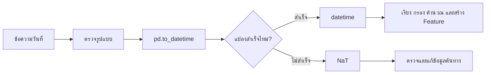
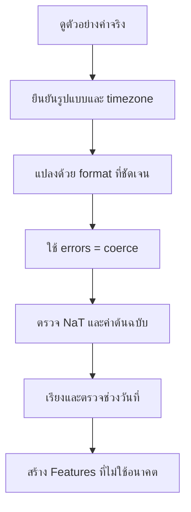

# 7. Parsing Dates: แปลงข้อความให้เป็นวันและเวลา

ข้อมูลวันที่จากไฟล์ CSV หรือฐานข้อมูลมักเข้ามาเป็นข้อความ เช่น `"2026-10-19"` โมเดลและ Pandas ยังใช้คำนวณช่วงเวลา เรียงลำดับ หรือสร้าง Feature จากข้อความนี้ได้ไม่ถูกต้อง จึงต้อง **Parse** ให้เป็นชนิด `datetime` ก่อน



## 1. Parsing Dates คืออะไร?

Parsing คือการอ่านข้อความแล้วตีความว่าส่วนใดคือปี เดือน วัน ชั่วโมง และเขตเวลา

```text
"2026-10-19"  →  19 ตุลาคม 2026
"19/10/2026"  →  19 ตุลาคม 2026
```

ข้อความสองแบบนี้หมายถึงวันเดียวกัน แต่ลำดับของตัวเลขต่างกัน หากไม่ระบุรูปแบบให้ชัด `01/02/2026` อาจถูกอ่านเป็น 1 กุมภาพันธ์ หรือ 2 มกราคมก็ได้

## 2. แปลงด้วย `pd.to_datetime()`

```python
import pandas as pd

df = pd.DataFrame({
    "order_date": ["2026-10-17", "2026-10-18", "2026-10-19"]
})

df["order_date"] = pd.to_datetime(
    df["order_date"],
    format="%Y-%m-%d",
)

print(df.dtypes)
```

ผลลัพธ์ของคอลัมน์จะเป็น `datetime64[ns]` แทน `object` หรือข้อความ

## 3. อ่านรหัส `format`

| รหัส | ความหมาย | ตัวอย่าง |
|---|---|---|
| `%Y` | ปี ค.ศ. 4 หลัก | `2026` |
| `%y` | ปี 2 หลัก | `26` |
| `%m` | เดือนเป็นตัวเลข | `10` |
| `%d` | วันที่ | `19` |
| `%H` | ชั่วโมงแบบ 24 ชั่วโมง | `14` |
| `%M` | นาที | `30` |
| `%S` | วินาที | `45` |
| `%z` | UTC offset | `+0700` |
| `%Z` | ชื่อเขตเวลา | `UTC` |

ตัวอย่างวันและเวลา:

```python
text = pd.Series(["19/10/2026 14:30:45"])

parsed = pd.to_datetime(
    text,
    format="%d/%m/%Y %H:%M:%S",
)

print(parsed)
```

การระบุ `format` ช่วยลดความกำกวม ตรวจจับข้อมูลผิดรูปแบบ และมักทำงานเร็วขึ้นเมื่อข้อมูลมีรูปแบบเดียวกัน

## 4. จัดการค่าที่แปลงไม่ได้

ข้อมูลจริงอาจมีข้อความผิด เช่น `"not-a-date"` หรือวันที่ที่ไม่มีอยู่จริง เช่น `"2026-02-30"`

```python
raw = pd.Series([
    "2026-10-19",
    "2026-02-30",
    "not-a-date",
    None,
])

parsed = pd.to_datetime(
    raw,
    format="%Y-%m-%d",
    errors="coerce",
)

print(parsed)
```

`errors="coerce"` เปลี่ยนค่าที่แปลงไม่ได้เป็น `NaT` ซึ่งย่อมาจาก **Not a Time** และมีบทบาทคล้าย `NaN` ของข้อมูลตัวเลข

ตรวจดูค่าต้นฉบับที่มีปัญหา:

```python
bad_mask = parsed.isna() & raw.notna()
bad_values = raw[bad_mask]

print(bad_values)
```

> **ข้อควรจำ:** อย่าลบ `NaT` ทันที ควรตรวจว่าปัญหาเกิดจากรูปแบบไม่ตรง ข้อมูลพิมพ์ผิด หรือวันที่หายจริง

## 5. วันที่รูปแบบวัน/เดือนกับเดือน/วัน

ข้อความ `03/04/2026` มีความกำกวม:

- `%d/%m/%Y` หมายถึง 3 เมษายน 2026
- `%m/%d/%Y` หมายถึง 4 มีนาคม 2026

วิธีที่ปลอดภัยที่สุดคือระบุ `format` จากข้อตกลงของแหล่งข้อมูล:

```python
thai_style = pd.to_datetime(
    pd.Series(["03/04/2026"]),
    format="%d/%m/%Y",
)
```

ไม่ควรเดารูปแบบจากข้อมูลเพียงไม่กี่แถว เพราะแถวที่ทั้งวันและเดือนไม่เกิน 12 อาจดูเหมือนถูกต้องทั้งสองแบบ

## 6. ข้อมูลหลายรูปแบบ

หากคอลัมน์เดียวมีหลายรูปแบบ ควรหาสาเหตุและทำมาตรฐานที่ต้นทางก่อน สำหรับ Pandas รุ่นใหม่สามารถใช้ `format="mixed"` ได้เมื่อจำเป็น:

```python
raw = pd.Series([
    "2026-10-19",
    "20/10/2026",
    "October 21, 2026",
])

parsed = pd.to_datetime(
    raw,
    format="mixed",
    dayfirst=True,
    errors="coerce",
)
```

`dayfirst=True` เป็นคำใบ้สำหรับรูปแบบที่กำกวม ไม่ได้ให้ความแน่นอนเท่าการกำหนด `format` แบบตายตัว

## 7. Unix Timestamp

บางระบบเก็บเวลาเป็นจำนวนวินาทีหรือมิลลิวินาทีที่นับจาก Unix epoch

```python
seconds = pd.Series([0, 1_728_000_000])
dates = pd.to_datetime(seconds, unit="s", utc=True)

milliseconds = pd.Series([1_728_000_000_000])
dates_ms = pd.to_datetime(milliseconds, unit="ms", utc=True)
```

ต้องรู้หน่วยจากระบบต้นทาง เพราะค่าที่เป็นวินาทีและมิลลิวินาทีต่างกัน 1,000 เท่า

$$
1\text{ second}=1{,}000\text{ milliseconds}
$$

## 8. Timezone

เวลา `2026-10-19 09:00` ที่ไม่มีเขตเวลายังไม่บอกว่าเป็น 09:00 ที่ประเทศใด

```python
local_time = pd.Series(["2026-10-19 09:00:00"])
local_time = pd.to_datetime(local_time)

# ระบุว่าเวลาต้นทางเป็นเวลาไทย
bangkok_time = local_time.dt.tz_localize("Asia/Bangkok")

# แปลงช่วงเวลาเดียวกันไปเป็น UTC
utc_time = bangkok_time.dt.tz_convert("UTC")
```

- `tz_localize()` กำหนดเขตเวลาให้ค่าที่ยังไม่มี timezone
- `tz_convert()` แปลงค่าที่มี timezone แล้วไปยังเขตเวลาอื่น

แนวทางทั่วไปคือเก็บเวลาหลักเป็น UTC แล้วแปลงเป็นเวลาท้องถิ่นตอนแสดงผล

## 9. คำนวณช่วงเวลา

เมื่อข้อมูลเป็น `datetime` แล้ว สามารถลบกันเพื่อหา `timedelta`:

```python
df = pd.DataFrame({
    "ordered_at": pd.to_datetime(["2026-10-17", "2026-10-18"]),
    "delivered_at": pd.to_datetime(["2026-10-19", "2026-10-22"]),
})

df["delivery_days"] = (
    df["delivered_at"] - df["ordered_at"]
).dt.days

print(df)
```

สมการของระยะเวลาคือ:

$$
\Delta t = t_{\text{end}} - t_{\text{start}}
$$

## 10. แยกส่วนของวันที่เป็น Features

```python
df["year"] = df["ordered_at"].dt.year
df["month"] = df["ordered_at"].dt.month
df["day"] = df["ordered_at"].dt.day
df["day_of_week"] = df["ordered_at"].dt.dayofweek
df["is_weekend"] = df["day_of_week"].isin([5, 6]).astype(int)
```

`dayofweek` เริ่มจากวันจันทร์เป็น `0` และวันอาทิตย์เป็น `6`

เดือนหรือวันในสัปดาห์มีลักษณะวนรอบ ธันวาคมอยู่ใกล้มกราคม และวันอาทิตย์อยู่ใกล้วันจันทร์ จึงอาจเข้ารหัสด้วย Sine/Cosine:

$$
x_{\sin}=\sin\left(2\pi\frac{x}{P}\right)
$$

$$
x_{\cos}=\cos\left(2\pi\frac{x}{P}\right)
$$

โดย $P$ คือจำนวนค่าต่อหนึ่งรอบ เช่น `12` สำหรับเดือน

## 11. เรียงและกรองตามวันที่

```python
# เรียงจากเก่าไปใหม่
df = df.sort_values("ordered_at")

# เลือกข้อมูลตั้งแต่วันที่กำหนด โดยไม่รวมวันสิ้นสุด
start = pd.Timestamp("2026-10-01")
end = pd.Timestamp("2026-11-01")

october = df[
    (df["ordered_at"] >= start)
    & (df["ordered_at"] < end)
]
```

การใช้เงื่อนไข `>= start` และ `< end` ลดปัญหาเวลาที่ซ่อนอยู่ เช่น `2026-10-31 23:59:59`

## 12. Parsing Date ใน Machine Learning

อย่าส่งค่า `datetime` ดิบให้โมเดลโดยไม่คิดความหมาย ควรสร้าง Feature ที่เกี่ยวกับโจทย์ เช่น:

- อายุบัญชี ณ วันที่ทำนาย
- จำนวนวันตั้งแต่สั่งซื้อครั้งล่าสุด
- เดือน ฤดูกาล หรือวันหยุด
- ชั่วโมงของวันสำหรับรูปแบบการใช้งาน

ตัวอย่างคำนวณอายุบัญชี:

```python
snapshot_date = pd.Timestamp("2026-10-19")

df["account_age_days"] = (
    snapshot_date - df["signup_date"]
).dt.days
```

Feature ทุกตัวต้องใช้ข้อมูลที่รู้แล้ว ณ `snapshot_date` เท่านั้น หากใช้วันที่หรือเหตุการณ์ที่เกิดหลังเวลาทำนาย จะเกิด **Time Leakage**

## 13. ขั้นตอนที่แนะนำ



Checklist:

- ยืนยันว่าข้อมูลใช้ปี ค.ศ. หรือ พ.ศ.
- ยืนยันลำดับวัน เดือน และปี
- ตรวจหน่วยของ Unix timestamp
- ระบุ timezone ให้ชัด
- ตรวจจำนวน `NaT` หลังแปลง
- ตรวจวันที่ต่ำสุดและสูงสุด
- แบ่งข้อมูลตามเวลาก่อนคำนวณสถิติที่อาจทำให้ข้อมูลรั่ว

## 14. ตัวอย่างรวม

```python
import pandas as pd

orders = pd.DataFrame({
    "ordered_at_raw": [
        "2026-10-17 09:30:00",
        "2026-10-18 14:15:00",
        "invalid",
    ],
    "amount": [500, 750, 300],
})

# 1. แปลงอย่างชัดเจน
orders["ordered_at"] = pd.to_datetime(
    orders["ordered_at_raw"],
    format="%Y-%m-%d %H:%M:%S",
    errors="coerce",
)

# 2. ตรวจข้อมูลเสียก่อนตัดสินใจแก้หรือลบ
bad_rows = orders[orders["ordered_at"].isna()]
print("แถวที่วันที่มีปัญหา:")
print(bad_rows)

# 3. ใช้เฉพาะแถวที่วันเวลาถูกต้อง
clean = orders.dropna(subset=["ordered_at"]).copy()

# 4. สร้าง Features
clean["hour"] = clean["ordered_at"].dt.hour
clean["day_of_week"] = clean["ordered_at"].dt.dayofweek
clean["is_weekend"] = clean["day_of_week"].isin([5, 6]).astype(int)

print(clean)
```

## สรุป

Parsing Dates ไม่ใช่เพียงการเปลี่ยนชนิดข้อมูล ต้องรู้รูปแบบ หน่วย และ timezone ของต้นทางด้วย หลังแปลงควรตรวจ `NaT` และช่วงวันที่เสมอ สำหรับ Machine Learning ต้องสร้าง Features จากวันที่โดยไม่ใช้ข้อมูลในอนาคต

## แหล่งอ้างอิง

- [pandas: `to_datetime`](https://pandas.pydata.org/docs/reference/api/pandas.to_datetime.html)
- [pandas: Time series and date functionality](https://pandas.pydata.org/docs/user_guide/timeseries.html)
- [Python: `strftime()` and `strptime()` format codes](https://docs.python.org/3/library/datetime.html#strftime-and-strptime-format-codes)

---

[← บทก่อนหน้า: Data Cleansing และ Missing Data](data-cleansing-missing-data.md) | [สารบัญ](index.md) | [บทถัดไป: Fuzzy Matching: จับคู่ข้อความที่สะกดไม่เหมือนกัน →](fuzzy-matching.md)
