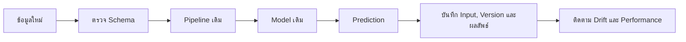

# 29. นำโมเดลไปใช้งานจริงและติดตามผล

การ Train สำเร็จเป็นเพียงจุดเริ่มต้น ระบบจริงต้องแปลงข้อมูลให้เหมือนตอน Train เก็บเวอร์ชัน และตรวจว่าคุณภาพลดลงหรือไม่



## 1. บันทึก Pipeline ทั้งชุด

ควรบันทึก preprocessing และโมเดลเป็นชิ้นเดียว เพื่อลดความเสี่ยงที่ Production แปลงข้อมูลต่างจากตอน Train

```python
import joblib

joblib.dump(model, "churn_pipeline.joblib")

loaded_model = joblib.load("churn_pipeline.joblib")
predictions = loaded_model.predict(X_new)
```

> [!WARNING]
> โหลดไฟล์ `pickle` หรือ `joblib` เฉพาะจากแหล่งที่เชื่อถือ เพราะไฟล์ชนิดนี้สามารถเรียกใช้โค้ดระหว่างการโหลดได้

## 2. เก็บสิ่งใดพร้อมโมเดล?

- เวอร์ชันโค้ด
- เวอร์ชันไลบรารี
- รายชื่อและชนิดข้อมูลของ Features
- ช่วงเวลาของข้อมูล Train
- Hyperparameters
- Metric จาก Validation และ Test
- Threshold ที่เลือก
- วันที่ Train และผู้รับผิดชอบ

## 3. ตรวจ Schema ก่อน Predict

```python
expected_columns = [
    "age",
    "income",
    "usage_count",
    "city",
    "plan",
]

missing_columns = [
    column for column in expected_columns
    if column not in X_new.columns
]

if missing_columns:
    raise ValueError(f"Missing columns: {missing_columns}")

X_new = X_new[expected_columns]
```

ควรตรวจชนิดข้อมูล ช่วงค่า Missing rate และ Category ใหม่ด้วย

## 4. Data Drift

Data Drift คือการกระจายของ Features เปลี่ยนจากตอน Train:

```text
ตอน Train: อายุลูกค้าเฉลี่ย 35 ปี
เดือนนี้:   อายุลูกค้าเฉลี่ย 52 ปี
```

Drift ไม่ได้แปลว่าคะแนนต้องลดลงเสมอ แต่เป็นสัญญาณให้ตรวจเพิ่มเติม

## 5. Concept Drift

Concept Drift คือความสัมพันธ์ระหว่าง Features กับ Target เปลี่ยนไป:

```text
อดีต: ใช้งานน้อยสัมพันธ์กับการยกเลิก
ปัจจุบัน: มีแพ็กเกจใหม่ ทำให้ความสัมพันธ์เดิมเปลี่ยน
```

Concept Drift ต้องอาศัย Target จริงที่มาถึงภายหลังเพื่อยืนยันว่าคุณภาพโมเดลเปลี่ยน

## 6. Metrics ที่ควรติดตาม

### ก่อน Target จริงมาถึง

- จำนวนคำทำนายต่อวัน
- Missing rate
- Category ที่ไม่เคยเห็น
- การกระจายของ Features
- การกระจายของ Probability และ Predicted class
- Latency และ Error rate

### หลัง Target จริงมาถึง

- Classification: Precision, Recall, F1, PR-AUC
- Regression: MAE, RMSE, $R^2$
- Metric แยกตามกลุ่มลูกค้าหรือช่วงเวลา

## 7. เมื่อไรควร Train ใหม่?

กำหนดกติกาล่วงหน้า เช่น:

- Recall ต่ำกว่าเกณฑ์ต่อเนื่อง
- Data Drift เกินเกณฑ์และคะแนนลดลง
- ธุรกิจเปลี่ยน Target หรือกระบวนการ
- มีข้อมูลใหม่เพียงพอ

ไม่ควร Train ใหม่โดยอัตโนมัติเพียงเพราะ Drift สูง ต้องตรวจคุณภาพข้อมูลและสาเหตุก่อน

## 8. Checklist ก่อนเปิดใช้งาน

- Pipeline ครอบคลุม preprocessing ทั้งหมด
- มี Schema validation
- บันทึกเวอร์ชันและ Metric
- ทดสอบข้อมูลตัวอย่างแบบเดียวกับ Production
- กำหนด Logging โดยไม่เปิดเผยข้อมูลส่วนบุคคลเกินจำเป็น
- มี Dashboard และ Alert ที่ลงมือแก้ไขได้
- มีขั้นตอน Rollback
- ระบุเงื่อนไข Train ใหม่

## 9. แหล่งอ้างอิง

- [scikit-learn: Model persistence](https://scikit-learn.org/stable/model_persistence.html)
- [scikit-learn: Common pitfalls](https://scikit-learn.org/stable/common_pitfalls.html)

---

[← บทก่อนหน้า: Time Series และ Forecasting](time-series.md) · [สารบัญ](index.md)
