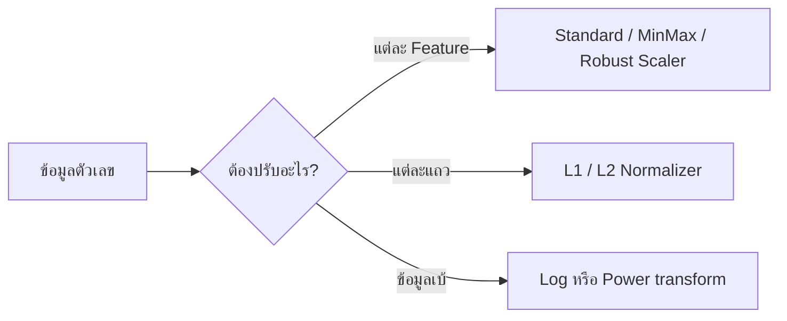
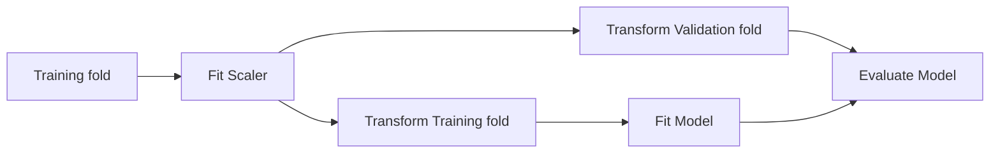

# 20. Scaling และ Normalization

Scaling และ Normalization คือการปรับค่าตัวเลขให้อยู่ในรูปแบบที่เหมาะกับโมเดล โดยไม่ได้เปลี่ยนความหมายพื้นฐานของข้อมูล

สองคำนี้มักถูกใช้แทนกัน แต่ใน scikit-learn มีความหมายต่างกัน:

- **Feature scaling:** ปรับแต่ละคอลัมน์จากสถิติของข้อมูล เช่น Mean, Standard deviation, Min หรือ Max
- **Sample normalization:** ปรับแต่ละแถวให้เวกเตอร์มีความยาวตามเกณฑ์ เช่น L1 หรือ L2 norm เท่ากับ 1



## 1. ทำไมต้องปรับสเกล?

สมมติมีสอง Features:

- อายุ: `20–60`
- รายได้: `15,000–200,000`

โมเดลที่ใช้ระยะทางหรือ Gradient อาจให้อิทธิพลกับรายได้มากกว่าเพียงเพราะตัวเลขมีขนาดใหญ่กว่า ไม่ได้หมายความว่ารายได้สำคัญกว่าเสมอไป

Scaling ช่วยให้:

- KNN, K-Means และ SVM คำนวณระยะทางอย่างสมดุลขึ้น
- Linear/Logistic Regression ที่มี Regularization เปรียบเทียบ Weights ได้เหมาะขึ้น
- Gradient descent ลู่เข้าได้ง่ายขึ้น
- PCA ไม่ถูก Feature ที่มีหน่วยใหญ่ครอง Components
- Neural Network ฝึกได้มีเสถียรภาพขึ้น

## 2. StandardScaler

StandardScaler ทำให้แต่ละ Feature มีค่าเฉลี่ยใกล้ 0 และ Standard deviation ใกล้ 1:

$$
z=\frac{x-\mu}{\sigma}
$$

```python
import pandas as pd
from sklearn.preprocessing import StandardScaler

X = pd.DataFrame(
    {
        "age": [20, 30, 40, 50],
        "income": [15000, 30000, 60000, 120000],
    }
)

scaler = StandardScaler()
X_scaled = scaler.fit_transform(X)

print(X_scaled)
print("Mean learned from Train:", scaler.mean_)
print("Scale learned from Train:", scaler.scale_)
```

เหมาะกับโมเดลทั่วไปที่ต้อง Scale และข้อมูลไม่มี Outliers รุนแรง แต่ไม่ได้บังคับให้ค่าอยู่ระหว่าง 0 ถึง 1

## 3. MinMaxScaler

แปลงค่าให้อยู่ในช่วงที่กำหนด โดยปกติคือ 0 ถึง 1:

$$
x'=\frac{x-x_{\min}}{x_{\max}-x_{\min}}
$$

```python
from sklearn.preprocessing import MinMaxScaler

scaler = MinMaxScaler(feature_range=(0, 1))
X_scaled = scaler.fit_transform(X)
```

ข้อดีคือได้ช่วงชัดเจน แต่ไวต่อ Outliers มาก เพราะ Min และ Max ถูกค่าสุดโต่งกำหนด ข้อมูลใหม่สามารถมีค่าต่ำกว่า 0 หรือสูงกว่า 1 หากอยู่นอกช่วงที่พบใน Train

## 4. RobustScaler

RobustScaler ใช้ Median และ IQR จึงทนต่อ Outliers มากกว่า:

$$
x'=\frac{x-\operatorname{Median}(x)}{Q_3-Q_1}
$$

```python
from sklearn.preprocessing import RobustScaler

scaler = RobustScaler()
X_scaled = scaler.fit_transform(X)
```

เหมาะเมื่อข้อมูลมี Outliers ที่เป็นค่าจริงและยังต้องเก็บไว้ แต่ไม่ได้ทำให้ Outliers หายไป

## 5. MaxAbsScaler

หารทุกค่าด้วยค่าสัมบูรณ์ที่มากที่สุด:

$$
x'=\frac{x}{\max(|x|)}
$$

```python
from sklearn.preprocessing import MaxAbsScaler

scaler = MaxAbsScaler()
X_scaled = scaler.fit_transform(X)
```

ค่าจะอยู่ประมาณช่วง -1 ถึง 1 และศูนย์ยังเป็นศูนย์ เหมาะกับ Sparse data บางประเภท แต่ยังไวต่อ Outliers

## 6. เปรียบเทียบ Scalers

| วิธี | ศูนย์กลาง/ช่วง | Outliers | เหมาะกับ |
|---|---|---|---|
| `StandardScaler` | Mean 0, Std 1 | ไว | ค่าเริ่มต้นสำหรับหลายโมเดล |
| `MinMaxScaler` | ช่วง เช่น 0–1 | ไวมาก | ต้องการช่วงค่าชัดเจน |
| `RobustScaler` | Median 0, ใช้ IQR | ทนกว่า | ข้อมูลมี Outliers |
| `MaxAbsScaler` | ประมาณ -1 ถึง 1 | ไว | Sparse data และต้องรักษาศูนย์ |

ไม่มี Scaler ที่ดีที่สุดสำหรับทุกงาน ควรเลือกจาก Distribution, Outliers และโมเดล แล้วประเมินด้วย Cross-validation

## 7. Normalizer: ปรับทีละแถว

`Normalizer` ไม่ได้เรียนรู้ Mean หรือ Min/Max แต่ปรับเวกเตอร์แต่ละแถวให้มี Norm เท่ากับ 1

L2 norm:

$$
\|x\|_2=\sqrt{\sum_{j=1}^{p}x_j^2}
$$

$$
x'=\frac{x}{\|x\|_2}
$$

```python
from sklearn.preprocessing import Normalizer

normalizer = Normalizer(norm="l2")
X_normalized = normalizer.transform(X)

print(X_normalized)
```

เหมาะเมื่อทิศทางของเวกเตอร์สำคัญกว่าขนาด เช่นข้อมูลคำแบบ Count/TF-IDF หรือการเปรียบเทียบด้วย Cosine similarity

> [!IMPORTANT]
> `StandardScaler` ปรับทีละคอลัมน์ ส่วน `Normalizer` ปรับทีละแถว จึงแก้ปัญหาคนละแบบ

## 8. L1 กับ L2 Normalization

L1 norm:

$$
\|x\|_1=\sum_{j=1}^{p}|x_j|
$$

L2 norm:

$$
\|x\|_2=\sqrt{\sum_{j=1}^{p}x_j^2}
$$

- L1 ทำให้ผลรวมค่าสัมบูรณ์ของแต่ละแถวเท่ากับ 1
- L2 ทำให้ระยะ Euclidean จากจุดกำเนิดเท่ากับ 1

## 9. Log Transformation

ข้อมูลรายได้ ราคา หรือจำนวนครั้งอาจเบ้ขวา ใช้ Log ลดช่วงของค่าขนาดใหญ่:

$$
x'=\log(1+x)
$$

```python
import numpy as np

income = np.array([0, 1000, 10000, 100000], dtype=float)
income_log = np.log1p(income)
income_restored = np.expm1(income_log)

print(income_log)
print(income_restored)
```

`log1p()` รองรับศูนย์ แต่ค่าต้องมากกว่า `-1` การแปลง Log ต่างจาก Scaling เพราะเปลี่ยนรูป Distribution และระยะห่างระหว่างค่า

## 10. PowerTransformer และ QuantileTransformer

```python
from sklearn.preprocessing import PowerTransformer, QuantileTransformer

power = PowerTransformer(method="yeo-johnson")
X_power = power.fit_transform(X)

quantile = QuantileTransformer(
    output_distribution="normal",
    random_state=42,
)
X_quantile = quantile.fit_transform(X)
```

- Yeo–Johnson รองรับค่าศูนย์และค่าติดลบ
- Box–Cox ต้องใช้ค่าบวก
- QuantileTransformer เปลี่ยนรูป Distribution มากและอาจลดผลของ Outliers แต่ความสัมพันธ์ของระยะห่างเดิมจะเปลี่ยน

ควรใช้เมื่อมีเหตุผลจาก Distribution และผล Validation ไม่ใช่เพียงเพื่อให้กราฟดูเป็น Normal

## 11. `fit()`, `transform()` และ `fit_transform()`

```python
from sklearn.preprocessing import StandardScaler

scaler = StandardScaler()

X_train_scaled = scaler.fit_transform(X_train)
X_valid_scaled = scaler.transform(X_valid)
X_test_scaled = scaler.transform(X_test)
```

- `fit()` เรียนรู้สถิติจาก Train
- `transform()` ใช้สถิติที่เรียนรู้แล้ว
- `fit_transform()` ทำสองขั้นตอนกับข้อมูลเดียวกัน

ห้าม `fit_transform()` Validation หรือ Test เพราะจะใช้ข้อมูลชุดนั้นสร้างค่า Mean/Scale ใหม่ และทำให้ขั้นตอนใช้งานจริงไม่ตรงกับการประเมิน

## 12. `inverse_transform()`

แปลงค่าที่ Scale แล้วกลับสู่หน่วยเดิม:

```python
X_restored = scaler.inverse_transform(X_train_scaled)
```

มีประโยชน์เมื่อต้องแสดงผลหรือ Debug แต่ค่าอาจต่างจากเดิมเล็กน้อยจาก Floating-point และการแปลงบางแบบ เช่น Quantile transformation อาจย้อนกลับได้เพียงประมาณค่า

ถ้า Scale Target ด้วย ต้อง Decode ค่าทำนายกลับก่อนรายงาน:

```python
y_pred_original = target_scaler.inverse_transform(
    y_pred_scaled.reshape(-1, 1)
).ravel()
```

## 13. ใช้ Pipeline ป้องกัน Data Leakage

```python
from sklearn.linear_model import LogisticRegression
from sklearn.pipeline import make_pipeline
from sklearn.preprocessing import StandardScaler

model = make_pipeline(
    StandardScaler(),
    LogisticRegression(max_iter=1000),
)

model.fit(X_train, y_train)
y_pred = model.predict(X_valid)
```

เมื่อใช้ Cross-validation Pipeline จะ `fit` Scaler ใหม่จาก Training fold เท่านั้น แล้ว Transform Validation fold ด้วยค่าเดิม



## 14. โมเดลใดต้อง Scale?

| โมเดล | ควร Scale หรือไม่? | เหตุผล |
|---|---|---|
| KNN | ควร | ใช้ระยะทาง |
| K-Means | ควร | ใช้ระยะถึง Centroid |
| SVM | ควร | Margin และ Kernel ไวต่อสเกล |
| Linear/Logistic + Regularization | ควร | Penalty เปรียบเทียบ Weights |
| PCA | ควรในหลายกรณี | Variance ถูกหน่วยใหญ่ครองได้ |
| Neural Network | ควร | ช่วย Optimization |
| Decision Tree | โดยทั่วไปไม่จำเป็น | ใช้ลำดับและ Threshold |
| Random Forest | โดยทั่วไปไม่จำเป็น | ประกอบจากต้นไม้ |
| Gradient Boosted Trees | โดยทั่วไปไม่จำเป็น | แบ่งด้วย Threshold |

แม้ต้นไม้ไม่ต้อง Scale แต่ Pipeline อาจมีโมเดลอื่นหรือขั้นตอนที่ต้อง Scale จึงต้องดูทั้งระบบ

## 15. Scaling Target

โดยทั่วไปเริ่มจากไม่ Scale Target ก่อน แต่บางงาน Neural Network หรือ Target ที่มีช่วงกว้างอาจได้ประโยชน์ scikit-learn มี `TransformedTargetRegressor`:

```python
from sklearn.compose import TransformedTargetRegressor
from sklearn.linear_model import Ridge
from sklearn.preprocessing import StandardScaler

model = TransformedTargetRegressor(
    regressor=Ridge(alpha=1.0),
    transformer=StandardScaler(),
)

model.fit(X_train, y_train)
y_pred = model.predict(X_valid)
```

ตัวช่วยนี้แปลง Target ตอนฝึกและแปลง Prediction กลับโดยอัตโนมัติ

## 16. Batch Normalization และ Layer Normalization

คำว่า Normalization ใน Deep Learning เป็นคนละขั้นตอนกับ `Normalizer`:

- **Batch Normalization:** ใช้สถิติของ Mini-batch ระหว่างฝึกและเก็บ Running statistics สำหรับ Inference
- **Layer Normalization:** Normalize ภายใน Representation ของตัวอย่างหนึ่ง ใช้มากใน Transformer
- **Feature scaling:** เป็น Preprocessing ของ Input ก่อนเข้าโมเดล

ทั้งสามอย่างสามารถอยู่ในระบบเดียวกันได้และไม่ได้ทดแทนกันโดยอัตโนมัติ

## 17. ข้อผิดพลาดที่พบบ่อย

- Scale ข้อมูลทั้งหมดก่อนแบ่ง Train/Test
- `fit_transform()` Validation หรือข้อมูล Production
- ใช้ MinMaxScaler โดยไม่ตรวจ Outliers
- ใช้ `Normalizer` แทน `StandardScaler` เพราะชื่อคล้ายกัน
- ลืม Scale ข้อมูลใหม่ด้วย Scaler ตัวเดิม
- Scale คอลัมน์ One-Hot โดยไม่มีเหตุผล
- รายงาน Target ที่ Scale แล้วโดยไม่ `inverse_transform()`
- คิดว่า Scaling ทำให้ Distribution เป็น Normal เสมอ

## 18. Checklist

- ตรวจหน่วย Distribution และ Outliers ของแต่ละ Feature
- เลือก Feature scaling หรือ Row normalization ให้ตรงปัญหา
- เริ่มทดลอง `StandardScaler` สำหรับโมเดลที่ไวต่อสเกล
- ทดลอง `RobustScaler` เมื่อมี Outliers
- ใช้ Pipeline เพื่อป้องกัน Data Leakage
- `fit` จาก Train เท่านั้น
- เก็บ Scaler ร่วมกับโมเดล
- ตรวจข้อมูลใหม่ที่อยู่นอกช่วง Train
- ประเมินตัวเลือกด้วย Cross-validation
- Decode Target กลับเป็นหน่วยเดิมก่อนรายงาน

## แหล่งอ้างอิง

- [scikit-learn: Preprocessing data](https://scikit-learn.org/stable/modules/preprocessing.html)
- [scikit-learn: Compare scaling methods](https://scikit-learn.org/stable/auto_examples/preprocessing/plot_all_scaling.html)
- [scikit-learn: StandardScaler](https://scikit-learn.org/stable/modules/generated/sklearn.preprocessing.StandardScaler.html)
- [scikit-learn: RobustScaler](https://scikit-learn.org/stable/modules/generated/sklearn.preprocessing.RobustScaler.html)
- [scikit-learn: Normalizer](https://scikit-learn.org/stable/modules/generated/sklearn.preprocessing.Normalizer.html)

---

[← บทก่อนหน้า: Encoding และ Decoding](encoding-decoding.md) | [สารบัญ](index.md) | [บทถัดไป: Outliers: ค่าที่ห่างจากข้อมูลส่วนใหญ่ →](outliers.md)
