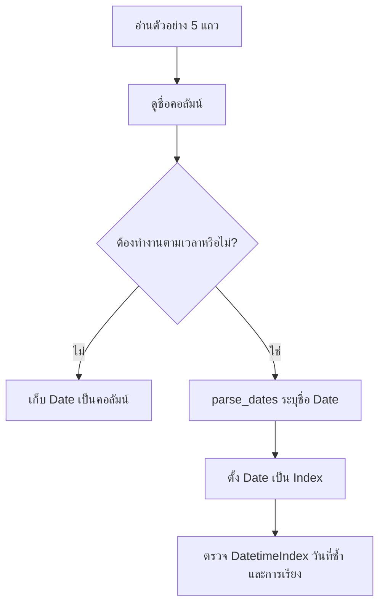
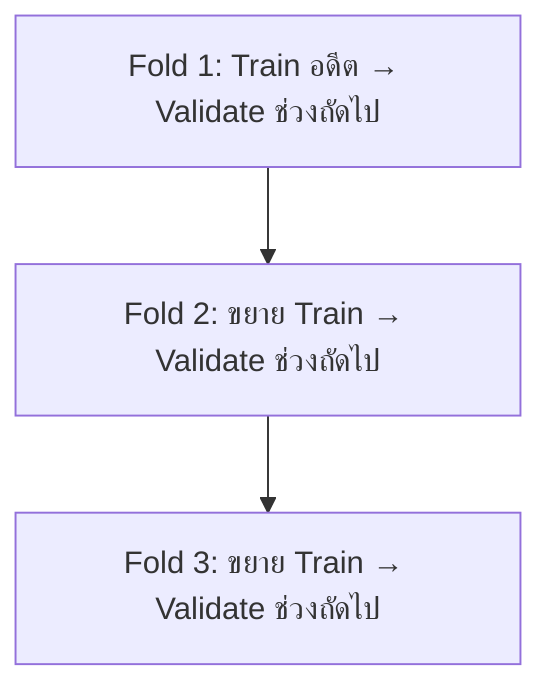

# 32. Time Series และ Forecasting

Time Series คือข้อมูลที่มีลำดับเวลา เช่นยอดขายรายวัน ราคา หรือค่าจาก Sensor การแบ่งข้อมูลต้องรักษาลำดับเวลาเพื่อจำลองการทำนายอนาคต

## ส่วนประกอบ

- Trend: แนวโน้มระยะยาว
- Seasonality: รูปแบบที่เกิดซ้ำ
- Cycle: การขึ้นลงที่ช่วงไม่แน่นอน
- Noise: ความผันผวนที่อธิบายไม่ได้

## อ่านไฟล์ CSV ที่มีวันที่

ตัวอย่างนี้อ่านข้อมูลจำนวนผู้เข้าชมพิพิธภัณฑ์ โดยใช้คอลัมน์ `Date` เป็น Index:

```python
import pandas as pd

museum_data = pd.read_csv(
    museum_filepath,
    index_col="Date",
    parse_dates=["Date"],
)
```

แต่ละ Parameter มีหน้าที่ต่างกัน:

| Parameter | ความหมาย |
|---|---|
| `museum_filepath` | ตำแหน่งไฟล์ CSV |
| `index_col="Date"` | ใช้คอลัมน์ `Date` เป็นชื่อแถวหรือ Index |
| `parse_dates=["Date"]` | แปลงคอลัมน์ `Date` จากข้อความเป็น `datetime` |

### จะรู้ได้อย่างไรว่า `index_col` ต้องเป็นอะไร?

อ่านตัวอย่างข้อมูลก่อนโดยยังไม่กำหนด Index:

```python
preview = pd.read_csv(
    museum_filepath,
    nrows=5,
)

print(preview)
print(preview.columns.tolist())
print(preview.dtypes)
```

สมมติว่าได้ข้อมูล:

```text
         Date  Avila Adobe  Firehouse Museum
0  2014-01-01         24778              4486
1  2014-02-01         18976              4172
```

และรายชื่อคอลัมน์คือ:

```text
['Date', 'Avila Adobe', 'Firehouse Museum']
```

จึงรู้ว่าไฟล์มีคอลัมน์ชื่อ `Date` จริง แต่การมีคอลัมน์นี้ไม่ได้แปลว่าต้องใช้เป็น Index เสมอไป

คอลัมน์เหมาะเป็น Index เมื่อ:

- แต่ละแถวอ้างอิงช่วงเวลาหนึ่ง
- ต้องเลือกข้อมูลด้วยช่วงวันที่
- ต้องใช้ `resample()` หรือ Rolling window ตามเวลา
- ต้องวาดกราฟโดยให้เวลาเป็นแกน X
- วันที่ไม่ซ้ำ หรือยอมรับได้ที่ Index จะซ้ำ

หากยังไม่ต้องใช้ความสามารถของ Time Series Index สามารถเก็บวันที่เป็นคอลัมน์ธรรมดา:

```python
museum_data = pd.read_csv(
    museum_filepath,
    parse_dates=["Date"],
)
```

และตั้งเป็น Index ภายหลังได้:

```python
museum_data = museum_data.set_index("Date")
```

### `parse_dates=True` หมายถึงอะไร?

เมื่อกำหนดทั้งสองค่านี้:

```python
museum_data = pd.read_csv(
    museum_filepath,
    index_col="Date",
    parse_dates=True,
)
```

Pandas จะพยายาม Parse คอลัมน์ที่ใช้เป็น Index ให้เป็นวันที่ วิธีนี้ใช้ได้ แต่ไม่ได้บอกผู้อ่านอย่างชัดเจนว่าต้องการแปลงคอลัมน์ใด

รูปแบบที่ชัดเจนกว่าคือระบุชื่อคอลัมน์:

```python
museum_data = pd.read_csv(
    museum_filepath,
    index_col="Date",
    parse_dates=["Date"],
)
```

ไม่ควรใช้ `parse_dates=True` โดยคาดว่า Pandas จะค้นหาและแปลงทุกคอลัมน์วันที่ในไฟล์ให้เอง

### ตรวจว่าการแปลงสำเร็จหรือไม่

```python
print(type(museum_data.index))
print(museum_data.index.dtype)
print(museum_data.index.min())
print(museum_data.index.max())
print(museum_data.index.isna().sum())
```

ผลที่ต้องการคือ Index ชนิด `DatetimeIndex`:

```text
<class 'pandas.core.indexes.datetimes.DatetimeIndex'>
datetime64[ns]
```

ตรวจคุณสมบัติที่สำคัญเพิ่มเติม:

```python
print("เรียงตามเวลา:", museum_data.index.is_monotonic_increasing)
print("วันที่ซ้ำ:", museum_data.index.duplicated().sum())
```

หากยังไม่เรียง สามารถเรียงได้ด้วย:

```python
museum_data = museum_data.sort_index()
```

### ข้อมูลจริงที่อาจมีวันที่เสีย

ถ้าต้องการระบุ `format` และตรวจแถวที่แปลงไม่ได้ ให้อ่านเป็นข้อความก่อน:

```python
museum_data = pd.read_csv(museum_filepath)

raw_date = museum_data["Date"].copy()

museum_data["Date"] = pd.to_datetime(
    museum_data["Date"],
    format="%Y-%m-%d",
    errors="coerce",
)

bad_date_mask = museum_data["Date"].isna() & raw_date.notna()
bad_dates = museum_data.loc[bad_date_mask].assign(
    original_date=raw_date[bad_date_mask]
)

print(bad_dates)
```

หลังตรวจและแก้ข้อมูลแล้วจึงตั้ง Index:

```python
museum_data = (
    museum_data
    .dropna(subset=["Date"])
    .set_index("Date")
    .sort_index()
)
```

อ่านรายละเอียดเรื่องรูปแบบวันที่ `NaT`, Unix Timestamp และ Timezone ได้ที่ [Parsing Dates](parsing-dates.md)

## ใช้ `DatetimeIndex`

เมื่อ `Date` เป็น `DatetimeIndex` แล้ว สามารถเลือกข้อมูลตามช่วงเวลาได้:

```python
data_2014 = museum_data.loc["2014-01-01":"2014-12-31"]
```

คำนวณผลรวมรายปี:

```python
yearly_visitors = museum_data.resample("YE").sum()
```

หรือค่าเฉลี่ยเคลื่อนที่ 3 เดือน:

```python
rolling_mean_3 = museum_data.rolling(window=3).mean()
```

Rolling จำนวน `3` แถวจะหมายถึง 3 เดือนก็ต่อเมื่อข้อมูลมีหนึ่งแถวต่อเดือนอย่างสม่ำเสมอ จึงควรตรวจความถี่ก่อน:

```python
print(pd.infer_freq(museum_data.index))
```

## หลักคิดสั้น ๆ



เลือก `index_col` จากบทบาทของคอลัมน์ ไม่ได้เลือกจากชื่อเพียงอย่างเดียว ส่วน `parse_dates` ใช้เมื่อค่าต้องถูกคำนวณ กรอง หรือเรียงในฐานะวันและเวลา

## แบ่งข้อมูลตามเวลา

```text
อดีต                           อนาคต
|--------- Train ---------|--- Validation ---|--- Test ---|
```

ห้าม Shuffle ก่อนแบ่ง เพราะข้อมูลอนาคตจะหลุดเข้า Train

```python
train = df[df["date"] < "2025-01-01"]
valid = df[(df["date"] >= "2025-01-01") & (df["date"] < "2025-04-01")]
test = df[df["date"] >= "2025-04-01"]
```

## Baseline

Naive forecast:

$$
\hat{y}_t=y_{t-1}
$$

Seasonal naive:

$$
\hat{y}_t=y_{t-s}
$$

$s=7$ อาจหมายถึงใช้วันเดียวกันของสัปดาห์ก่อนสำหรับข้อมูลรายวัน

## Lag และ Rolling Features

```python
df = df.sort_values("date")
df["lag_1"] = df["sales"].shift(1)
df["lag_7"] = df["sales"].shift(7)
df["rolling_mean_7"] = df["sales"].shift(1).rolling(7).mean()
```

ต้อง `shift(1)` ก่อน Rolling เพื่อไม่ให้ Target ของเวลาปัจจุบันเข้า Feature ของแถวเดียวกัน

## Time-series Cross-validation



```python
from sklearn.model_selection import TimeSeriesSplit

splitter = TimeSeriesSplit(n_splits=5)
for train_index, valid_index in splitter.split(X):
    X_train, X_valid = X.iloc[train_index], X.iloc[valid_index]
```

## Metrics

ใช้ MAE หรือ RMSE ตามต้นทุนของความผิดพลาด MAPE มีปัญหาเมื่อค่าจริงเป็นศูนย์หรือใกล้ศูนย์ ควรเปรียบเทียบกับ Naive baseline เสมอ

## Time Leakage

- ใช้ยอดขายปลายวันทำนายเหตุการณ์ตอนเช้า
- Rolling window รวมค่าปัจจุบันหรืออนาคต
- เติม Missing ด้วยข้อมูลจากอนาคต
- สุ่มแบ่งแถวที่อยู่ติดกันไปคนละชุด
- Features ที่ระบบจริงยังไม่ทราบ ณ เวลาทำนาย

## Checklist

- เรียงและตรวจ Timestamp, Time zone และความถี่
- กำหนด Forecast horizon
- สร้าง Naive และ Seasonal baseline
- แบ่งข้อมูลตามเวลา
- สร้าง Lag/Rolling จากอดีตเท่านั้น
- ใช้ Backtesting หลายช่วง
- ติดตาม Drift และ Retraining schedule

## แหล่งอ้างอิง

- [pandas: `read_csv`](https://pandas.pydata.org/docs/reference/api/pandas.read_csv.html)
- [pandas: Time series and date functionality](https://pandas.pydata.org/docs/user_guide/timeseries.html)
- [scikit-learn: TimeSeriesSplit](https://scikit-learn.org/stable/modules/generated/sklearn.model_selection.TimeSeriesSplit.html)
- [Forecasting: Principles and Practice](https://otexts.com/fpp3/)

---

[← บทก่อนหน้า: อธิบายผลโมเดล](model-explainability.md) | [สารบัญ](index.md) | [บทถัดไป: นำโมเดลไปใช้งานจริงและติดตามผล →](production-monitoring.md)
