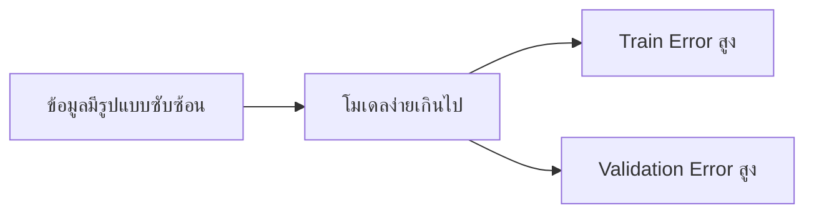
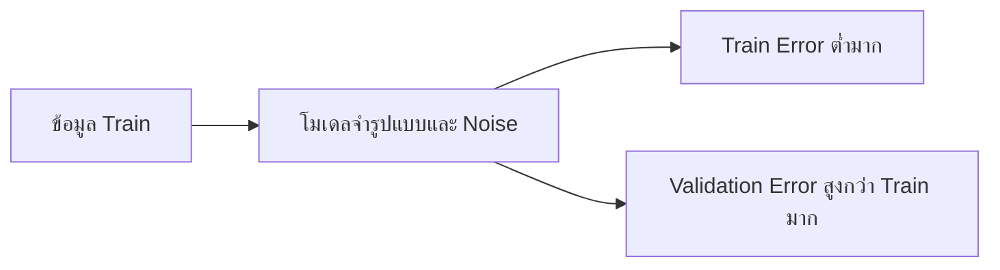

# 12. Underfitting และ Overfitting

Underfitting และ Overfitting อธิบายว่าโมเดลเรียนรู้รูปแบบจากข้อมูลน้อยหรือมากเกินไป เป้าหมายคือโมเดลที่เรียนรู้รูปแบบจริงและทำนายข้อมูลใหม่ได้ดี


## 1. Underfitting

**Underfitting** คือโมเดลง่ายเกินไปหรือเรียนรู้ไม่เพียงพอ จึงจับรูปแบบสำคัญไม่ได้ เช่น ความสัมพันธ์จริงเป็นเส้นโค้ง แต่ใช้โมเดลที่สร้างได้เพียงเส้นตรง



| ชุดข้อมูล | ผลลัพธ์ที่พบบ่อย |
|---|---|
| Train | ทำได้ไม่ดี |
| Validation/Test | ทำได้ไม่ดี |
| ความต่างของคะแนน | มักไม่ห่างกันมาก |

ตัวอย่าง:

| โมเดล | Train RMSE | Validation RMSE |
|---|---:|---:|
| Linear Regression | 800,000 | 850,000 |

ทั้งสองค่าสูงและใกล้กัน โมเดลอาจเรียนรู้รูปแบบไม่เพียงพอ แต่ต้องเปรียบเทียบกับ Baseline และขนาดความผิดพลาดที่งานยอมรับได้ด้วย

### สาเหตุที่พบบ่อย

- โมเดลง่ายเกินไป
- Features ไม่มีข้อมูลเพียงพอ
- Regularization แรงเกินไป
- ต้นไม้ตื้นเกินไป
- ฝึกโมเดลแบบวนรอบน้อยเกินไป
- Preprocessing ทำให้ข้อมูลสำคัญสูญหาย

### วิธีแก้

- เพิ่ม Features ที่มีประโยชน์
- ใช้โมเดลที่จับความสัมพันธ์ซับซ้อนได้ขึ้น
- ลดความแรงของ Regularization
- เพิ่ม `max_depth` หรือจำนวนรอบอย่างระมัดระวัง
- ตรวจคุณภาพข้อมูล Target และ Metric

## 2. Overfitting

**Overfitting** คือโมเดลเรียนรู้รายละเอียดและ Noise ใน Train มากเกินไป จึงทำได้ดีมากกับข้อมูลที่เคยเห็น แต่ทำได้ไม่ดีกับข้อมูลใหม่



| ชุดข้อมูล | ผลลัพธ์ที่พบบ่อย |
|---|---|
| Train | ทำได้ดีมาก |
| Validation/Test | แย่กว่า Train ชัดเจน |
| ความต่างของคะแนน | ห่างกันมาก |

ตัวอย่าง:

| โมเดล | Train RMSE | Validation RMSE |
|---|---:|---:|
| Decision Tree | 20,000 | 700,000 |

Train RMSE ต่ำมาก แต่ Validation RMSE สูง ต้นไม้อาจจำ Train มากเกินไป

### สาเหตุที่พบบ่อย

- โมเดลซับซ้อนหรือต้นไม้ลึกเกินไป
- Features มากเมื่อเทียบกับจำนวนข้อมูล
- ข้อมูล Train น้อย
- มี Noise ข้อมูลผิด หรือ Outliers
- ปรับ Hyperparameters ตาม Validation ชุดเดิมหลายครั้งเกินไป
- มี Data Leakage หรือข้อมูลซ้ำข้ามชุด

### วิธีแก้

- ลดความซับซ้อนของโมเดล
- ลด `max_depth` และเพิ่ม `min_samples_leaf`
- ใช้ Regularization
- ลด Features ที่ไม่มีประโยชน์
- เพิ่มข้อมูล Train ที่เป็นตัวแทนของงานจริง
- ใช้ Cross-validation และ Early stopping
- ตรวจ Data Leakage ข้อมูลซ้ำ และ Outliers

## 3. Generalization gap

**Generalization** คือความสามารถในการทำนายข้อมูลใหม่ โมเดลที่ทำคะแนน Train ดีที่สุดจึงไม่จำเป็นต้องเป็นโมเดลที่ดีที่สุด

สำหรับ Metric แบบ Error ซึ่งค่ายิ่งต่ำยิ่งดี:

$$
\mathrm{Gap}_{\text{error}}
=\mathrm{Validation\ Error}
-\mathrm{Train\ Error}
$$

จากตัวอย่าง Decision Tree:

$$
\mathrm{Gap}=700{,}000-20{,}000=680{,}000
$$

สำหรับ Metric แบบคะแนนซึ่งค่ายิ่งสูงยิ่งดี:

$$
\mathrm{Gap}_{\text{score}}
=\mathrm{Train\ Score}
-\mathrm{Validation\ Score}
$$

Gap สูงอาจบ่งชี้ Overfitting แต่ Gap ต่ำไม่ได้แปลว่าโมเดลดีเสมอไป เพราะ Train และ Validation อาจแย่ทั้งคู่

## 4. ตารางช่วยวิเคราะห์

| Train | Validation | ความเป็นไปได้ |
|---|---|---|
| แย่ | แย่และใกล้ Train | Underfitting |
| ดีมาก | แย่กว่า Train ชัดเจน | Overfitting |
| ดี | ดีและใกล้ Train | Generalization ดี |
| ดีผิดปกติทั้งคู่ | ดีผิดปกติ | ตรวจ Data Leakage หรือข้อมูลซ้ำ |

คำว่า “ดี” ต้องอ้างอิง Baseline เป้าหมายของงาน และความผันผวนจาก Cross-validation ไม่มีตัวเลขตายตัวที่ใช้ได้กับทุกปัญหา

## 5. ทดลองด้วย Decision Tree

```python
from sklearn.datasets import make_regression
from sklearn.metrics import root_mean_squared_error
from sklearn.model_selection import train_test_split
from sklearn.tree import DecisionTreeRegressor

SEED = 42
X, y = make_regression(
    n_samples=500,
    n_features=6,
    n_informative=4,
    noise=20,
    random_state=SEED,
)
X_train, X_valid, y_train, y_valid = train_test_split(
    X,
    y,
    test_size=0.25,
    random_state=SEED,
)

for depth in [1, 2, 4, 8, None]:
    model = DecisionTreeRegressor(max_depth=depth, random_state=SEED)
    model.fit(X_train, y_train)

    train_rmse = root_mean_squared_error(
        y_train, model.predict(X_train)
    )
    valid_rmse = root_mean_squared_error(
        y_valid, model.predict(X_valid)
    )

    print(
        f"depth={str(depth):>4} | "
        f"train={train_rmse:7.2f} | "
        f"valid={valid_rmse:7.2f} | "
        f"gap={valid_rmse - train_rmse:7.2f}"
    )
```

แนวโน้มที่มักพบ:

- `max_depth` ต่ำมาก: Train และ Validation Error สูง มีแนวโน้ม Underfitting
- เพิ่ม `max_depth`: โมเดลจับรูปแบบได้ดีขึ้น
- `max_depth` สูงมาก: Train Error ต่ำมาก แต่ Validation Error อาจสูงขึ้น มีแนวโน้ม Overfitting

ผลจริงขึ้นอยู่กับข้อมูล จึงต้องวัดแทนการเดา

## 6. Validation Curve

Validation Curve แสดงผลของ Hyperparameter หนึ่งค่าต่อคะแนน Train และ Validation:

```python
import matplotlib.pyplot as plt
from sklearn.datasets import make_regression
from sklearn.metrics import root_mean_squared_error
from sklearn.model_selection import train_test_split
from sklearn.tree import DecisionTreeRegressor

SEED = 42
X, y = make_regression(
    n_samples=500,
    n_features=6,
    noise=20,
    random_state=SEED,
)
X_train, X_valid, y_train, y_valid = train_test_split(
    X, y, test_size=0.25, random_state=SEED
)

depths = range(1, 16)
train_errors = []
valid_errors = []

for depth in depths:
    model = DecisionTreeRegressor(max_depth=depth, random_state=SEED)
    model.fit(X_train, y_train)
    train_errors.append(
        root_mean_squared_error(y_train, model.predict(X_train))
    )
    valid_errors.append(
        root_mean_squared_error(y_valid, model.predict(X_valid))
    )

plt.plot(depths, train_errors, marker="o", label="Train RMSE")
plt.plot(depths, valid_errors, marker="o", label="Validation RMSE")
plt.xlabel("max_depth")
plt.ylabel("RMSE")
plt.title("Validation curve")
plt.legend()
plt.show()
```

เลือกช่วงที่ Validation Error ต่ำและผลสม่ำเสมอ อย่าเลือกจาก Train Error ที่ต่ำที่สุด

## 7. Learning Curve

Learning Curve แสดงคะแนนเมื่อเพิ่มจำนวนข้อมูลที่ใช้ฝึก:

```python
import matplotlib.pyplot as plt
import numpy as np
from sklearn.datasets import make_regression
from sklearn.model_selection import learning_curve
from sklearn.tree import DecisionTreeRegressor

X, y = make_regression(
    n_samples=500,
    n_features=6,
    noise=20,
    random_state=42,
)

sizes, train_scores, valid_scores = learning_curve(
    DecisionTreeRegressor(max_depth=5, random_state=42),
    X,
    y,
    cv=5,
    scoring="neg_root_mean_squared_error",
    train_sizes=np.linspace(0.2, 1.0, 5),
)

train_rmse = -train_scores.mean(axis=1)
valid_rmse = -valid_scores.mean(axis=1)

plt.plot(sizes, train_rmse, marker="o", label="Train RMSE")
plt.plot(sizes, valid_rmse, marker="o", label="Validation RMSE")
plt.xlabel("Number of training rows")
plt.ylabel("RMSE")
plt.title("Learning curve")
plt.legend()
plt.show()
```

วิธีอ่าน:

- Error สูงและเข้าใกล้กัน: มีแนวโน้ม Underfitting
- Train Error ต่ำ แต่ Validation Error สูงและห่างกัน: มีแนวโน้ม Overfitting
- Validation Error ยังลดลงเมื่อเพิ่มข้อมูล: การเพิ่มข้อมูลอาจช่วยได้
- Error ต่ำและเข้าใกล้กัน: มีแนวโน้ม Generalize ได้ดี

## 8. วิธีแก้ตามโมเดล

| โมเดล | เมื่อ Underfitting | เมื่อ Overfitting |
|---|---|---|
| Linear/Ridge | เพิ่ม Features หรือ Interaction, ลด `alpha` | เพิ่ม Regularization, ลด Features |
| Decision Tree | เพิ่ม `max_depth`, ลด `min_samples_leaf` | ลด `max_depth`, เพิ่ม `min_samples_leaf`, Pruning |
| Random Forest | เพิ่มความลึกหรือ Features ที่มีประโยชน์ | จำกัดความลึก เพิ่ม `min_samples_leaf` |
| Gradient Boosting | เพิ่มจำนวนรอบหรือความลึกเล็กน้อย | ลดความลึก ลด Learning rate ใช้ Early stopping |

## 9. ระวังการวินิจฉัยผิด

- **Validation เล็กเกินไป:** คะแนนอาจแกว่ง ควรดู Cross-validation
- **Distribution ต่างกัน:** Validation Error สูงอาจเกิดจาก Data drift หรือวิธีแบ่งข้อมูล
- **Data Leakage:** อาจทำให้ Validation ดูดีผิดปกติ
- **ปรับตาม Validation มากเกินไป:** โมเดลสามารถ Overfit กับ Validation ได้ จึงต้องเก็บ Test ไว้ใช้ครั้งสุดท้าย

## 10. ขั้นตอนใช้งานจริง

1. สร้าง Baseline
2. แบ่ง Train, Validation และ Test
3. ฝึกโมเดลบน Train
4. เปรียบเทียบ Metric ของ Train และ Validation
5. ใช้ Cross-validation ตรวจความสม่ำเสมอ
6. ปรับความซับซ้อนและ Hyperparameters
7. เลือกโมเดลจาก Validation หรือ CV
8. เปิด Test ประเมินครั้งสุดท้าย
9. ติดตาม Performance หลังนำไปใช้งาน

## 11. Checklist

- Train และ Validation ใช้ Metric เดียวกัน
- เปรียบเทียบกับ Baseline แล้ว
- ดูทั้งระดับ Error และ Gap
- ตรวจความผันผวนจาก Cross-validation
- ตรวจ Data Leakage ข้อมูลซ้ำ และ Outliers
- ไม่ใช้ Test ปรับ Hyperparameters
- บันทึกผลของแต่ละการทดลอง

## แหล่งอ้างอิง

- [scikit-learn: Underfitting vs. Overfitting](https://scikit-learn.org/stable/auto_examples/model_selection/plot_underfitting_overfitting.html)
- [scikit-learn: Learning curve](https://scikit-learn.org/stable/modules/learning_curve.html)
- [scikit-learn: Validation curves](https://scikit-learn.org/stable/modules/learning_curve.html#validation-curve)

---

[← บทก่อนหน้า: ROC, Precision–Recall และ Probability Calibration](roc-pr-calibration.md) · [สารบัญ](index.md) · [บทถัดไป: Cross-validation คือการลองสอบหลายรอบ →](cross-validation.md)
